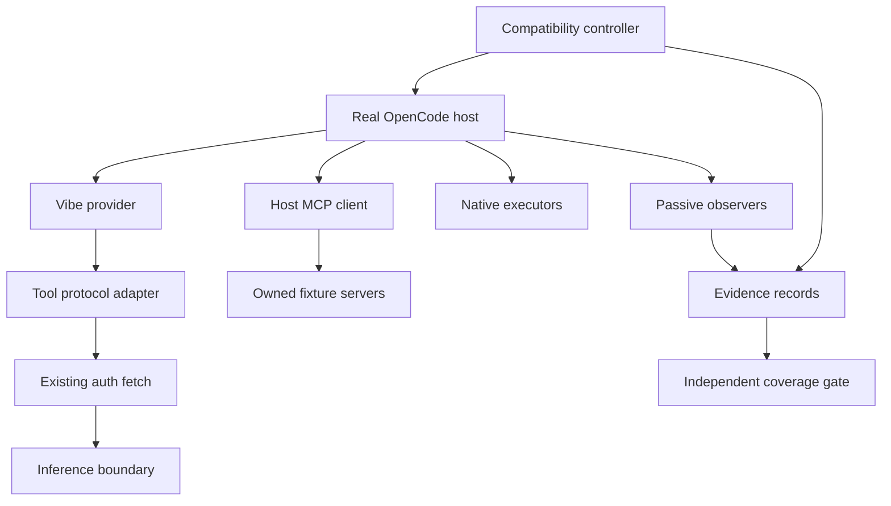
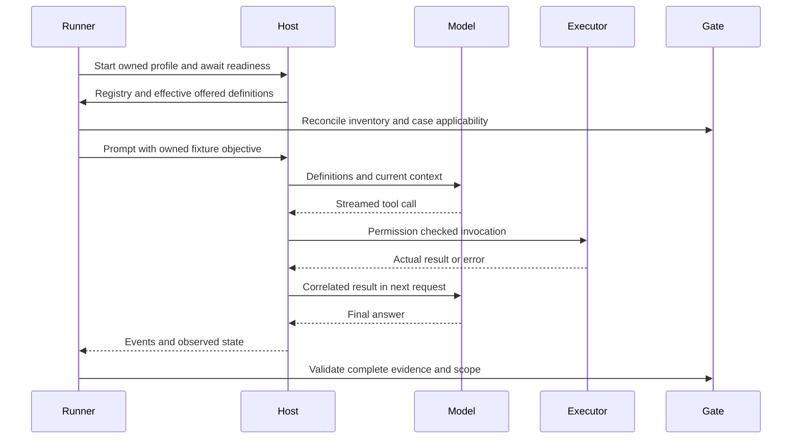

# Tool compatibility technical design

## Overview

Mistral-Vibe retains OpenCode's offered tools and verifies their complete round
trip through the direct OIDC provider. OpenCode remains responsible for tool
selection, permissions, execution, MCP connections and user interaction. This
specification adds scoped inventory, real-host fixtures, evidence validation and
only demonstrated model-facing protocol corrections.

The existing 24-tool registry observation is a discovery input, not a fixed
product list or execution claim. Compatibility is evaluated for a recorded host,
profile, agent, model and capability configuration. The default verifier remains
offline; live runs are deliberate, separate operations.

### Goals
- Account for every registered, dynamically discovered and actually offered tool.
- Observe definitions, model calls, host execution, correlated results and the
  next model turn before accepting a positive case.
- Exercise native tools and the real host MCP client without replacing their
  executors or loading private user services into fixtures.
- Preserve errors, cancellation, permissions and supported non-text content.

### Non-Goals
- Reimplement OpenCode tools, MCP clients, image providers or user interfaces.
- Change OIDC persistence, refresh, tenant selection or proxy routing.
- Add a Vibe search service, another inference authentication method, or claim
  compatibility for untested models, profiles or future host versions.

## Boundary Commitments

### This Spec Owns
- A compatibility controller, passive host observers, owned external fixtures,
  inventory/case mapping and independently validated report format.
- A narrow V3 language-model compatibility boundary for wire mismatches proved
  by conformance tests. It never dispatches an executor or grants permission.
- Per-configuration compatibility claims and explicit incomplete outcomes.

### Out of Boundary
- Native file, shell, question, skill, subagent, session and worktree execution.
- The host MCP lifecycle, resource protocol, permissions and background scheduling.
- Shared Python authentication and its storage. Existing parent regressions remain
  mandatory; this feature does not introduce a second auth store.
- Real private memory/search/image service data or credentials in test evidence.

### Allowed Dependencies
- Existing `@opencode/plugin` / native CLI 2.2.5 contracts, Bun 1.4.4 and
  TypeScript 5.9.3. Later hosts require a separate observed run and capability
  preflight; major-version matching alone is insufficient evidence.
- Existing `@ai-sdk/openai-compatible` 2.0.88 and its V3 contract. Declare
  `@ai-sdk/provider` 3.0.19 directly if the production wrapper imports its types.
- Official `@modelcontextprotocol/sdk` 1.32.2 as a direct development dependency
  for stdio fixtures; no production dependency or hand-written MCP client.
- Existing uv-created Python 3.12 environment, synthetic child bootstrap,
  process supervision and offline verification scripts.

### Revalidation Triggers
Host/SDK versions or hashes, effective tool schemas/names, MCP negotiation or
capabilities, model/protocol profiles, hooks/event ordering, permission policy,
profile paths and parent authentication/cancellation contracts invalidate the
corresponding earlier scope fingerprint. A new unmapped tool fails coverage.

## Architecture

### Existing Architecture Analysis
`src/index.ts` registers the direct provider and a V3 SDK factory.
`src/provider.ts` exclusively owns destination validation, current credential
resolution, approved header replacement, redirect refusal and retry suppression.
The provider currently owns no executor. Preserve that dependency direction.

The old native-host fixture replaces offered tools with `synthetic_echo` and
stops after arguments arrive. It verifies transport preservation, not execution
or the next model turn. Keep that regression; add a separate real-tool harness.

### Architecture Pattern & Boundary Map



Dependency direction: production `index -> tool-protocol -> V3 model factory /
provider fetch -> shared auth bridge`; test contracts -> inventory/fixtures /
observers -> runner -> report validator. Production imports no harness module.
The Python report validator imports no application, browser, keyring or network
client. The backend is synthetic offline and real Mistral only in explicit live
mode. Native executors remain real in both modes.

### Technology Stack

| Layer | Choice / version | Role |
| --- | --- | --- |
| Host | Native OpenCode / plugin SDK 2.2.5 reference | Tool registry, sessions, hooks, permissions and execution |
| Provider | OpenAI-compatible SDK 2.0.88, V3 provider types 3.0.19 | Existing inference path and typed compatibility wrapper |
| Harness | Bun 1.4.4 / TypeScript 5.9.3 | Controller, observers, fixtures and unit checks |
| MCP fixture | Official SDK 1.32.2, protocol baseline 2025-11-25 | Real initialization, tools and resources through host client |
| Evidence | Versioned JSON and standard-library Python validator | Independent completeness and claim validation |

No SDK upgrade is bundled with this feature. MCP negotiated version is recorded;
newer specification documentation does not silently change the fixture contract.

## File Structure Plan

Paths below are concrete ownership boundaries; a fixture family shares one
module rather than introducing a production component per tool.

| File | Change | Responsibility |
| --- | --- | --- |
| `packages/opencode-vibe-oidc/src/tool-protocol.ts` | New, corrections gated by reproduced mismatch | Typed per-invocation protocol policy and V3 wrapper |
| `packages/opencode-vibe-oidc/src/index.ts` | Modify when wrapper is required | Register provider-scoped language wrapper; preserve SDK setup and discovery lifecycle |
| `packages/opencode-vibe-oidc/test/tool-compatibility/contracts.ts` | New | Run, scope, inventory, case and evidence types |
| `packages/opencode-vibe-oidc/test/tool-compatibility/inventory.ts` | New | Registry/offering reconciliation and schema fingerprints |
| `packages/opencode-vibe-oidc/test/tool-compatibility/cases.ts` | New | Explicit case manifest, applicability and expected fixture observations |
| `packages/opencode-vibe-oidc/test/tool-compatibility/runner.ts` | New | Isolated native host/client lifecycle and offline/live commands |
| `packages/opencode-vibe-oidc/test/tool-compatibility/host-plugin.ts` | New | Register fixture configuration and passive observers through public host SDK |
| `packages/opencode-vibe-oidc/test/tool-compatibility/observe.ts` | New | Correlation and bounded sanitized evidence capture |
| `packages/opencode-vibe-oidc/test/tool-compatibility/synthetic-inference.ts` | New | Deterministic streamed model responses and next-request assertions |
| `packages/opencode-vibe-oidc/test/tool-compatibility/evidence.ts` | New | Runtime schema validation and report assembly |
| `packages/opencode-vibe-oidc/test/tool-compatibility/requirements-map.json` | New | Feature-scoped mapping of all 33 criteria to executed checks/documents |
| `packages/opencode-vibe-oidc/test/tool-compatibility/fixtures/workspace.ts` | New | Owned repository, files, sessions, skills and child-agent cases |
| `packages/opencode-vibe-oidc/test/tool-compatibility/fixtures/mcp-server.ts` | New | Official-SDK stdio tool/resource/error/cancellation fixture |
| `packages/opencode-vibe-oidc/test/tool-compatibility/fixtures/services.ts` | New | Controlled web pages/search backend and capability-bound content fixtures |
| `packages/opencode-vibe-oidc/test/tool-compatibility/fixtures/plugin-tools.ts` | New | Owned plugin-only fixtures; never substitutes for a claimed native executor |
| `packages/opencode-vibe-oidc/test/tool-compatibility/live-helper-launcher.py` | New | Restore only credential-root paths in the live helper when host isolation redirects them |
| `packages/opencode-vibe-oidc/test/tool-compatibility.test.ts` | New | Pure inventory, correlation, applicability and negative-evidence unit checks |
| `packages/opencode-vibe-oidc/test/tool-protocol.test.ts` | New | Installed-SDK wire conversion and bounded protocol correction regressions |
| `scripts/tool_verification.py` | New | Independent read-only evidence/claim validator |
| `tests/test_tool_verification.py` | New | Report/schema rejection cases using synthetic artifacts |
| `scripts/verify-tool-compatibility.ps1` | New | Explicit prepared-runtime offline integration command |
| `scripts/verify.ps1`, `scripts/verification.py`, `tests/traceability.json` | Modify | Add mandatory tool gate without weakening existing ten stages |
| `packages/opencode-vibe-oidc/package.json`, `bun.lock` | Modify | Explicit fixture/type dependencies and standalone runner commands |
| `docs/tool-compatibility.md`, `README.md` | New / modify | Operation, prerequisites, scoped results and update behavior |

Do not move real-host/MCP process tests into ordinary `bun test`; its default
guards deny external effects. Unit tests consume synthetic records only.

The default owned case manifest and shared report schema vectors live at
`packages/opencode-vibe-oidc/test/tool-compatibility/manifests/default.json` and
`packages/opencode-vibe-oidc/test/tool-compatibility/vectors/report-v1.json`.
They belong to InventoryCoverage and EvidenceGate respectively. Manifest budgets
are validated positive limits before execution; vectors are synthetic contract
samples, never execution evidence.

## System Flows



Offline Model is the synthetic boundary, not a synthetic executor. Live Model
is the direct OIDC provider. Title, compaction and one-shot generation requests
are recorded by kind and cannot satisfy primary agent-loop evidence.

Run lifecycle is preflight -> host ready -> inventory reconciled -> executing ->
validating -> closing -> closed. Failure/cancellation always enters closing.
Readiness uses host/API/MCP state and actual model visibility, never sleeps.

## Requirements Traceability

| Requirement | Summary | Components | Interfaces | Flows |
| --- | --- | --- | --- | --- |
| 1.1 | Preserve identities and schemas | InventoryCoverage, ToolProtocolAdapter | ToolIdentity | Discovery and model request |
| 1.2 | Native file operations | FixtureSet, RoundTripRecorder | CaseSpec | Native round trip |
| 1.3 | Native commands | FixtureSet, HostController | CaseSpec | Command execution |
| 1.4 | Disabled/unavailable tools | InventoryCoverage, EvidenceGate | ToolOutcome | Applicability |
| 1.5 | Other native/plugin tools | InventoryCoverage, FixtureSet | InventorySnapshot | All-tool matrix |
| 2.1 | MCP discovery | FixtureSet, InventoryCoverage | MCP negotiated capabilities | Discovery |
| 2.2 | Actual MCP invocation | FixtureSet, RoundTripRecorder | CaseSpec | MCP round trip |
| 2.3 | Correlated MCP results | RoundTripRecorder, ToolProtocolAdapter | TraceEvent / RoundTripProof | Result continuation |
| 2.4 | MCP failures | FixtureSet, EvidenceGate | ToolOutcome | Failure |
| 3.1 | Incremental JSON values | ToolProtocolAdapter, RoundTripRecorder | TraceEvent / RoundTripProof | Stream |
| 3.2 | Multiple calls | RoundTripRecorder, EvidenceGate | TraceEvent / RoundTripProof | Correlation |
| 3.3 | Content and error meaning | ToolProtocolAdapter, EvidenceGate | ToolProtocolProfile | Continuation |
| 3.4 | Invalid requests | FixtureSet, EvidenceGate | CaseSpec | Rejection |
| 3.5 | Observation reaches next turn | RoundTripRecorder, EvidenceGate | RoundTripProof | Positive acceptance |
| 4.1 | No permission bypass | HostController, FixtureSet | Permission fixture | Denial |
| 4.2 | Cancellation | HostController, RoundTripRecorder | CancelProof | Closing |
| 4.3 | Tool errors | ToolProtocolAdapter, EvidenceGate | ToolOutcome | Failure |
| 4.4 | Bounded failure and no replay | HostController, ToolProtocolAdapter | Request counters | Parent regressions |
| 5.1 | Real offline host/fixtures | HostController, FixtureSet | RunSpec | Offline run |
| 5.2 | Complete positive evidence | RoundTripRecorder, EvidenceGate | RoundTripProof | Validation |
| 5.3 | Separate evidence classes | EvidenceGate | RunReport | Reporting |
| 5.4 | Unexercised stays unverified | EvidenceGate | ToolOutcome | Reporting |
| 5.5 | Versioned sanitized record | HostController, RoundTripRecorder | ScopeFingerprint | Preflight and capture |
| 5.6 | Updates require new evidence | InventoryCoverage, EvidenceGate | ScopeFingerprint | Drift |
| 5.7 | Registered and offered inventory | InventoryCoverage | InventorySnapshot | Discovery |
| 5.8 | Every tool accounted | InventoryCoverage, EvidenceGate | CoverageRow | Matrix |
| 5.9 | Unknown tool fails coverage | InventoryCoverage, EvidenceGate | InventoryDiff | Drift |
| 5.10 | Positive evidence for scoped claim | EvidenceGate | RunReport | Claim gate |
| 6.1 | Questions remain interactive | FixtureSet, RoundTripRecorder | Session form API | Question |
| 6.2 | Skills and real children | FixtureSet, RoundTripRecorder | Child-session proof | Delegation |
| 6.3 | Session/worktree mutation | FixtureSet, HostController | Owned resources | Mutation |
| 6.4 | Unsupported content explicit | ToolProtocolAdapter, EvidenceGate | ToolProtocolProfile | Capability rejection |
| 6.5 | Supported non-text delivery | ToolProtocolAdapter, RoundTripRecorder | Media proof | Content continuation |

## Components and Interfaces

| Component | Intent | Requirements | Dependencies and contracts |
| --- | --- | --- | --- |
| HostController | Own isolated host and case lifecycle | 1.3, 4.1, 4.2, 4.4, 5.1, 5.5, 6.3 | P0 native CLI/client and prepared runtimes; Service, State |
| InventoryCoverage | Reconcile all offered tools with cases | 1.1, 1.4, 1.5, 2.1, 5.6-5.10 | P0 host registry/context and case manifest; Service, Batch |
| RoundTripRecorder | Observe definitions through continuation | 1.2, 2.2, 2.3, 3.1-3.3, 3.5, 4.2, 5.2, 5.5, 6.1, 6.2, 6.5 | P0 public context/http/tool hooks; Event, State |
| FixtureSet | Supply owned resources and external actors | 1.2-1.5, 2.1-2.4, 3.4, 4.1, 4.3, 5.1, 6.1-6.5 | P0 host execution; P1 official MCP SDK; Service |
| ToolProtocolAdapter | Correct only proved wire incompatibilities | 1.1, 2.3, 3.1-3.4, 4.3, 4.4, 6.4, 6.5 | P0 V3 model factory and existing auth fetch; Service |
| EvidenceGate | Validate inventory, proofs and exact claims | 1.4, 2.4, 3.2-3.5, 4.3, 5.2-5.10, 6.4 | P0 versioned report/schema; Batch |

### HostController

Controller inputs are explicit prepared host/Bun/uv-managed Python paths and a
case/profile manifest. It hashes binaries and records exact versions before any
host startup. Offline mode supplies synthetic AuthSession and default-deny
Python keyring/browser/network guards. It scrubs inherited credentials, model
fetch/update flags and OpenCode configuration overrides, and starts an owned
server with a random local port and scoped client authentication. Every client
API call carries the owned location explicitly; a returned different location
fails isolation instead of falling back to server defaults.

Live mode is a separate command requiring mode, model and owned profile paths.
It never copies the user's plugin/MCP configuration. Connection uses the existing
OIDC flow; a browser is opened only by an explicitly selected login operation.
Unknown tool execution is denied by the harness before dispatch, not silently
removed from offered definitions. Fixture permission decisions are scoped to
owned requests, paths and exact command objectives; no global auto-approval.

`OPENCODE_TEST_HOME` alone is insufficient isolation in the installed host.
Set private XDG data/config/cache/state plus temporary paths and an owned cwd;
verify every CLI `debug paths` result lies below the run root before startup.
Preserve Windows LOCALAPPDATA and macOS HOME for the live helper. On Linux a
helper-only launcher restores original XDG_DATA_HOME/HOME path values, including
unset semantics, before running `mvibe_auth` in the same prepared interpreter.
The launcher changes no auth API, adds no credentials to files and preserves the
bridge/login final argument contract and process ownership. Cross-platform path
and cancellation probes are mandatory before enabling that platform's live run.

Shutdown cancels the active turn, awaits executor/MCP/helper cleanup, closes the
host and then removes only verified owned resources. An unknown commit or
cleanup failure is recorded; cancellation never implies rollback.

### InventoryCoverage

Collect the transformed registry using `ctx.tool.list()`, MCP configuration and
negotiated discovery, and the actual `context.tools` for each primary turn.
Context definitions, not a startup list, determine what the model was offered.
Record registry IDs, effective names, namespace, schema fingerprints and origin
when known. Do not infer provenance from a name prefix. Ambiguous mapping fails
coverage; the harness never guesses which executor a model name denotes.

The case manifest maps every scoped discovered tool to its owned fixture,
prerequisites, expected observation and result assertions. It also records tools
not offered due to proved policy/capability state. Absence alone does not prove
that a tool is disabled. Unknown tools require a case or explicit classification.
An inventory-complete report can still be compatibility-incomplete.

Private profile observations and controlled-fixture runs have different scope
hashes. A synthetic memory server with the same tool names cannot turn the user's
real memory service row into PASS. Every report identifies the actual executor
and service configuration, with hashes replacing sensitive contents.

### RoundTripRecorder

Register passive `session.hook("context")`, `session.hook("http.request")`,
`session.hook("http.response")`, `tool.hook("execute.before")` and
`tool.hook("execute.after")` plus relevant session/form/child events. Imported
2.2.5 SDK types define payloads; validate event objects at report boundaries.
Do not replace `context.tools` with a fake tool or mutate tool results for capture.

Correlate session, request kind, message, host call ID, offered name and fixture
nonce. Record upstream and host identifiers separately. Join only with observed
links and unique fixture identity; missing or ambiguous links fail the proof.
A normal success needs all stages: offered definition, streamed call, executor
start/completion, actual result, next model request containing that result, and
final outcome. Unsupported/error/denied/cancelled cases have their own expected
proofs and cannot satisfy positive execution coverage.

The execute.before hook is a dispatch observation, not sole proof of a side
effect. A capability probe establishes its permission/event ordering. Completion
and independent fixture/host-state observations establish actual execution;
denial checks require the host decision and no execution effect, not an assumed
absence of a pre-dispatch callback.

HTTP hooks are a capability preflight: demonstrate that both synthetic and custom
SDK requests actually traverse them. If a host bypasses these hooks, use a
fixture-owned SDK transport observer installed before production setup and prove
its coverage; otherwise mark that host unsupported. Never substitute a CLI final
answer for missing request evidence. Separate primary, title, generate and
compaction traffic and bound records per request/call.

Request inspection consumes a bounded clone of owned fixture JSON. Response
observation uses a backpressure-aware passthrough tap and returns immediately;
it never waits for a complete stream before the host receives its first chunk.
The tap preserves bytes, headers in transit, abort and close ownership. A trace
limit failure cancels the owned test turn rather than retaining an unbounded tee.

Only validate/capture allowlisted fixture payload fields, event kinds, hashes,
lengths and safe outcomes. Never serialize an entire Request, headers, SDK options
or event object. Unexpected/private output is rejected with a fixed code; only verified fixture fields are hashed. Bound
body cloning, stream observation and trace storage; exceeding limits fails the
case without truncating production tool content or replaying inference.

### FixtureSet

| Family | Real host behavior exercised | Owned external boundary and assertions |
| --- | --- | --- |
| Files and shell | read/write/edit/patch/glob/grep/shell | Temporary repository and unpredictable files; exact diff/stdout/exit checks |
| Web | Native webfetch/websearch tools | Owned page service and `ctx.websearch.transform` search backend; capture source links |
| Question | Real form lifecycle | Client `session.form.list/get/reply/cancel`; controlled fixture answers and cancellation |
| Skills/subagents | Skill activation and actual child session | Owned skill/agent configuration, bounded child work and parent result association |
| Sessions/worktrees/models | Actual host state mutation/enumeration | Test-created sessions and repository/worktrees only; inspect resulting state |
| MCP | Actual host stdio client and resource tools | Official SDK fixture tools/list, tools/call, resources/list/read, structured errors/content and cancellation |
| Plugin extras | Actual configured fixture plugin executor | Explicit provenance and scope; no private memory access or claim of another plugin's execution |
| Experimental media | Native image tool if supported by demonstrated host route | Controlled provider only if public hooks support it; otherwise explicit unsupported/unverified reason |

MCP initializes and records negotiated version/capabilities before calls. Test
safe execution `isError` separately from JSON-RPC protocol errors. Pagination and
list changes are tested when advertised. Resource links are not assumed to appear
in resource listings. Stdio stdout is protocol-only; diagnostics stay bounded.

Owned web/native tool operations are checked in execute.before against exact
fixture targets; other destinations and arbitrary commands are rejected. Global
synthetic provider fetch has no unrestricted fallback. Never loosen host private
network restrictions to make a test pass; classify an unavailable fixture route.
No public image-provider hook was established in the installed SDK. Returning a
file from a fake plugin tool tests content plumbing, not native image generation.
Image-positive coverage remains unavailable until the actual native route and
controlled provider are demonstrated; it must not block truthful negative tests
or be mislabeled as a successful generator test.

### ToolProtocolAdapter

Keep the existing V3 custom SDK and auth fetch. Installed SDK 2.0.88 preserves
function fields/IDs, but collapses typed error results into ordinary strings and
JSON-stringifies content arrays. Conformance tests first record actual baseline
behavior; only a matching proved defect enables a correction. Do not switch to
another SDK/native route without OIDC, streaming, cancellation and no-replay
parity evidence.

The provider-scoped language hook wraps typed V3 doGenerate/doStream methods.
A per-invocation plan inspects typed prompt/tool outputs before SDK conversion.
Where a wire correction is required, construct a base-model instance with a
request-local fetch codec placed BEFORE existing auth fetch. It changes only
validated chat-completion JSON fields described by that plan; it never reads or
writes credential headers, changes destination, executes tools, or retries.
Decoded stream parts restore original tool names incrementally; raw SSE and
non-tool parts remain untouched. Avoid shared mutable state across sessions.

Default behavior preserves the current successful text path. Optional
`options.toolProtocolProfiles[exact-upstream-model-id]` selects only a named,
validated built-in profile; no wildcard matching, inferred tokenizer generation
or arbitrary rewrite configuration is accepted. A profile is published only with
its conformance vectors and scope evidence. An unknown profile fails setup.
A strict unsupported-content guard prevents an unproved media representation
from being counted as delivery even in the preserve profile.

Profiles have evidence references and exact model/route scope:
- Preserve conforming identities and arguments by default. If constrained names
  need encoding, reserve valid names and use a collision-checked reversible map;
  unknown inverse names fail rather than select another executor.
- A legacy-ID profile maps complete request history and matching results into
  nine alphanumeric IDs, reserving already valid history IDs. Other models may
  retain arbitrary nonempty IDs. Never infer tokenizer generation from a name.
- Typed tool errors/denials retain their host outcome and original content. If
  conversion loses meaning, encode an explicit error envelope INSIDE content;
  do not add an unsupported top-level Mistral `isError` field.
- Non-text delivery uses only verified route/model MIME representations. Mistral
  user-image support does not establish tool-result image support. If the SDK or
  route cannot preserve supported content, return an explicit unsupported result
  before outbound continuation; never claim JSON text is image delivery. A media
  codec is enabled only with pinned schema and wire/host regression evidence.

Mistral's official validator distinguishes legacy nine-character IDs from newer
nonempty IDs and text-only tool messages from later multimodal tool messages.
These are profile constraints, not blanket rules for every deployed model.

### EvidenceGate

The TS writer and independent Python validator share canonical JSON fixtures and
schema version 1. Both reject unknown fields, malformed hashes, missing stages,
crossed call results, reused proofs, private/raw captures and stale scope data.
The validator is read-only and cannot start hosts, login or send network requests.

Report inventory completeness separately from executed support. Positive coverage
is per tool AND scope AND mode; required negatives do not count as a successful
positive tool execution. FAIL, unsupported, disabled and unverified rows cannot
be silently promoted. A broad all-tool claim requires every applicable offered
tool's positive proof. Otherwise output the exact supported subset and exclusions.

## Data Models and Service Contracts

The following domain contracts belong in contracts.ts; SDK/MCP/V3 payload types
are imported at their boundaries instead of copied. Strings below are identifiers
or hashes, not unrestricted captured messages. Runtime schemas enforce lengths,
allowed reason codes, relative artifact paths and exact shapes.

```typescript
import type { LanguageModelV3 } from "@ai-sdk/provider";
import type { ProviderFetch } from "../../src/provider.js";
type Mode = "offline" | "live";
type ReasonCode = "not_exercised" | "missing_capability" | "host_disabled" |
  "unknown_tool" | "unsupported_protocol" | "incomplete_evidence" |
  "permission_denied" | "cancelled" | "executor_failed" | "cleanup_failed" |
  "invalid_report" | "scope_changed" | "inventory_gap" | "timeout" |
  "redaction_failed" | "hook_unavailable" | "model_declined" | "upstream_rejected";
interface ToolIdentity {
  registryId: string; declaredName: string; offeredName?: string; namespace?: string;
  origin: "native" | "plugin" | "mcp" | "unknown";
  originHash?: string; schemaHash: string;
}
interface ScopeFingerprint {
  hash: string; hostVersion: string; hostSha256: string; sdkVersion: string;
  providerBuildHash: string; profileHash: string; agent: string;
  model: string; protocolProfile: string; negotiatedMcpVersions: readonly string[];
}
type ToolOutcome =
  | { status: "PASS"; proofIds: readonly string[] }
  | { status: "FAIL"; code: ReasonCode }
  | { status: "UNSUPPORTED" | "DISABLED" | "UNVERIFIED"; reason: ReasonCode };
interface CoverageRow {
  tool: ToolIdentity; scopeHash: string;
  offline: ToolOutcome; live: ToolOutcome;
}
interface RunSpec {
  mode: Mode; hostExecutable: string; bunExecutable: string;
  preparedPython: string; caseManifest: string; ownedProfile: string;
  model: string; reportDirectory: string;
  loginPolicy: "reuse-only" | "explicit-browser";
  limits: { startupMs: number; discoveryMs: number; cancellationMs: number;
    runMs: number; traceBytes: number; eventsPerCase: number; toolCallsPerCase: number };
}
interface CaseSpec {
  id: string; toolIds: readonly string[]; prerequisites: readonly string[];
  fixtureKind: "filesystem" | "shell" | "web" | "question" | "delegation" |
    "state" | "mcp" | "plugin" | "media";
  expectedObservationHash: string; positiveRequired: boolean; timeoutMs: number;
  expectedCalls: readonly { toolId: string; fixtureNonceHash: string;
    inputHash: string; observationHash: string }[];
  expectedOutcome: "success" | "denied" | "error" | "cancelled" | "unsupported";
  requiredObservations: readonly ("definition" | "model_call" | "executor_started" |
    "executor_completed" | "next_model_request" | "final_response" |
    "denied" | "error" | "unsupported" | "state_observed")[];
  executorExpectation: "must_complete" | "must_not_start" | "observe_if_started";
  cancellation?: { host: boolean; executor: boolean; provider: boolean; mcp: boolean;
    completionRace: "fail_case" | "mark_unverified" };
}
interface InventorySnapshot {
  scope: ScopeFingerprint; registered: readonly ToolIdentity[];
  offered: readonly ToolIdentity[]; classifiedAbsent: readonly CoverageRow[];
}
interface InventoryDiff { missingCases: readonly string[]; changedSchemas: readonly string[] }
type TraceKind = "definition" | "model_call" | "executor_started" |
  "executor_completed" | "next_model_request" | "final_response" |
  "denied" | "error" | "unsupported" | "host_cancelled" | "executor_released" |
  "provider_aborted" | "fixture_cancelled" | "state_observed";
interface TraceBase {
  sequence: number; runId: string; caseId: string; scopeHash: string;
  sessionId: string; chainId: string; requestId: string;
  requestKind: "primary" | "title" | "compaction" | "generate";
  payloadHash: string; observationHash?: string;
}
interface ToolTraceIdentity {
  toolId: string; toolSchemaHash: string; originHash?: string;
}
interface CallCorrelation {
  hostMessageId: string; hostCallId: string; upstreamCallId: string;
  inputHash: string; link: "host_exposed" | "unique_fixture_nonce";
  fixtureNonceHash?: string;
}
type TraceEvent = TraceBase & (
  | ({ kind: "definition" | "unsupported" | "state_observed" } & ToolTraceIdentity)
  | { kind: "final_response" }
  | ({ kind: "model_call" | "next_model_request";
       call: CallCorrelation; wireCallId: string } & ToolTraceIdentity)
  | ({ kind: "executor_started" | "executor_completed" | "denied" | "error";
       call: CallCorrelation } & ToolTraceIdentity)
  | { kind: "host_cancelled" | "executor_released" | "provider_aborted" |
      "fixture_cancelled"; call?: CallCorrelation }
);
interface RoundTripProof {
  id: string; caseId: string; scopeHash: string; sessionId: string;
  toolId: string; toolSchemaHash: string; originHash?: string; chainId: string;
  requestKind: "primary"; primaryRequestId: string; nextRequestId: string;
  hostMessageId: string; upstreamCallId: string; hostCallId: string;
  continuationWireCallId: string;
  definitionEvent: number; modelCallEvent: number;
  executorStartEvent: number; executorEndEvent: number;
  nextRequestEvent: number; finalResponseEvent: number;
}
interface CancelProof {
  hostEvent: number; executorEvent?: number; providerEvent?: number; mcpEvent?: number;
  stateEvent: number; commitState: "absent" | "observed" | "unknown";
}
interface CaseResult {
  caseId: string; scopeHash: string; toolId: string; sessionId: string; chainId: string;
  status: "PASS" | "FAIL" | "UNVERIFIED";
  observedOutcome: "success" | "denied" | "error" | "cancelled" | "unsupported" | "not_observed";
  eventReferences: readonly number[]; proofId?: string;
  cancellation?: CancelProof;
}
interface RunReport {
  schemaVersion: 1; feature: "opencode-vibe-tool-compatibility";
  runId: string; mode: Mode; caseManifestHash: string; criteriaMappingHash: string;
  scopes: readonly ScopeFingerprint[]; inventories: readonly InventorySnapshot[];
  rows: readonly CoverageRow[]; events: readonly TraceEvent[];
  proofs: readonly RoundTripProof[]; caseResults: readonly CaseResult[]; inventoryComplete: boolean;
  supportedToolIds: readonly string[]; cleanupComplete: boolean;
}
interface ScopedClaim { scopeHash: string; mode: Mode; supported: readonly string[]; complete: boolean }
interface GateResult { claims: readonly ScopedClaim[]; errors: readonly ReasonCode[] }
interface HostController { run(spec: RunSpec, signal: AbortSignal): Promise<RunReport> }
interface InventoryCoverage {
  reconcile(snapshot: InventorySnapshot, cases: readonly CaseSpec[]): InventoryDiff;
}
interface RoundTripRecorder {
  finish(caseId: string): RoundTripProof | { status: "INCOMPLETE"; code: ReasonCode };
}
interface EvidenceGate { validate(report: RunReport, expectedScopes: readonly string[], expectedCases: readonly CaseSpec[]): GateResult }
interface ToolProtocolProfile {
  id: string; evidenceRefs: readonly string[];
  callIds: "preserve" | "legacy-nine-alphanumeric";
  names: "preserve" | "mistral-constrained";
  errors: "preserve" | "explicit-content-envelope";
  supportedToolMimeTypes: readonly string[];
}
interface ToolProtocolAdapter {
  wrap(factory: (fetch: ProviderFetch) => LanguageModelV3,
       authorizedFetch: ProviderFetch, profile: ToolProtocolProfile): LanguageModelV3;
}
```

Negative CaseResult records are checked against the external expected case
manifest, including required denial/error/cancellation cases. They never satisfy
positive CoverageRow proof requirements. Known tools with unknown provenance or
unproved offering state cannot receive an all-tool compatibility PASS.

CaseSpec is authoritative: positiveRequired must match a success expectation.
The gate checks observedOutcome, requiredObservations and executorExpectation;
a CaseResult cannot supply its own expected outcome. Cancellation cases attach
CancelProof and must reference matching host/executor/provider/MCP observations
required by the manifest. Completion before cancellation requires an observed completion/state event and
follows the manifest's fail_case or mark_unverified rule; it cannot earn a
cancellation PASS. No boolean alone proves cleanup or rollback.

A positive proof's event references must exist, be ordered, and belong to the
same run, case, session, scope and primary request chain. Every tool-bearing
reference must also match tool/schema/origin; a shared final-response event is
chain-scoped rather than assigned to one of several parallel tools.
Definition/model-call references bind to primaryRequestId; continuation binds to
nextRequestId. Call-bearing references must match hostMessageId, hostCallId,
upstreamCallId and inputHash. Model-call and continuation wire IDs are retained
separately when a verified codec maps history IDs; the gate checks the one-to-one
observed mapping. A nonce-based link requires the manifest's unique fixture nonce
and matching argument/observation hashes; ambiguous links remain incomplete.

The actual tool output observation must match the owned fixture and next-request
observation. One call's executor/result events cannot prove another call. Shared
definition/final events are allowed only within the same scoped case/request
chain, as needed for parallel calls; distinct executor and result links remain
mandatory. Wire JSON is validated and canonicalized before
hashing; body bytes and raw event objects are not persisted. Schema validation
checks consistency, not cryptographic proof that an arbitrary operator report
was executed. Execution claims rely on the trusted controller/observers and
independent fixture/host state observations.

Unlinked incoming observations are bounded diagnostics and cannot be promoted
to a complete TraceEvent/positive proof until correlation is established.

MCP negotiated versions and fixture versions are explicit report data. Changes
to schemaVersion require new reader support and canonical vectors in both
validators; old evidence is never silently promoted to a new contract.

## Error Handling

| Condition | Outcome |
| --- | --- |
| Missing prepared runtime, API/hook incompatibility or unisolated path | Preflight FAIL before executor/account access |
| New/unmapped tool or ambiguous provenance | Inventory gap; no broad compatibility claim |
| Missing capability or unsupported media representation | Explicit UNSUPPORTED/UNVERIFIED with proof or missing-prerequisite reason |
| Host permission denial or fixture error | Expected negative outcome only; no positive execution credit |
| Wrong/missing call/result/next-request evidence | FAIL, even if final answer looks correct |
| Provider rejection or cancellation | Preserve parent status/cancellation, no inference replay |
| Owned child/resource cleanup failure | FAIL/cleanup incomplete; retain sanitized diagnostics |

MCP cancellation receipt, executor cancellation and provider HTTP abort are
separate observations. A committed file/worktree operation is verified as state;
its rollback is never inferred from cancellation. Reason codes and public error
messages come from fixed catalogues and exclude rejected input.

## Testing Strategy

### Unit and Contract Tests
- Inventory union, schema drift, duplicate names, late MCP additions and absent
  exposure without invented disabled status (1.1, 1.4, 5.6-5.10).
- Installed-SDK serialization of streamed/multiple calls, typed errors, denials
  and media; reversible name/ID collision and history/result pairing (3.1-3.4,
  4.3, 6.4, 6.5).
- Evidence mutation tests reject missing executor/continuation stages, crossed
  IDs, stale versions, duplicate proof reuse, secret-bearing captures and false
  all-tool claims (3.5, 5.2-5.5, 5.8-5.10).
- Fixture launcher path unset/restore semantics and unchanged bridge/login
  protocol, cancellation and owned helper cleanup (4.2, 5.1, 5.5).

### Standalone Real-Host Offline Tests
- Retain actual offered tools. Synthetic inference chooses the case's observed
  name, emits incremental JSON/tool_calls with the proper completion reason,
  waits for real execution, validates the next request's nonce, then responds.
- Run each applicable native tool and configured MCP/resource/plugin case in the
  owned manifest, plus errors, permission denial and cancellation. Validate side
  effects through host APIs and owned resource state, not final text alone.
- Observe controlled user form replies, real child sessions, skills and
  session/worktree mutations; never substitute a fake executor for these tests.
- Prove network/command/path guards before external-boundary fixtures; deny
  unexpected destinations and private credential/browser access. Validate web
  targets before invoking native tools; configure only the owned search backend.
- Add the dedicated gate to existing offline acceptance after its own host/tool
  preflight. Preserve the original ten stages and their coverage mappings.
  The new tool-compatibility stage validates its feature-scoped 33-criterion map;
  parent tests/traceability.json keeps its existing 97-criterion namespace and
  adds only relevant parent integration references. Numeric IDs from the two
  specifications are never combined without their feature identifier.

### Explicit Live Tests
Use a selected tool-capable model and owned profile; inspect actual execution and
continuation. A model declining a requested tool or unavailable external service
is not a positive pass. Per-tool results and exact scope accompany every claim.
No live tool test is executed during design generation or default verification.

### Budgets and Readiness
Case manifests declare startup, discovery, execution, cancellation and trace
limits before launch. Use request-local counters and events, not arbitrary delays
or automatic inference retries. Exceeding a limit records a failed/incomplete
case and performs owned cleanup. Fixtures keep payloads small; media bytes remain
owned artifacts with MIME/size/hash evidence rather than unbounded trace blobs.

## Security Considerations

Use fresh profiles and owned targets. Live helper path restoration contains only
paths and never copies credentials. Observers cannot serialize headers/options
or unrelated tool content. Unknown offered tools are accounted for but cannot be
invoked until an owned case exists. All file/repository removal verifies absolute
ownership and avoids reparse paths; no process-wide tool/keyring fallback.

## Migration Strategy

No credential or user-config migration is introduced. First land evidence types
and inventory/case mapping, then isolated observers/fixtures and installed-SDK
conformance cases. Add only reproduced protocol corrections. Integrate offline
coverage before publishing scoped live results. Existing installations keep the
provider ID, models and OIDC behavior; no automatic host/SDK update is performed.

## Supporting References

See research.md for pinned primary sources and installed contract locations.
The discovery tool-coverage.md and verification-plan.md are inputs; neither is an
executed report. Design review must check all 33 criterion IDs and the concrete
file/contract boundaries above before tasks are generated.
