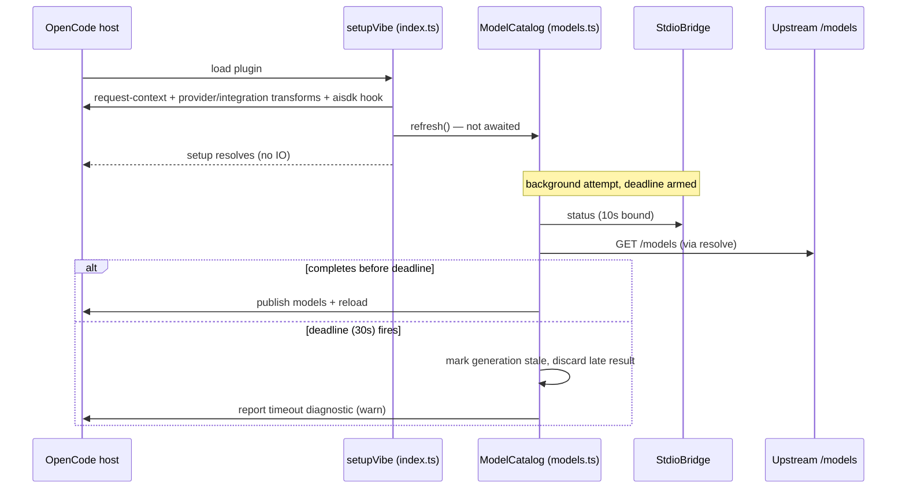
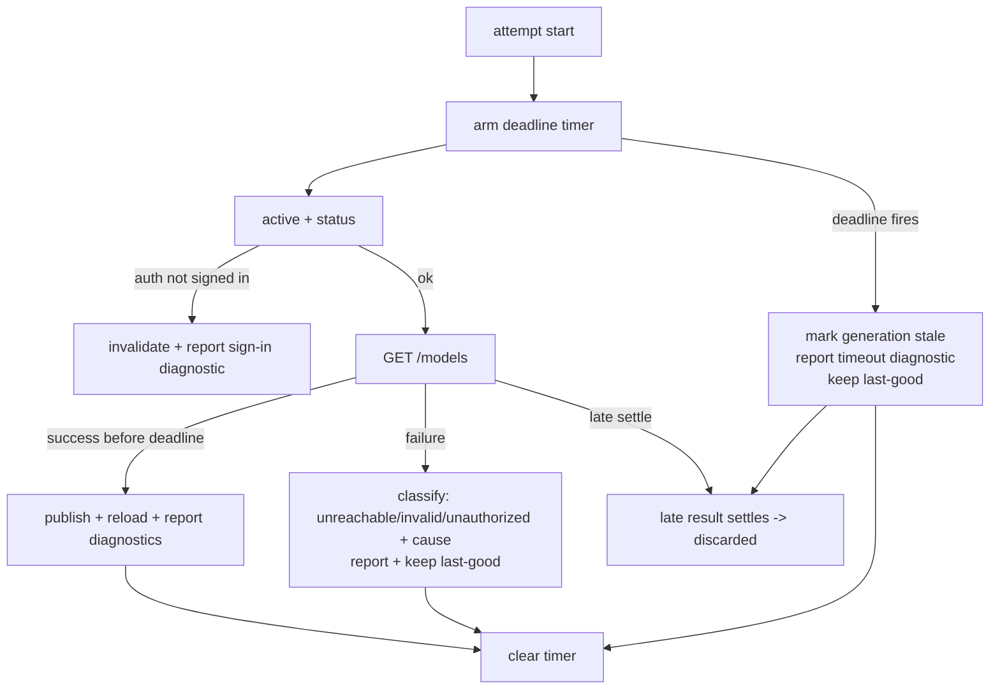

# Design Document

## Overview
**Purpose**: This feature makes `vibe-oidc` provider registration prompt and failure-tolerant: the provider appears within seconds of plugin load regardless of helper, keyring or upstream reachability; every model discovery attempt is bounded; real failure causes reach the host log.
**Users**: OpenCode users selecting Mistral-Vibe models (loading speed), and operators diagnosing credential/network/version failures (error handling).
**Impact**: Changes activation flow in `packages/opencode-vibe-oidc` only — no bridge protocol, auth-flow, installer-layout or host changes. Model visibility policy is unchanged (authenticated inventory remains the only entitlement evidence); the provider simply registers before that inventory arrives instead of after.

### Goals
- Registration completes without any IO (helper, keyring, network) — target well under the 5 s budget on a warm host.
- Each catalog attempt is bounded (default 30 s deadline); timeout keeps the last-good list and reports a timeout diagnostic.
- Failure causes (step + underlying error, failure class for discovery) propagate to the host log; no generic substitution.
- Degraded mode: auth/helper failures never unregister the provider; recovery refreshes automatically.

### Non-Goals
- Showing a baseline model list from the host catalog before authenticated discovery (rejected 2026-11-08 — entitlement policy).
- Changes to `mvibe_auth`, the bridge protocol, hello/version coupling, installer, proxy, or the OpenCode host.
- New retry scheduling/polling: existing event triggers (`integration.updated`, `credential.*`, reload) remain the only refresh triggers.

## Boundary Commitments

### This Spec Owns
- `setupVibe()` activation sequencing (registration vs first refresh), including setup error shape.
- `createModelCatalog` attempt lifecycle: deadline, abandonment, snapshot/diagnostic content, timer cleanup.
- Discovery failure classification strings and their propagation through `report`.
- Package tests covering the above; README notes on visibility flags and pending-models behavior.

### Out of Boundary
- Bridge session/timeout semantics, helper spawn/termination, protocol and `HELPER_API_MAJOR` (unchanged).
- Credential acquisition/renewal (`mvibe_auth`, Vibe login flows).
- Host plugin-loading/publication semantics; npm/host version pinning policy.
- Release mechanics and user-environment installation (standing published-release rule; separate step after implementation).

### Allowed Dependencies
- Existing `@opencode/plugin` context APIs (2.2.x), existing `StdioBridge` (`request`, `dispose`), existing `createProviderFetch`.
- Standard `setTimeout`/`clearTimeout` via injection, mirroring the `bridge.ts` `io` pattern. No new npm dependencies.

### Revalidation Triggers
- Host change to provider publication vs plugin-setup completion semantics.
- Bridge protocol/version coupling bumps (release-major invariant in `tech.md`).
- Any change making discovery fetches session-fatal on cancellation (would invalidate the detach decision).

## Architecture

### Existing Architecture Analysis
- Current flow: `setupVibe` registers transforms/hooks, then `await catalog.refresh()` (`index.ts:66`) — the only IO-blocking step in setup.
- `createModelCatalog.run()` per attempt: `active()` → `bridge.request("status")` (10 s) → `discoverInventory` → unbounded `fetch(baseURL+"/models")` (which internally performs a `resolve` bridge call, 180 s bound) → publish + `provider.reload()`. Generations coalesce; `close()` aborts.
- Failure paths discard causes (`index.ts:67-69`, `models.ts:103-104`, `models.ts:161-164`); diagnostics flow only through `report → console.warn`.
- Bridge aborts are session-fatal: cancelling an in-flight request retires the shared helper session, which would also fail in-flight chat `resolve` calls.

### Architecture Pattern & Boundary Map
Selected pattern: in-place extension of the two existing components (setup orchestration, model catalog). No new runtime components; one new typed options surface and injectable timer per component. Boundaries preserved: catalog never touches host APIs beyond its injected `reload/report/active`; setup never awaits catalog IO.



Key decisions captured above: setup performs zero IO; the first refresh runs concurrently with host completion of plugin loading; deadline abandonment is non-destructive (see System Flows for close/abort).

### Technology Stack

| Layer | Choice / Version | Role in Feature | Notes |
|-------|------------------|-----------------|-------|
| Plugin runtime | TypeScript 5.9 / Bun 1.4.4 (pinned) | Implementation + unit tests | No new dependencies |
| Plugin API | `@opencode/plugin` 2.2.5 | Registration/hooks surface | Host 2.2.6 verified compatible (probes 2026-11-08) |
| Timers | injected `setTimeout`/`clearTimeout` | Deadline enforcement | Same injection style as `bridge.ts` `io` |

## File Structure Plan

### Directory Structure
No new directories. Package layout unchanged.

### Modified Files
- `packages/opencode-vibe-oidc/src/index.ts` — Setup orchestration: drop `await` on first `catalog.refresh()` (fire-and-forget with internal reporting); step-labeled registration phases; `BridgeError` carries `cause`; setup message names the failing step.
- `packages/opencode-vibe-oidc/src/models.ts` — Catalog: per-attempt deadline via injected timer (default 30_000 ms, option `deadlineMs`); timeout abandons the attempt (stale generation, discard late result, timeout diagnostic); `discoverInventory` catch classifies failures and includes the underlying message; pending diagnostic on empty snapshot before first publish; timer cleanup on supersede/close.
- `packages/opencode-vibe-oidc/src/bridge.ts` — **Unchanged** (stated explicitly to prevent scope creep).
- `packages/opencode-vibe-oidc/test/models.test.ts` — Deadline/abandonment/last-good/retry/cleanup cases using the existing `catalogFixture()` pattern.
- `packages/opencode-vibe-oidc/test/setup.test.ts` — Setup resolves while refresh pending; cause/step propagation; degraded registration.
- `packages/opencode-vibe-oidc/test/host-integration-plugin.ts` — Gate the discovery fetch; assert provider is queryable and setup evidence recorded before release.
- `packages/opencode-vibe-oidc/README.md` — Document empty-until-discovery behavior, timeout diagnostic, `--print-logs` visibility, and diagnostics option.
- `.kiro/specs/plugin-registration-resilience/research.md` — This discovery record.

## System Flows



Decision notes:
- Timeout does **not** abort the shared bridge session; only `close()` aborts (existing semantics). This protects in-flight chat requests.
- Late settlements are discarded by generation check, not by cancellation.
- Next trigger (credential/connection event, reload) starts a fresh attempt; no polling loop is introduced.

## Requirements Traceability

| Requirement | Summary | Components | Interfaces | Flows |
|-------------|---------|------------|------------|-------|
| 1.1 | Registration awaits no helper/network | Setup | `setupVibe` | register-first sequence |
| 1.2 | ≤5 s warm registration | Setup | `setupVibe` | register-first sequence |
| 1.3 | Empty list + pending diagnostic until first discovery | Catalog | `snapshot`, `report` | publish flow |
| 1.4 | Registration never delayed by metadata/discovery | Setup/Catalog | `setupVibe`, `refresh` | register-first sequence |
| 2.1 | ≤30 s deadline per attempt | Catalog | `createModelCatalog.deadlineMs` | deadline flow |
| 2.2 | Timeout keeps last-good + diagnostic | Catalog | `run`, `report` | deadline flow |
| 2.3 | Successful discovery publishes without restart | Catalog (existing) | `reload` | publish flow |
| 3.1 | Setup failure: step + cause at warn | Setup | `BridgeError.cause` | — |
| 3.2 | Discovery failure class in host log | Catalog | `discoverInventory`, `report` | failure flow |
| 3.3 | No generic substitution of causes | Setup/Catalog | `BridgeError`, `report` | — |
| 3.4 | No secrets in diagnostics | Catalog/Provider (existing policy) | `report` | — |
| 4.1 | Auth/helper failure keeps provider registered | Setup/Catalog | `setupVibe`, `run` | auth-failure flow |
| 4.2 | Recovery refreshes without restart | Catalog (existing event loop) | event subscription | — |
| 4.3 | Failures not cached permanently | Catalog | generation coalescing | retry flow |
| 5.1 | No protocol/version/layout changes | boundary commitment | — | — |
| 5.2 | Works under documented 2.2.x host behavior | Setup | `setupVibe` | register-first sequence |

## Components and Interfaces

| Component | Domain/Layer | Intent | Req Coverage | Key Dependencies | Contracts |
|-----------|--------------|--------|--------------|------------------|-----------|
| Setup orchestration | Plugin entry | Non-blocking registration + step-labeled errors | 1.1, 1.2, 1.4, 3.1, 3.3, 4.1, 5.2 | plugin ctx (P0), ModelCatalog (P0) | Service |
| ModelCatalog | Provider domain | Bounded attempts, last-good snapshot, diagnostics | 1.3, 2.1–2.3, 3.2, 3.3, 4.1, 4.3 | bridge `request` (P0), provider fetch (P0), `reload`/`report`/`active` (P0), injected timer (P1) | Service, State |
| Discovery classification | Provider domain | Failure class + cause extraction | 3.2, 3.3 | provider fetch (P0) | Service |

### Plugin entry

#### Setup orchestration (`setupVibe`)
| Field | Detail |
|-------|--------|
| Intent | Complete all host registrations synchronously, start first refresh concurrently, propagate failures with step + cause |
| Requirements | 1.1, 1.2, 1.4, 3.1, 3.3, 4.1, 5.2 |

**Responsibilities & Constraints**
- Steps labeled `request-context`, `provider-transform`, `integration-transform`, `aisdk-hook`; the failing step names itself in the thrown `BridgeError` message and attaches the original error as `cause`.
- The first `catalog.refresh()` is started but not awaited; its failures are reported by the catalog itself (catalog `run()` never rejects; setup adds a defensive `.catch` that reports).
- Registration transforms remain exactly as today (`Provider.Info.empty` + catalog snapshot, integration method, aisdk hook).

**Dependencies**
- Outbound: ModelCatalog — first refresh trigger (P0); plugin context — transforms/hooks (P0).

**Contracts**: Service [x]

##### Service Interface
```typescript
// existing export, behavior change only — no signature change
export async function setupVibe(ctx: RegistrationContext): Promise<() => Promise<void>>
```
- Preconditions: `settings(ctx.options)` validates as today.
- Postconditions: resolves after registration transforms only (no helper process spawned, no network); provider entry present with empty model list until first publish; on registration-phase failure, throws `BridgeError` whose message names the step and whose `cause` is the underlying error.
- Invariants: cleanup semantics unchanged (dispose chain, bridge disposal); no replay/resurrect behavior introduced.

### Provider domain

#### ModelCatalog (`createModelCatalog`)
| Field | Detail |
|-------|--------|
| Intent | Deadline-bounded discovery attempts with last-good snapshot and classified diagnostics |
| Requirements | 1.3, 2.1, 2.2, 2.3, 3.2, 3.3, 4.1, 4.3 |

**Responsibilities & Constraints**
- Attempt lifecycle: arm timer at attempt start; clear on settle/supersede/close. On expiry: mark the attempt's generation stale, report `Model discovery timed out after {deadlineMs/1000}s; kept the last known model list.` and discard the late result. The shared bridge session is never aborted by a timeout.
- `discoverInventory` failures are classified: `timeout` (deadline, handled at catalog level), `unreachable` (transport/network errors), `unauthorized` (401/403 — existing message retained), `invalid` (malformed payload — existing message retained), each including the underlying error message where available.
- Before the first successful publish, the snapshot reports a pending diagnostic once (via existing `report`): model discovery pending; provider registered with an empty model list.
- Generations/coalescing, `invalidate`, `reload` publication and event-triggered refresh behavior unchanged.

**Dependencies**
- Outbound: bridge `request` — `status` (P0); provider fetch — `/models` (P0); `active`/`reload`/`report` (P0).
- External: none new; injectable `timer`/`clearTimer` default to globals (test seam, mirrors `bridge.ts`).

**Contracts**: Service [x] / State [x]

##### Service Interface
```typescript
export interface CatalogTimer {
  timer: (callback: () => void, ms: number) => ReturnType<typeof setTimeout>;
  clearTimer: (timer: ReturnType<typeof setTimeout>) => void;
}
export interface ModelCatalogOptions {
  deadlineMs?: number; // default 30_000; values <= 0 disable the deadline (tests only)
  timer?: CatalogTimer;
}
// createModelCatalog(input & ModelCatalogOptions) — refresh()/close()/snapshot unchanged in signature
```
- Preconditions: `deadlineMs > 0` unless explicitly disabled.
- Postconditions: every armed timer is cleared on settle, supersede or close; a timed-out attempt never publishes; last-good snapshot is retained across timeouts/failures.
- Invariants: no timers leak past `close()`; timeout never retires the bridge session.

##### State Management
- State model: existing (`inventory`, `sourceConnection`, `generation`, `closed`, `controller`, `pending`) plus per-attempt `deadline` handle and `stale` generation marker.
- Persistence: none (in-memory, host-session scoped).
- Concurrency: unchanged generation-replacement loop; timer expiry behaves like a supersede for result-discarding purposes but does not cancel the controller.

#### Discovery classification (`discoverInventory`)
| Field | Detail |
|-------|--------|
| Intent | Convert swallowed fetch errors into classified diagnostics with cause text |
| Requirements | 3.2, 3.3 |

**Responsibilities & Constraints**
- `catch (error)` replaces `catch {}`: message of form `Model discovery unavailable ({class}): {underlying message}` for transport-class failures; existing 401/403 and invalid-payload messages retained (class name added as prefix).
- Never includes credentials, tokens, authorization headers, prompts or bodies (unchanged allowlist policy; fetch errors carry none of these).

**Implementation Notes**
- Integration: `host-integration-plugin.ts` gates the discovery fetch promise and asserts provider queryability before release (1.1/1.2 evidence under a real host).
- Validation: `bun test` unit coverage for all new behaviors; existing refresh-coalescing and registration tests must stay green; secret-policy tests (`isolation`, `diagnostics`) unchanged.
- Risks: dangling fetch per timed-out attempt (documented, bounded by trigger count); warn-channel visibility varies by client (`--print-logs` documented in README).

## Data Models
No persistent data changes. In-memory additions only (deadline handle, stale-generation marker, classified diagnostic strings). `BridgeError` gains standard `Error.cause` population (ES2022 error-cause; no shape change to `code`/`message`).

## Error Handling
Strategy: fail-open registration, fail-visible catalog.
- Setup phase failure (transform/hook incompatibility): throw immediately with step + cause; host marks plugin failed — same as today but diagnosable.
- Auth/helper failure during refresh: provider stays registered; sign-in diagnostic (existing message) or classified transport message; retried on next event trigger (4.1–4.3).
- Deadline: abandon attempt, keep last-good, report timeout class (2.1/2.2).
- Diagnostics content: single-line warn strings, class-prefixed, cause-suffixed, secret-free (3.4).

## Testing Strategy
Derived from acceptance criteria:
- 1.1/1.2: `setup.test.ts` — setup resolves while `refresh` promise is gated; no bridge spawn during setup (spy). `host-integration-plugin.ts` — provider queryable in real host before gated discovery settles.
- 1.3/1.4: `models.test.ts` — pending diagnostic reported exactly once pre-publish; registration never throws on discovery outcomes (fixture `respond` variants).
- 2.1/2.2: `models.test.ts` — fake never-settling fetch + fake timer: expiry reports timeout diagnostic, last-good retained, late settle discarded, timer cleared.
- 2.3: existing publish/reload tests (regression).
- 3.1/3.3: `setup.test.ts` — failing transform stub asserts step name in message and `cause` identity.
- 3.2: `models.test.ts` — transport reject/401/invalid payload produce classified messages including underlying text.
- 3.4: existing isolation/diagnostics tests (regression).
- 4.1–4.3: `models.test.ts` — `signed_in:false` keeps provider + diagnostic; next `refresh()` attempt proceeds after prior failure.
- 5.1/5.2: `prepared-runtime`/`baseline-integration` tests unchanged and green; no protocol files touched.

## Security Considerations
- Diagnostics remain allowlisted (no tokens/headers/prompts/bodies/URLs beyond the configured audience already present in today's messages).
- Timeout-detached requests cannot be used to force session retirement of other consumers.
- No new privileges, processes, or dependencies.

## Performance Considerations
- Setup cost becomes O(host transforms) — no process spawn, no keyring, no network on the registration path (fixes the minutes-long activation).
- At most one extra in-flight `/models` request per timed-out attempt; no polling introduced.

## Open Questions / Risks
- None blocking. Recorded risks: dangling fetches under pathological upstream (documented); warn-channel visibility per client (README).
