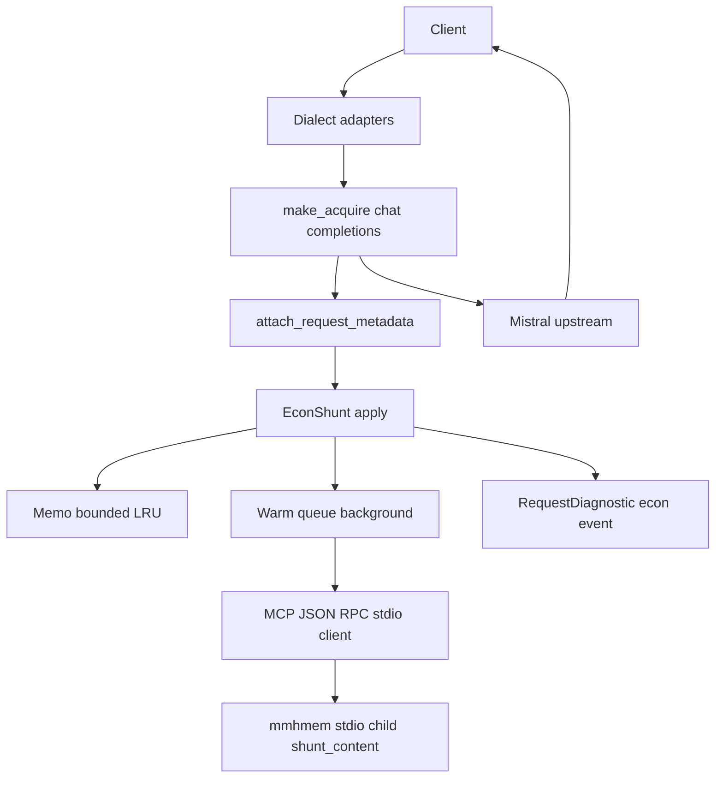
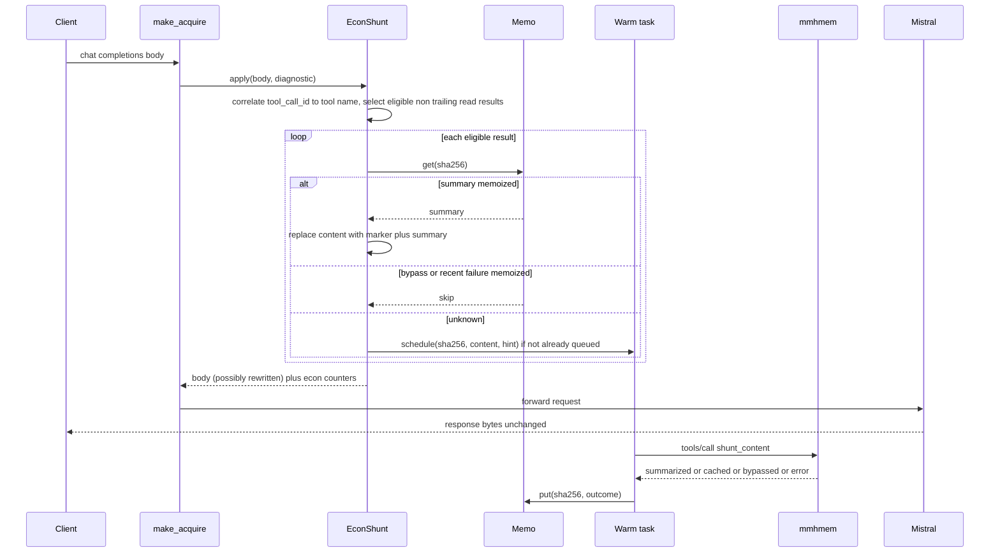

# Design Document — proxy-econ-client

## Overview

**Purpose**: Let the local proxy replace historical file-read tool results in chat-completion requests with deterministic structural summaries obtained from an embedded mmhmem stdio child, so repeated resends of the same read stop costing frontier prompt tokens.

**Users**: Operators of the mvibe proxy who also run mmhmem; agent users on OpenCode, Claude Code (Anthropic dialect) or Ollama-dialect clients routed through the proxy. Clients are unaware.

**Impact**: One new module `mvibe_proxy/econ.py`, one hook line in `proxy.py`, one new event type in the diagnostics allowlist, env configuration, a supervised child process, Docker build/compose wiring, offline tests, and an operator guide. Default behaviour (no `MVIBE_ECON_MMHMEM_BIN`) is unchanged. Responses are never touched.

### Goals
- Replace only *historical* `read` results, from an in-process memo, with byte-identical marked summaries (Req 2, 3).
- Zero request-path latency and fail-open on every error (Req 4).
- Honest, allowlisted `econ` diagnostics (Req 5); offline verification (Req 6).

### Non-Goals
- Summarizing shell, grep, glob, web, edit, write or MCP tool results (v1).
- Any response or streaming change; tool execution; worker configuration; usage metering or budget caps; changes to mmhmem beyond its companion spec.

## Boundary Commitments

### This Spec Owns
- `EconConfig` (env parsing, validation, binary-path validation, `--econ` switch).
- Eligibility of tool results inside an upstream-shaped chat-completion body: tool-name correlation by `tool_call_id`, allowlist, size, string type, trailing-group rule, hard exclusions, source-hint extraction.
- The replacement contract: marker line + summary; memo semantics (bounded LRU, outcomes, back-off); background warm-up scheduling with bounded concurrency.
- The minimal MCP JSON-RPC stdio client and the supervised `mmhmem stdio` child (`shunt_content` only; Amendment 1).
- The `econ` and `econ_warm` diagnostic events and their allowlisted fields.
- `tests/test_econ.py`, `docs/token-economics.md`, a pointer in `docs/proxy-guide.md`.

### Out of Boundary
- The `shunt_content` tool itself, its cache, eviction, worker prompt, security-critical regexes and audit (mmhmem companion spec `shunt-content-tool`).
- The response path (`mvibe_proxy/streaming.py`), the adapters' translation logic (`compat.py`), account-attribution metadata (`mvibe_auth/request_metadata.py`), authentication.
- Usage metering, `GET /stats`, budget 429s (future spec).

### Allowed Dependencies
- Existing: `anyio`, stdlib `json`, `hashlib`, `collections.OrderedDict`, `re`, `os`, `time`, `logging`, `asyncio.subprocess` (child + pipes); FastAPI app state for lifecycle. `httpx` remains in use by the upstream path only — the econ path no longer uses it.
- `mvibe_proxy.diagnostics` / `mvibe_proxy.observability` for emitting events (econ imports them; they never import econ).
- No new runtime dependency; `uv.lock` unchanged.
- Dependency direction: `econ.py` → (`diagnostics.py`, `observability.py`); `proxy.py` → `econ.py`. `mvibe_auth` never imports `mvibe_proxy`.

### Revalidation Triggers
- `shunt_content` request/response contract changes in mmhmem (fields, bypass reasons, error codes).
- rmcp stdio framing (newline-delimited JSON-RPC) or the `mmhmem stdio` subcommand contract changes.
- Tool naming or `read` output header format changes in OpenCode or Claude Code.
- Diagnostics allowlist changes (`proxy-observability` must re-check its schema tests).
- Any change to where `attach_request_metadata` runs or to the adapter translation of `tool_result` blocks.

## Architecture

### Existing Architecture Analysis
- `proxy.py:193` `make_acquire` builds the upstream request for `/v1/*` and the adapters; for `chat/completions` it parses the body once in `attach_request_metadata` and re-dumps it. The acquire closure is awaited exactly once (`streaming.py:150`).
- `RequestDiagnostic` carries per-request state and emits one allowlisted event; `observability.allowlisted()` is the export gate with a fixed `_ALLOWED_FIELDS`.
- `compat.py` converts Anthropic `tool_result` blocks into `role: tool` messages and Ollama messages into OpenAI shape before `make_acquire`, so one hook covers all dialects.
- Steering: credentials bound to destinations; diagnostics never carry payloads; proxy executes no tools.

### Architecture Pattern & Boundary Map



- Selected pattern: **in-process memoized rewrite with background warm-up**. The request path is a pure function of (body, memo); all I/O to mmhmem happens in background tasks owned by the app lifespan.
- Existing patterns preserved: opt-in via env, fail-open, allowlisted events, response byte-exactness, single body parse.
- New components rationale: `EconShunt` isolates policy; `StdioMcpClient` isolates transport and child supervision; `Memo` isolates determinism and bounds.

### Technology Stack

| Layer | Choice / Version | Role in Feature | Notes |
|---|---|---|---|
| Proxy runtime | Python 3.12+, FastAPI/uvicorn (existing) | hook + lifespan-owned warm tasks | unchanged |
| Transport to mmhmem | stdio pipes (`asyncio.subprocess`) | newline-delimited JSON-RPC to the supervised child | no HTTP, no TLS, no SDK |
| Diagnostics | `diagnostics.py`, `observability.py` (existing) | `econ`, `econ_warm` events | allowlist extended |
| External | mmhmem built from a pinned git ref with `shunt_content` | summaries, bypass decisions | companion spec; Docker build arg `MMHMEM_REF` |

## File Structure Plan

### Directory Structure
```
mvibe_proxy/
├── econ.py               # NEW: EconConfig, Eligibility, Memo, StdioMcpClient, EconShunt (single module; ~900 lines after Amendment 1 added child supervision to the transport boundary — the original ≤500-line estimate predates the amendment)
├── diagnostics.py        # modified: econ fields on RequestDiagnostic; econ_warm emit helper
├── observability.py      # modified: _ALLOWED_FIELDS gains econ fields
proxy.py                  # modified: --econ switch, EconConfig.from_env, lifespan start/stop + child supervision, hook in make_acquire
Dockerfile                # modified: pinned mmhmem build stage (Amendment 1)
docker-compose.yml        # modified: MVIBE_ECON_* / AGENT_MEM_* env, mmhmem data volumes
tests/
├── test_econ.py          # NEW: offline tests with FakeMmhmem (in-process stdio double) and the test_proxy harness
docs/
├── token-economics.md    # NEW: operator guide
├── proxy-guide.md        # modified: pointer section
```

### Modified Files
- `proxy.py` — parse `--econ`; build `EconConfig` from env (warn on incomplete config, exit 2 when `--econ` set and incomplete); in `lifespan` create `EconShunt` on `app.state.econ` (the client spawns the `mmhmem stdio` child at startup and supervises it) and stop it on shutdown; in `make_acquire`, after `attach_request_metadata`, call `app.state.econ.apply(payload, diagnostic)` when econ is configured. The hook must not change the metadata output (Req 3.6): apply works on the already-attributed body.
- `Dockerfile` — multi-stage: pinned `ARG MMHMEM_REF` Rust build stage produces the static mmhmem binary; copied to `/usr/local/bin/mmhmem` in the proxy image. The ref must contain `shunt_content` (companion spec implementation).
- `docker-compose.yml` — pass through `MVIBE_ECON_MMHMEM_BIN` and the `AGENT_MEM_*` child settings (worker, data dir, audit file); optional volumes for mmhmem state when economics is enabled. No new published ports: the child opens no listener.
- `mvibe_proxy/diagnostics.py` — `RequestDiagnostic` gains optional `econ: dict | None`; `emit()` includes it under allowlisted keys; module-level `emit_econ_warm(record)` reuses the stdout/export path.
- `mvibe_proxy/observability.py` — extend `_ALLOWED_FIELDS` with `econ_eligible, econ_replaced, econ_bypassed, econ_pending, econ_in_bytes, econ_out_bytes, econ_est_saved_tokens, econ_outcome, econ_latency_ms`.

## System Flows



Flow decisions: `apply` is synchronous CPU work only; warm tasks run under a semaphore (default 2) and dedup by hash; a failed hash is memoized with a timestamp and not retried before `MVIBE_ECON_RETRY_S` (default 300); the memo is LRU with `MVIBE_ECON_MEMO_MAX` entries (default 2000).

## Requirements Traceability

| Requirement | Summary | Components | Interfaces | Flows |
|---|---|---|---|---|
| 1.1 | off by default, no extra calls | EconConfig, proxy.py gating | `MVIBE_ECON_MMHMEM_BIN` unset ⇒ `app.state.econ is None` | — |
| 1.2 | env validation | EconConfig.from_env | EconConfigError | startup |
| 1.3 | in-container child; binary validated | EconConfig, StdioMcpClient | actionable error when the binary is missing/not executable | startup |
| 1.4 | no secrets/content in diagnostics | allowlist, event schema | `_ALLOWED_FIELDS` | — |
| 1.5 | `--econ` fail fast | proxy.main | exit 2 | startup |
| 2.1 | correlate by tool_call_id | Eligibility.correlate | `ToolCallIndex` | sequence |
| 2.2 | allowlist, string, min size | Eligibility.select | EconConfig.tools, min_bytes | sequence |
| 2.3 | trailing group never eligible | Eligibility.trailing_start | — | sequence |
| 2.4 | all dialects | hook after adapters | upstream-shaped body | sequence |
| 2.5 | hard exclusions + warning | EconConfig (`HARD_EXCLUDED`) | startup warning | startup |
| 2.6 | source hint | Eligibility.source_hint | read header regex, `filePath`/`file_path` arg | sequence |
| 3.1 | replace content only | EconShunt.apply | message dict in place | sequence |
| 3.2 | marker line | EconShunt.render | `MARKER` format | — |
| 3.3 | byte-identical | Memo | sha256 key → fixed summary | — |
| 3.4 | raw on first sight + warm | EconShunt.apply, WarmQueue | schedule() | sequence |
| 3.5 | responses untouched | no change to streaming.py | — | — |
| 3.6 | metadata unchanged | hook ordering | after attach_request_metadata | sequence |
| 4.1 | never await on request path | EconShunt.apply (sync) | — | sequence |
| 4.2 | once per hash, bounded concurrency | WarmQueue | semaphore, in-flight set | sequence |
| 4.3 | fail-open + memoized failure + back-off | WarmQueue, Memo | `Outcome.failed(ts)` | sequence |
| 4.4 | bounded LRU | Memo | `MVIBE_ECON_MEMO_MAX` | — |
| 4.5 | exception ⇒ raw body | proxy.py try/except around apply | diagnostic `econ_outcome=error` | — |
| 4.6 | no self-calls, skip without tool msgs | StdioMcpClient talks only to the spawned child; apply early return | — | — |
| 5.1 | per-request econ event | RequestDiagnostic.econ | field list | — |
| 5.2 | via existing channels, no content | diagnostics.emit, observability.allowlisted | — | — |
| 5.3 | no event when nothing eligible | apply returns None counters | — | — |
| 5.4 | warm outcome event | emit_econ_warm | `econ_warm` | sequence |
| 6.1 | fake mmhmem, harness | tests/test_econ.py | in-process stdio double | — |
| 6.2 | coverage list | tests/test_econ.py | — | — |
| 6.3 | docs | docs/token-economics.md | — | — |
| 6.4 | pre-existing suite unchanged | CI gate | `uv run --locked --offline -- pytest -q` | — |

## Components and Interfaces

| Component | Domain/Layer | Intent | Req Coverage | Key Dependencies (P0/P1) | Contracts |
|---|---|---|---|---|---|
| EconConfig | config | env parsing, validation, warnings | 1.1–1.3, 1.5, 2.5 | os.environ (P0) | State |
| Eligibility | policy | select historical read results, hints | 2.1–2.4, 2.6 | EconConfig (P0) | Service |
| Memo | state | bounded LRU of outcomes by sha256 | 3.3, 4.3, 4.4 | — | State |
| WarmQueue | background | dedup, bounded concurrency, back-off | 3.4, 4.2, 4.3, 5.4 | StdioMcpClient (P0), Memo (P0) | Service |
| StdioMcpClient | transport | supervised `mmhmem stdio` child; JSON-RPC over pipes | 4.1–4.3, 4.6 | asyncio.subprocess (P0), mmhmem binary (P1 external) | API |
| EconShunt | orchestration | apply() on a body; render marker; counters | 3.1, 3.2, 3.4–3.6, 4.5, 4.6, 5.1–5.3 | all above (P0) | Service |

### config

#### EconConfig

| Field | Detail |
|---|---|
| Intent | Parse and validate `MVIBE_ECON_*`; off when URL unset |
| Requirements | 1.1, 1.2, 1.3, 1.5, 2.5 |

**Responsibilities & Constraints**
- Env keys: `MVIBE_ECON_MMHMEM_BIN` (absent/blank ⇒ disabled; when set, the path must exist and be executable, else `EconConfigError` — this replaces the former loopback warning per Amendment 1), `MVIBE_ECON_PROJECT` (default `mvibe`), `MVIBE_ECON_TOOLS` (comma list, default `read`), `MVIBE_ECON_MIN_BYTES` (default 4096, int ≥ 256), `MVIBE_ECON_TIMEOUT_MS` (warm call timeout, default 45000), `MVIBE_ECON_MEMO_MAX` (default 2000), `MVIBE_ECON_RETRY_S` (default 300), `MVIBE_ECON_CONCURRENCY` (default 2).
- `HARD_EXCLUDED = {'edit','write','bash','shell','execute','patch','multiedit'} ∪ {names starting with 'mmhmem'}`; entries from `MVIBE_ECON_TOOLS` that hit the hard exclusion are dropped with one stderr warning (2.5). v1 documents that only `read` is tested.
- Loopback check removed (Amendment 1): there is no endpoint address; tool-result contents never traverse a network.

**Contracts**: State [x]
```python
@dataclass(frozen=True)
class EconConfig:
    mmhmem_bin: str; project: str; tools: frozenset[str]
    min_bytes: int; timeout_ms: int; memo_max: int; retry_s: int; concurrency: int
    @classmethod
    def from_env(cls, env: Mapping[str, str] = os.environ) -> 'EconConfig | None': ...  # None = disabled
class EconConfigError(ValueError): ...
```
- Preconditions: none. Postconditions: returns `None` or a fully validated config; raises `EconConfigError` naming the offending key.

### policy

#### Eligibility

| Field | Detail |
|---|---|
| Intent | Pure functions over the upstream-shaped `messages` list |
| Requirements | 2.1, 2.2, 2.3, 2.4, 2.6 |

**Contracts**: Service [x]
```python
READ_HEADER = re.compile(r'^Read file (?P<path>.+?), lines (?P<a>\d+)-(?P<b>\d+)\s*$', re.M)
@dataclass(frozen=True)
class Candidate:
    index: int            # position in messages
    tool_call_id: str
    tool: str             # lower-cased name
    content: str
    sha256: str
    line_count: int
    source_hint: str | None
def correlate(messages: list[dict]) -> dict[str, tuple[str, dict]]: ...   # id -> (name, parsed args or {})
def trailing_start(messages: list[dict]) -> int: ...                      # index where the trailing tool group begins (len(messages) if none)
def select(messages: list[dict], config: EconConfig) -> list[Candidate]: ...
```
- `select` iterates `messages[:trailing_start]`, keeps `role == 'tool'` with `str` content, `len(content.encode()) >= min_bytes`, tool name in `config.tools` (case-insensitive), not hard-excluded; hint from `READ_HEADER` else args `filePath`/`file_path`/`path` if a string.
- Invariants: never mutates input; a message without a matching tool call is never eligible.

### state

#### Memo

| Field | Detail |
|---|---|
| Intent | Deterministic outcomes by content hash, bounded |
| Requirements | 3.3, 4.3, 4.4 |

**Contracts**: State [x]
```python
@dataclass(frozen=True)
class Outcome:
    kind: Literal['summary', 'bypassed', 'failed']
    summary: str | None = None        # rendered replacement (marker + summary), fixed once stored
    reason: str | None = None         # bypass reason or error class name
    at: float = 0.0                   # monotonic time, for back-off
class Memo:
    def __init__(self, max_entries: int): ...
    def get(self, sha256: str) -> Outcome | None: ...   # touches LRU
    def put(self, sha256: str, outcome: Outcome) -> None: ...
    def retry_due(self, outcome: Outcome, retry_s: int, now: float) -> bool: ...
```
- Persistence: in-memory only (summaries are derived data; mmhmem's cache is the cross-process store).
- Concurrency: single event loop; no locks required.

### background

#### WarmQueue

| Field | Detail |
|---|---|
| Intent | Fetch outcomes for unknown hashes without touching the request path |
| Requirements | 3.4, 4.2, 4.3, 5.4 |

**Contracts**: Service [x]
```python
class WarmQueue:
    def __init__(self, client: StdioMcpClient, memo: Memo, config: EconConfig, emit: Callable[[dict], None]): ...
    def schedule(self, candidate: Candidate) -> bool: ...   # False if already in flight or memo says wait
    async def shutdown(self, timeout_s: float = 2.0) -> None: ...
```
- `schedule` spawns an `anyio`/asyncio task bounded by a semaphore (`config.concurrency`), tracked in an in-flight set keyed by sha256.
- Task: `client.shunt_content(...)` with `config.timeout_ms`; on success `memo.put(summary|bypassed)`; on any exception `memo.put(failed, reason=type name)`; always `emit({'event':'econ_warm', 'econ_outcome': ..., 'econ_latency_ms': ..., 'econ_in_bytes': len(content)})`.
- Idempotency: a hash is never fetched twice concurrently; a `failed` outcome is re-fetched only when `retry_due`.

### transport

#### StdioMcpClient

| Field | Detail |
|---|---|
| Intent | Supervised `mmhmem stdio` child; minimal JSON-RPC client for one tool over pipes |
| Requirements | 1.3, 4.1, 4.2, 4.3, 4.6 |

**Dependencies**: External — the mmhmem binary at `config.mmhmem_bin` (P1, optional at runtime, required when econ enabled). No network, no ports, no tokens.

**Contracts**: API [x]
```python
@dataclass(frozen=True)
class ShuntResult:
    outcome: Literal['summarized', 'cached', 'bypassed']
    summary: str | None
    bypass_reason: str | None
    content_sha256: str
    line_count: int
    avoided_input_tokens_est: int
class StdioMcpClient:
    def __init__(self, bin_path: str, reader: asyncio.StreamReader | None = None,
                 writer: asyncio.StreamWriter | None = None): ...
    async def start(self) -> None: ...      # spawn [bin, "stdio"], initialize handshake (no-op when streams injected)
    async def shunt_content(self, *, project: str, content: str, kind: str, source_hint: str | None, timeout_ms: int) -> ShuntResult: ...
    async def shutdown(self, timeout_s: float = 2.0) -> None: ...
class McpError(RuntimeError): ...   # transport, protocol, or tool error (message is sanitized: no content)
```
| Method | Channel | Request | Response | Errors |
|---|---|---|---|---|
| start | stdin | JSON-RPC `initialize` | capabilities on stdout | spawn failure / non-zero exit ⇒ McpError(spawn) |
| start | stdin | `notifications/initialized` | none (notification) | — |
| shunt_content | stdin | JSON-RPC `tools/call` `{name:'shunt_content', arguments:{project, agent_harness:'mvibe-proxy', content, kind:'file_read', source_hint}}` | stdout: one JSON-RPC response per line, matched by `id`; result is a text content block holding one JSON object (companion contract) | tool `isError` ⇒ McpError; timeout ⇒ McpError(timeout); EOF (child died) ⇒ McpError(terminated) + restart |

- Framing: one JSON-RPC message per `\n`-terminated line, UTF-8 (rmcp stdio transport; pinned by mmhmem's own stdio test harness). Only client-originated `id`s are awaited; server notifications are ignored.
- Supervision: abnormal child exit fails all in-flight calls fast (→ `Outcome.failed` with back-off, fail-open) and schedules a restart with capped exponential back-off (1 s → 30 s); an idle healthy child is left running. `shutdown()` closes stdin, waits ≤ `timeout_s`, then terminates the child.
- Injected `reader`/`writer` (tests) replace the child entirely: no subprocess is spawned, the protocol logic is exercised in-process.
- The client never logs request bodies or child stderr content; errors carry the JSON-RPC error code or errno only. Child stderr is drained and discarded (mmhmem logs are file-based).

### orchestration

#### EconShunt

| Field | Detail |
|---|---|
| Intent | The only object `proxy.py` talks to |
| Requirements | 3.1, 3.2, 3.4, 3.5, 3.6, 4.5, 4.6, 5.1, 5.2, 5.3 |

**Contracts**: Service [x]
```python
MARKER = '[mvibe econ] Summary of an earlier file read ({hint}, {lines} lines, sha256:{sha12}). The exact text was shown earlier in this conversation; read the file again for exact lines.\n'
@dataclass
class EconCounters:
    eligible: int; replaced: int; bypassed: int; pending: int; in_bytes: int; out_bytes: int; est_saved_tokens: int
class EconShunt:
    def __init__(self, config: EconConfig, client: McpClient, emit_warm: Callable[[dict], None]): ...
    def apply(self, body: dict) -> EconCounters | None: ...   # mutates body['messages'] in place; None when nothing eligible
    async def shutdown(self) -> None: ...
```
- `apply` is synchronous and never awaits. `est_saved_tokens = (in_bytes - out_bytes) // 4`, labelled estimate (same heuristic as mmhmem).
- `render(summary, candidate)` produces `MARKER.format(hint=candidate.source_hint or 'unknown source', ...) + summary`; the rendered text is what `Memo` stores, so repeats are byte-identical by construction.
- `proxy.py` wraps the call: `try: counters = econ.apply(parsed) except Exception: diagnostic.econ = {'econ_outcome': 'error'}; keep original payload`. The parse/dump is shared with `attach_request_metadata` (refactor that helper to expose `attach_request_metadata_dict(payload: dict, ...)` or parse once in `make_acquire`; either keeps its output bytes identical when econ is disabled — verified by the existing metadata tests).

**Implementation Notes**
- Integration: `app.state.econ` created in lifespan; `StdioMcpClient.start()` spawns the child during startup (missing/not-executable binary ⇒ `EconConfigError` path); `shutdown()` awaited in the lifespan `finally` with a 2 s bound (closes stdin, waits, terminates).
- Validation: `tests/test_econ.py` drives `apply` with captured-shape fixtures (synthetic content, not real captures) and the full app through the `harness()` pattern with a `FakeMmhmem` stdio double (injected streams) speaking the companion contract.
- Risks: large bodies parsed twice (avoid by single parse); memo memory (bounded); a client that resends with different whitespace produces a different hash and a separate entry (acceptable).

## Data Models

### Econ event (allowlisted fields, in addition to the existing schema)

| Field | Type | Notes |
|---|---|---|
| `event` | `proxy_request` (existing) or `econ_warm` | warm events are standalone |
| `econ_eligible`, `econ_replaced`, `econ_bypassed`, `econ_pending` | int | per request |
| `econ_in_bytes`, `econ_out_bytes` | int | sum over eligible results before/after |
| `econ_est_saved_tokens` | int | `(in − out) // 4`, estimate |
| `econ_outcome` | enum: `applied`, `none`, `error`, `summarized`, `cached`, `bypassed`, `failed` | request vs warm |
| `econ_latency_ms` | int | warm only |

No content, hints, paths or hashes are exported (hashes stay in memory only).

## Error Handling

- **Config**: `EconConfigError` at startup → warning and disabled, or exit 2 under `--econ`.
- **Request path**: any exception inside `apply` → original body relayed, `econ_outcome=error`.
- **Warm path**: `McpError`, subprocess spawn/EOF errors, child termination, timeouts, JSON errors → `Outcome.failed` with back-off, `econ_warm` event `failed`; never raised to a request; the supervisor restarts a crashed child with capped back-off.
- **Bypass** from mmhmem (`security_critical`, `below_threshold`, `unsupported_kind`) → `Outcome.bypassed`, permanent for the process.
- **Monitoring**: counters in the econ events; stdout `--log` and OpenObserve export both receive them.

## Testing Strategy

- **Unit (`tests/test_econ.py`, offline)**:
  - `EconConfig.from_env`: unset ⇒ None; `--econ`-worthy key set but binary missing/not executable ⇒ error naming `MVIBE_ECON_MMHMEM_BIN`; hard-excluded tool in allowlist ⇒ dropped + warning; malformed numeric keys ⇒ actionable errors.
  - `Eligibility`: correlation by id across multi-call assistant messages; trailing-group detection for `[…, assistant(tool_calls), tool, tool]` and `[…, tool, user]`; min bytes; non-string content; `Read` vs `read`; hint from header vs `filePath` arg vs none.
  - `Memo`: LRU eviction at max; `retry_due` semantics; byte-identical `get` after `put`.
  - `StdioMcpClient`: initialize handshake; response matching by id; tool `isError` ⇒ `McpError`; malformed line ⇒ `McpError(protocol)`; EOF mid-request (child death) ⇒ `McpError(terminated)` and a scheduled restart; injected-stream mode never spawns a subprocess; no content in error messages.
  - `EconShunt.apply`: unknown hash ⇒ raw + scheduled; memoized summary ⇒ replaced content equals `MARKER + summary`, role/id untouched, other messages byte-identical; nothing eligible ⇒ `None`.
- **Integration (full app, `harness()` pattern)**: Anthropic and Ollama adapter requests with historical read results reach the upstream mock with replaced content after warm-up; OpenAI dialect same; upstream response bytes identical; `attach_request_metadata` output unchanged; `X-Request-ID` event carries econ fields; token absent from every emitted record; econ disabled ⇒ upstream request bytes equal to the pre-feature expectation.
- **Fail-open**: FakeMmhmem returning tool errors / hanging beyond timeout / malformed JSON / closing the stream (child death) ⇒ raw relay, `failed` memo, no retry before back-off, then retry after.
- **Regression**: `uv run --locked --offline -- pytest -q` (1212 pre-existing tests) and `scripts/verify.ps1` gate unchanged.
- **Live (not part of the gate)**: documented manual check with a locally built mmhmem binary (`MVIBE_ECON_MMHMEM_BIN=<path>`, child spawned by the proxy) and `smoketests` request replay; record in `docs/live-results.md` when done.

## Security Considerations
- No tokens in the econ path: stdio needs no authentication (pipes are kernel-enforced process-local; mmhmem's local profile opens no listener and reads no token).
- Tool-result content stays inside the container: it is written to the child's stdin only. The child is the sole consumer; the proxy never sends it anywhere else and never calls itself. mmhmem audits hash-only (companion spec).
- The operator guide states the trust boundary: the child (and its worker-model egress, if configured) sees full tool-result contents by design.
- Security-critical content is bypassed by mmhmem; the proxy memoizes the bypass so it is not resent.

## Performance & Scalability
- Request path: one body parse (shared), O(messages) correlation, O(eligible) hashing (SHA-256 over at most a few hundred KB), no I/O. Target: < 5 ms added for a 250 KB body on the reference workstation.
- Warm path: bounded by semaphore (2) and mmhmem's worker latency; does not affect requests.
- Memory: memo ≤ `MVIBE_ECON_MEMO_MAX` rendered summaries (typically < 2 KB each).

## Design Review Gate
Requirements 1.1–6.4 are mapped. Boundary, dependencies, files, contracts, failure modes and offline validation are concrete. Two ambiguities were repaired during review: (a) the body is parsed once and shared with metadata attachment so the metadata bytes stay identical; (b) rendered text, not the bare summary, is what the memo stores, which makes byte-identity a structural property rather than a test-only promise. Gate passed.
