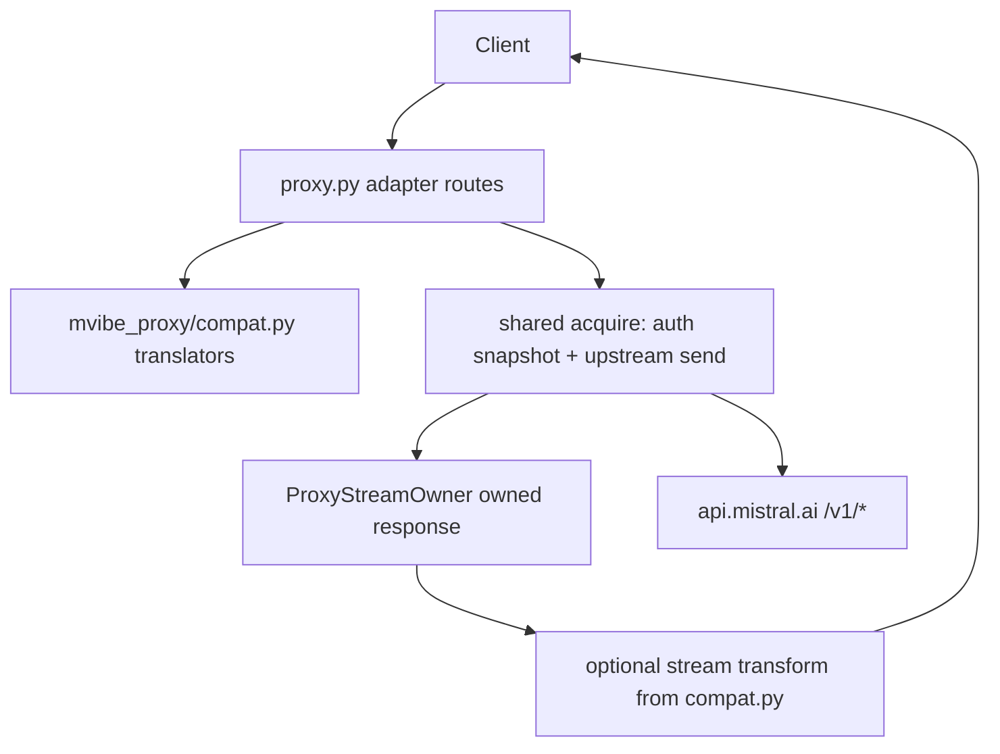
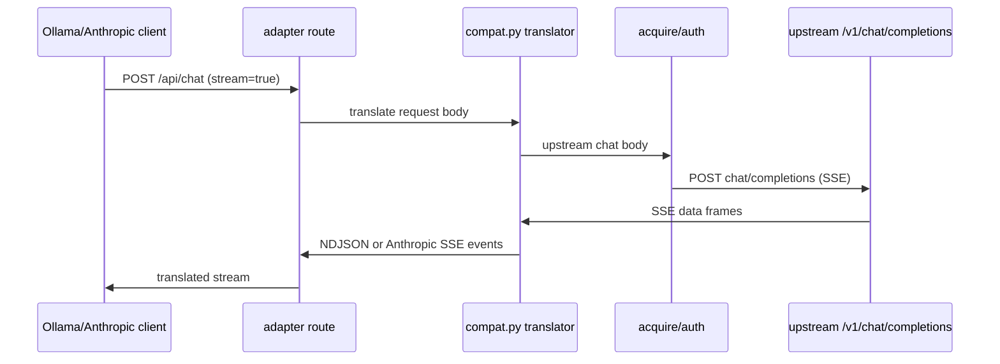

# Design Document — proxy-endpoint-compatibility

## Overview

**Purpose**: Let Ollama- and Anthropic-dialect clients use the local Vibe proxy, by adding adapter endpoints that translate to the existing upstream `/v1/chat/completions` passthrough — same credential flow (default existing-vibe), same safe diagnostics, same loopback default.

**Users**: Ollama clients (`/api/*`) and Anthropic clients (`/v1/messages`) on the same machine/network as the proxy.

**Impact**: one new module `mvibe_proxy/compat.py` (pure translators), thin route registrations in `proxy.py`, a small optional stream-transform hook in `mvibe_proxy/streaming.py`, offline contract tests, live smoke procedure. Raw `/v1/*` passthrough is byte-unchanged.

### Goals

- Ollama: `/api/version`, `/api/tags`, `/api/chat`, `/api/generate`, `/api/show`, `/api/embed` (Req 1–3).
- Anthropic: `POST /v1/messages` non-stream + SSE stream, `GET /v1/models` in Anthropic dialect via `anthropic-version` header (Req 4).
- Shared auth/diagnostics/privacy/bind behavior (Req 5); OpenAPI + tests + operator smoke (Req 6).

### Non-Goals

- Ollama management endpoints (`/api/pull`, `/api/delete`, `/api/copy`, `/api/create`, `/api/blobs`, `/api/ps`); Responses API; search; tool/MCP execution; caller authentication; any change to credential storage or the bridge protocol.

## Boundary Commitments

### This Spec Owns

- `mvibe_proxy/compat.py`: all request/response/stream translation for both dialects (pure functions/classes).
- Adapter route registration in `proxy.py` (`/api/*`, `/v1/messages`, dialect switch on `/v1/models`).
- The optional stream-transform hook in `mvibe_proxy/streaming.py` (`_OwnedResponse` transform, bounded buffering).
- OpenAPI documentation for the new operations; `tests/test_compat.py`; live smoke section in `docs/proxy-guide.md`.

### Out of Boundary

- Raw `/v1/models`, `/v1/chat/completions`, `/v1/embeddings` passthrough (unchanged, byte-exact).
- Auth/credential handling, keyring, OIDC flows (steering authentication.md).
- Diagnostics event schema changes (adapter routes reuse it; only `model` may be set).
- The direct OpenCode plugin; OpenObserve export (already implemented; adapter routes are exportable automatically).

### Allowed Dependencies

- Existing only: FastAPI/Starlette, httpx2, stdlib json. **No new dependencies.**
- Upstream Mistral `/v1` API shapes as the translation target.

### Revalidation Triggers

- Ollama or Anthropic client-dialect schema changes (field renames) → translator fixtures must be re-pinned.
- New adapter route → OpenAPI + diagnostics coverage must be added.
- Any change to the raw passthrough or stream ownership semantics.

## Architecture

### Existing Architecture Analysis

- `proxy.py` routes call `acquire()` (per-request auth snapshot → upstream send via `ProxyStreamOwner.response`) and return the owned response; unknown `/v1/*` → local 404, wrong methods → 405.
- `ProxyStreamOwner`/`_OwnedResponse` own stream lifecycle, retirement and cleanup diagnostics.

### Architecture Pattern & Boundary Map



- Selected pattern: **edge translation, shared core** — adapters are pure translators; auth/stream/diagnostics reuse the existing path unchanged.
- Dependency direction preserved: `proxy.py` → `mvibe_proxy.compat` → nothing upstream; `mvibe_proxy` never imports FastAPI-heavy route code.

### Technology Stack

| Layer | Choice / Version | Role | Notes |
|---|---|---|---|
| Proxy runtime | Python 3.12+, FastAPI/uvicorn (existing) | routes | unchanged |
| Translation | stdlib json + `mvibe_proxy/compat.py` (new) | dialect mapping | pure, unit-tested |
| Streaming | existing owned response + small buffer transform | NDJSON/SSE out | bounded by SSE line size |
| Tests | pytest offline mock transport; curl live smoke | contracts | no network in tests |

## File Structure Plan

```
mvibe_proxy/
├── compat.py        # NEW: ollama_* and anthropic_* translators (pure)
├── streaming.py     # modified: optional transform hook on _OwnedResponse
proxy.py             # modified: /api/* routes, /v1/messages, /v1/models dialect switch, OpenAPI extras
tests/
├── test_compat.py   # NEW: offline contract fixtures for every adapter route
docs/
├── proxy-guide.md   # modified: live smoke section for the new endpoints
```

### Modified Files

- `mvibe_proxy/streaming.py` — `_OwnedResponse`/`_stream_body` accept an optional `transform(chunk) -> bytes` (stateful translator closure); default None keeps byte-exact passthrough.
- `proxy.py` — adapter routes + `acquire()` variant with body transform; `GET /v1/models` returns Anthropic paginated shape when `anthropic-version` header present.
- `docs/proxy-guide.md` — smoke commands.

## System Flows



Flow decisions: translation happens per SSE `data:` frame; partial lines are buffered across chunks and flushed at stream end; upstream error statuses are mapped to adapter-shaped errors with curated hints, never upstream bodies.

## Requirements Traceability

| Requirement | Summary | Components | Interfaces | Flows |
|---|---|---|---|---|
| 1.1–1.3 | Ollama version/tags/errors | compat.ollama_version/tags, route | GET /api/version, /api/tags | — |
| 2.1–2.4 | Ollama chat/generate, stream, errors | compat.ollama_chat/generate + stream translator | POST /api/chat, /api/generate | sequence above |
| 3.1–3.3 | Ollama show/embed | compat.ollama_show/embed | POST /api/show, /api/embed | — |
| 4.1–4.5 | Anthropic messages + models + errors | compat.anthropic_messages_* + models list | POST /v1/messages, GET /v1/models (anthropic-version) | sequence above |
| 5.1–5.5 | shared auth/diagnostics/privacy/bind | proxy.py routes reuse acquire + RequestDiagnostic | event schema unchanged | — |
| 6.1–6.3 | OpenAPI, offline tests, smoke guide | openapi_extra, tests/test_compat.py, docs | /openapi.json, /docs | — |

## Components and Interfaces

### Compat translators (`mvibe_proxy/compat.py`) — pure, no I/O

- `ollama_version() -> dict` — `{version: <proxy-side compat version>}`.
- `ollama_tags(upstream_models_json: dict) -> dict` — map `data[]` to `{models:[{name, model, modified_at?, size?, digest?, details?}]}`.
- `ollama_chat_request(body: dict) -> dict` — messages passthrough, `options.temperature/top_p/num_predict` → `temperature/top_p/max_tokens`, `tools` → OpenAI function tools, `stream` → `stream`.
- `ollama_chat_response(upstream: dict, model: str) -> dict` — `choices[0].message` → `message` (+`tool_calls`), usage → `eval_count`/`prompt_eval_count`/`total_duration` (0 when unknown), `done: true`.
- `OllamaStreamTranslator` — fed upstream SSE data payloads; yields NDJSON lines (`done:false` per delta incl. tool_calls, final `done:true` with usage).
- `ollama_generate_request/response` — `prompt`+`system` wrapped as messages; response text in `response`.
- `ollama_show(upstream_model_entry) -> dict`, `ollama_embed_request(body) -> upstream embeddings body`, `ollama_embed_response(upstream) -> {embeddings: [...]}`.
- `anthropic_messages_request(body) -> dict` — `system` → leading system message; content blocks (text/tool_use/tool_result) → OpenAI messages incl. tool_calls/tool messages; `tools` → function tools; `max_tokens` required → upstream `max_tokens`; `stream` passthrough.
- `anthropic_messages_response(upstream) -> dict` — Anthropic message object with `content` blocks, `stop_reason` mapped (`end_turn`/`stop_sequence`/`max_tokens`/`tool_use`), `usage` mapped.
- `AnthropicStreamTranslator` — upstream SSE → `event: message_start` + `content_block_*` + `message_delta` + `message_stop` frames.
- `anthropic_models_list(upstream) -> dict` — paginated `{data:[{id,type:'model',display_name,created_at}], has_more:false, first_id, last_id}`.
- `adapter_error(dialect, status, hint) -> (status, body)` — Ollama `{error: message}`; Anthropic `{type:'error', error:{type, message}}`; curated hints only.
- All translators: input validated defensively (wrong shape → 400 adapter error, never upstream).

### Route wiring (`proxy.py`)

- `/api/version` (GET, no upstream), `/api/tags` (GET), `/api/chat`, `/api/generate`, `/api/show`, `/api/embed` (POST), `/v1/messages` (POST).
- Each POST route: parse+validate adapter body (400 on invalid), translate, call shared `acquire()` with transformed target path/body, translate the owned response (stream transform for `stream=true`).
- Unknown `/api/*` → 404 `{error: '...'}`; wrong methods → 405.
- `GET /v1/models`: `anthropic-version` header present → Anthropic paginated list; else existing OpenAI shape.

## Data Models

- Adapter request/response schemas per dialect docs (Ollama api.md; Anthropic messages API); internal contract is the upstream OpenAI chat-completion JSON. Streaming contract: upstream SSE `data: {json}\n\n` → adapter frames (NDJSON lines or Anthropic `event:`/`data:` SSE).
- Diagnostics: unchanged allowlisted event schema; `model` set from the adapter request when present.

## Error Handling

- Invalid adapter body → 400 in the adapter's error shape (Ollama `{error}`, Anthropic error object), no upstream call, diagnostic outcome recorded.
- Upstream error status → mapped to adapter error shape with curated hint (no upstream body); local auth/connection failures reuse the existing 401/502 JSON (unchanged).
- Stream interruption mid-translation → final frame with `done:true`/`error` per dialect, existing stream outcome diagnostics (`stream_interrupted`/`cancelled`).

## Testing Strategy

- **Unit (offline, `tests/test_compat.py`)**: pinned fixtures per translator — Ollama tags/chat/generate/show/embed request+response, NDJSON frame sequence for a 3-chunk stream incl. tool_calls delta; Anthropic messages request (system+text+tool_use+tool_result), response mapping, full SSE event sequence, models list, error mappings for 400/401/403/422/429/500, dialect header switch on `/v1/models`.
- **Integration (offline)**: full app via mock upstream transport; assert upstream body equals translated expectation, client receives translated shape, one diagnostic event with matching `X-Request-ID`, no secrets in events.
- **Live smoke (operator guide)**: start proxy, `curl /api/version`, `/api/tags`, small `POST /api/chat` and `/api/generate` ("Reply with exactly OK."), one streaming call each, `POST /v1/messages` with `anthropic-version` header (stream and non-stream), `GET /v1/models` both dialects; expected shapes documented.

## Security Considerations

- No caller auth added; loopback default + `--host 0.0.0.0` warning unchanged (Req 5.5).
- Adapter bodies are request payloads: diagnostics remain allowlisted (no bodies/headers/URLs); only model id exported.
- Error mapping never forwards upstream bodies into adapter error shapes.

## Performance & Scalability

- Translation is O(body) JSON work per request; stream transform buffers at most one partial SSE line.
- No new dependencies; no background tasks.
