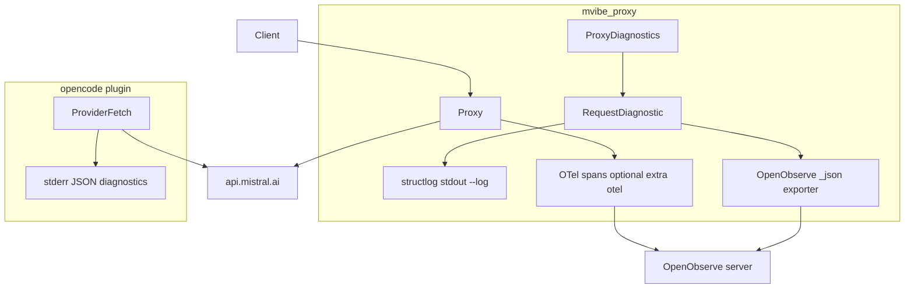
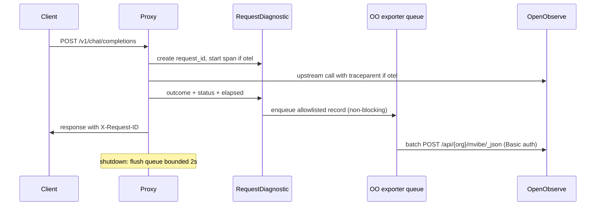

# Design Document — proxy-observability

## Overview

**Purpose**: Extend the existing opt-in diagnostics baseline (proxy `--log` structlog events, plugin `diagnostics: true` stderr events) with correlation IDs, stream lifecycle granularity, and opt-in export to an **OpenObserve-style** backend, so operators can trace Vibe-backed requests end to end without ever exposing secrets or payloads.

**Users**: Operators running the local proxy and the direct OpenCode provider plugin, plus agent users debugging failed/streaming/tool conversations.

**Impact**: Adds one new proxy module (`mvibe_proxy/observability.py`), small edits to `diagnostics.py`/`proxy.py`/`streaming.py` and the TS provider, one optional dependency extra, offline tests and an operator guide. Default behavior (no flags/env) is unchanged.

### Goals

- Correlated, safe, structured events for every proxied request and stream (Req 1–2), opt-in and inert by default (Req 3).
- Same correlation shape on the direct provider path (Req 4).
- Opt-in export to OpenObserve: native `_json` logs ingest plus OTLP/HTTP traces & metrics via standard `OTEL_EXPORTER_OTLP_*` env (Req 5), stream name `mvibe`.
- Operator documentation and offline verification (Req 6).

### Non-Goals

- Dashboards, hosted telemetry services, alerting rules in the proxy.
- Payload/prompt/tool-argument capture (the separate opt-in `http-capture.ts` stays untouched).
- Responses API, search endpoints, tool/MCP execution.
- Changes to credential storage, the bridge protocol version, or auth flows.
- Mandatory exporter dependency: nothing is exported unless configured.

## Boundary Commitments

### This Spec Owns

- The proxy diagnostic event schema and its safe field allowlist; correlation ID generation and `X-Request-ID` propagation.
- The OpenObserve-style logs exporter (native `_json` batching, Basic auth, bounded queue, shutdown flush) in `mvibe_proxy/observability.py`.
- Optional OTel span/metric creation for proxy requests/streams/auth resolution when the `otel` extra is installed and enabled; W3C `traceparent` injection on the proxy→upstream hop only.
- Plugin-side diagnostic event parity (request_id, model) on the existing stderr JSON channel.
- Operator documentation (`docs/observability.md`) and offline tests.

### Out of Boundary

- OpenObserve server itself, its dashboards/alerts, and collector deployment (documented as reference config only).
- MCP server internals and helper/bridge protocol stdout (must remain uncorrupted; no protocol version bump).
- Credential storage, renewal, and keyring handling (steering `authentication.md`).
- The direct provider's inference/transport logic beyond the diagnostic fields.

### Allowed Dependencies

- Existing: `structlog`, `httpx`/`httpx2`, FastAPI/uvicorn, stdlib logging, anyio.
- New optional extra `otel`: `opentelemetry-sdk` + `opentelemetry-exporter-otlp-proto-http` (~1.45.x, Apache-2.0). Never imported unless the extra is installed and export is enabled.
- TS plugin: no new runtime dependencies; stderr JSON channel only.
- Env-var configuration only; no config files containing tokens.

### Revalidation Triggers

- Diagnostic event schema field additions/removals (OpenObserve stream schema drift).
- New `MVIBE_OBSERVE_*` / `OTEL_EXPORTER_OTLP_*` keys or CLI flags.
- Any change to `X-Request-ID` behavior or bridge protocol (would need a protocol version bump — out of scope here).
- OpenObserve endpoint path changes (`/api/{org}/...`) in a future server version.

## Architecture

### Existing Architecture Analysis

- `proxy.py` builds the FastAPI app; lifespan owns the auth session, HTTP client and `ProxyStreamOwner`.
- `ProxyDiagnostics` (ASGI middleware) creates a `RequestDiagnostic` per HTTP request, adds `X-Request-ID`, and `emit()`s one JSON event on stdout when `--log` is set. `_OwnedResponse`/`_OwnedByteStream` mark auth/connection/cancelled/interrupted/cleanup outcomes and stream ownership.
- Plugin path: `createProviderFetch` wraps fetch; with `options.diagnostics === true` it prints one JSON line per request to **stderr** (never stdout, which carries MCP/plugin protocol).
- Dependency direction (steering `structure.md`): consumers → `mvibe_proxy`/`mvibe_auth`; the shared auth library stays independent of FastAPI/observability.

### Architecture Pattern & Boundary Map



- Selected pattern: **sidecar-free in-process export** — diagnostics stay in-process; the optional OTel extra emits OTLP/HTTP directly to OpenObserve; no collector is required (the user's collector `otlphttp/openobserve` snippet is documented as an alternative topology).
- Existing patterns preserved: opt-in flags, fixed safe hint codes, stdout/stderr channel separation, body-never-read rule.
- New component rationale: one module owns all export concerns (queue, auth, batching, flush) so the request path only enqueues.

### Technology Stack

| Layer | Choice / Version | Role in Feature | Notes |
|---|---|---|---|
| Proxy runtime | Python 3.12+, FastAPI/uvicorn (existing) | Hosts request/stream lifecycle | unchanged |
| Structured logs | structlog 25.5.0 (existing, pinned) | `--log` stdout events | schema extended, allowlisted |
| Logs export | httpx (existing) → OpenObserve `_json` | batched native ingest to stream `mvibe` | new module, opt-in |
| Traces/metrics export | opentelemetry-sdk + -exporter-otlp-proto-http ~1.45.x (optional extra `otel`) | spans + counters via standard OTEL_EXPORTER_OTLP_* env | inert without extra |
| Plugin diagnostics | TypeScript, no new deps | stderr JSON parity events | `diagnostics: true` flag |
| Backend | OpenObserve (reference) | stores logs stream `mvibe`, traces, metrics | OTLP at `/api/{org}/v1/*`, logs at `/api/{org}/mvibe/_json` |

## File Structure Plan

### Directory Structure

```
mvibe_proxy/
├── diagnostics.py        # modified: event schema + trace ids + enqueue hook
├── observability.py      # NEW: OpenObserve-style exporter + OTel bootstrap
├── streaming.py          # modified: stream lifecycle outcomes feed the same schema
proxy.py                  # modified: --observe flag, env config, lifespan wiring
packages/opencode-vibe-oidc/src/
├── provider.ts           # modified: parity fields request_id/model in stderr events
├── index.ts              # unchanged (diagnostics flag already plumbed)
tests/
├── test_observability.py # NEW: offline exporter/OTel/diagnostics tests
docs/
├── observability.md      # NEW: operator guide (OpenObserve, env vars, collector alt)
pyproject.toml            # modified: optional extra `otel`
```

### Modified Files

- `mvibe_proxy/diagnostics.py` — add optional `trace_id`/`span_id`/`model` to the event; `emit()` also enqueues the allowlisted record to the exporter when enabled; all existing behavior unchanged when disabled.
- `mvibe_proxy/streaming.py` — record stream start/completion explicitly so outcomes `stream_started`/`completed`/`aborted`/`cancelled`/`cleanup_failed` are emitted distinctly.
- `proxy.py` — `--observe` flag; reads `MVIBE_OBSERVE_URL/ORG/STREAM/USER/TOKEN`; lifespan starts the drain task and flushes on shutdown; OTel bootstrap only if extra importable and enabled.
- `packages/opencode-vibe-oidc/src/provider.ts` — stderr diagnostic object gains `request_id` and `model`; still gated by `diagnostics: true`; never bodies/headers.
- `pyproject.toml` — `[project.optional-dependencies] otel = ["opentelemetry-sdk==1.45.*", "opentelemetry-exporter-otlp-proto-http==1.45.1"]` (exact SDK pin confirmed at lock time).

## System Flows



Flow decisions: enqueue is O(1) and never awaited on the request path; export failures increment `dropped_events`/`export_failures` counters and never raise into inference; shutdown flush is bounded.

## Requirements Traceability

| Requirement | Summary | Components | Interfaces | Flows |
|---|---|---|---|---|
| 1.1 | correlation ID + response header | RequestDiagnostic, ProxyDiagnostics | `X-Request-ID` header; event `request_id` | sequence above |
| 1.2 | lifecycle event fields | RequestDiagnostic.emit | event schema (Data Models) | sequence above |
| 1.3 | stream outcomes | streaming.py outcomes | event `outcome` enum | stream lifecycle |
| 1.4 | fixed failure codes | RequestDiagnostic.failure | fixed code map | error handling |
| 1.5 | per-request correlation | request_id on all events | event schema | sequence above |
| 2.1 | no secrets/payloads | allowlist in observability.py + diagnostics.py | exported record schema | — |
| 2.2 | diagnostics failure never breaks inference | emit() guard; enqueue-only | — | error handling |
| 2.3 | curated hints for upstream errors | RequestDiagnostic.upstream | fixed hint map | — |
| 3.1 | off by default | proxy.py flag/env gating | CLI `--observe`, env `MVIBE_OBSERVE_*` | — |
| 3.2 | disabled = unchanged behavior | gating | — | — |
| 3.3 | plugin opt-in, no proxy claims | provider.ts gating | stderr JSON | — |
| 3.4 | no routing/stream/protocol changes | no changes to routing; stdout untouched | — | — |
| 4.1 | plugin correlated events | provider.ts diagnostic fields | stderr event schema | — |
| 4.2 | plugin disabled = silent | `diagnostics: true` check | — | — |
| 4.3 | plugin diagnostic failure safe | try/catch around emit | — | error handling |
| 5.1 | spans exported when configured | OTel bootstrap (otel extra) | standard OTEL_EXPORTER_OTLP_* | sequence above |
| 5.2 | W3C only on approved boundary | traceparent injection proxy→upstream | header contract | sequence above |
| 5.3 | no exporter needed by default | gating + optional extra | env config | — |
| 5.4 | failure safety, bounded queue, flush | OO exporter | queue contract | error handling |
| 6.1 | operator docs | docs/observability.md | — | — |
| 6.2 | offline tests with owned sinks | tests/test_observability.py | mock transport / in-memory exporter | testing |
| 6.3 | host-version re-check guidance | docs/observability.md | — | — |

## Components and Interfaces

| Component | Domain/Layer | Intent | Req Coverage | Key Dependencies (P0/P1) | Contracts |
|---|---|---|---|---|---|
| RequestDiagnostic | proxy core | per-request event state + emit | 1.1–1.5, 2.1–2.3 | observability queue (P1) | Event |
| OpenObserveExporter | proxy infra | bounded queue + batched `_json` POST + flush | 5.3, 5.4, 2.1 | httpx (P0), env config (P0) | Batch |
| OTel bootstrap | proxy infra (optional extra) | spans/metrics via OTLP to OpenObserve | 5.1, 5.2, 1.5 | opentelemetry-sdk (P1, optional) | Service |
| Plugin diagnostics | TS provider | stderr JSON parity events | 4.1–4.3, 3.3 | none (P0) | Event |

### OpenObserveExporter (new, `mvibe_proxy/observability.py`)

- **Responsibilities & Constraints**: own all export I/O; enqueue-only on the hot path; batch ≤100 records or 1s interval, whichever first; Basic auth from `MVIBE_OBSERVE_USER`/`MVIBE_OBSERVE_TOKEN`; POST `{MVIBE_OBSERVE_URL}/api/{MVIBE_OBSERVE_ORG}/{MVIBE_OBSERVE_STREAM:-mvibe}/_json`; hard per-request timeout 5s; queue cap 1000 with drop-oldest + `dropped_events` counter; `shutdown()` flushes with 2s bound.
- **Dependencies**: Inbound — `RequestDiagnostic.emit`. Outbound — httpx, env. External — OpenObserve server (P1, optional).
- **Contracts**: Batch — trigger: queue non-empty; input: allowlisted records; output: HTTP 200 or counted failure; idempotency: at-least-once, duplicates acceptable for logs.
- **Implementation Notes**: Integration — created only when enabled; Validation — tests assert token never appears in body and payload fields ⊆ allowlist; Risks — slow backend mitigated by queue+timeouts.

### OTel bootstrap (optional extra `otel`)

- **Responsibilities**: create TracerProvider/MeterProvider; spans for `proxy.request`, `proxy.stream`, `auth.resolve`, `bridge.call` (bridge span only via existing hooks, no protocol change); exporter configured **purely** by standard `OTEL_EXPORTER_OTLP_ENDPOINT`/`OTEL_EXPORTER_OTLP_HEADERS` (documented for OpenObserve as `{url}/api/{org}` + `Authorization=Basic …` + `stream-name=mvibe`); inject `traceparent` into upstream headers on the approved proxy→upstream hop.
- **Dependencies**: External — opentelemetry-sdk/-exporter (optional extra, P1); OpenObserve `/v1/traces`, `/v1/metrics` (P1).
- **Implementation Notes**: ImportError → inert + startup note; Validation — in-memory exporter in tests, no sockets (conftest guards); Risks — version drift pinned in lock.

### Plugin diagnostics (`provider.ts`)

- **Responsibilities**: when `options.diagnostics === true`, emit one JSON line to **stderr** per request: `{event, request_id, model?, phase, outcome, status?, elapsed_ms, hint}` — same field names as the proxy for OpenObserve correlation.
- **Constraints**: never stdout, never bodies/headers/URLs, try/catch around emit.
- **Req coverage**: 4.1–4.3, 3.3.

## Data Models

### Event schema (allowlist — the only fields ever emitted or exported)

| Field | Type | Notes |
|---|---|---|
| `event` | string | e.g. `proxy_request` |
| `timestamp` | ISO-8601 | added at emit |
| `request_id` | string | uuid hex; also sent as `X-Request-ID` |
| `trace_id` / `span_id` | string, optional | only when OTel enabled; never invented |
| `phase` | enum | request, routing, authentication, acquisition, upstream, stream, cleanup |
| `outcome` | enum | completed, auth_failed, connection_failed, unsupported_endpoint, upstream_error, stream_interrupted, cancelled, cleanup_failed, headers_received |
| `status` | int, optional | HTTP status when one was produced |
| `elapsed_ms` | number | monotonic delta |
| `model` | string, optional | request model id only (not a secret); omitted when unknown |
| `hint` | string | fixed curated strings only |

Resource attributes on export: `service.name=mvibe-proxy`, `service.version` from package version. OpenObserve record = event fields flattened + `_timestamp`; ≤200 fields per record is satisfied by construction.

## Error Handling

- **Export path**: any exception in enqueue/drain/export is caught, counted (`export_failures`, `dropped_events`), and never propagated to the request path (Req 2.2, 5.4).
- **Config errors** (e.g. `MVIBE_OBSERVE_URL` set but token missing): fail fast at startup with a clear message and refuse to enable export (credentials never partially configured); proxy still serves without export.
- **OTel missing extra**: ImportError → export disabled with a startup note; proxy fully functional.
- **Upstream statuses**: mapped to fixed hints only (Req 2.3); bodies never logged.
- **Monitoring**: the counters above are themselves exported as metrics when OTel is enabled, and included in the final stdout event when `--log` is on.

## Testing Strategy

- **Unit (Python, offline, `tests/test_observability.py`)**:
  - allowlist enforcement: emit event with attempted extra fields → exported record contains only allowlisted keys.
  - exporter batching: enqueue 150 records → two POSTs to `/api/default/mvibe/_json`, correct Basic auth header, JSON array body, token absent from body; mock httpx transport (conftest blocks sockets).
  - queue bound: enqueue 2000 with a dead transport → `dropped_events` counts drops, request path never blocks (assert enqueue returns immediately).
  - shutdown flush: pending records exported within the 2s bound; after bound, exits anyway.
  - disabled by default: no env/flag → no exporter task, no network, `emit()` unchanged (existing tests must still pass unchanged).
  - OTel optional: with in-memory span exporter, `proxy.request` span carries request_id; traceparent present on upstream request only when enabled; without the extra installed, import guard keeps startup inert.
- **Integration (Python)**: full app via existing `harness()` in `tests/test_proxy.py` style — request through ASGI transport with exporter pointed at mock transport; assert one exported record with matching `X-Request-ID`.
- **Plugin (Bun)**: `provider.test.ts` — with `diagnostics: true`, stderr line parses as JSON with `request_id`/`model`/`outcome`; with flag off, no stderr output; capture failure never throws.
- **E2E/operator**: docs-driven manual check against a real OpenObserve (`curl /api/default/mvibe/_json`, then search the `mvibe` stream); recorded in docs/observability.md — not part of the offline gate.
- **Live**: unchanged — no paid inference needed; observability is verified offline plus one operator-side manual check.

## Security Considerations

- Tokens/passwords only via env vars; never in files, logs, tests, issues, or this spec's documents (user-visible credential from 2026-11-02 chat was deliberately not recorded; rotation advised).
- Exported payloads are allowlisted by construction (Req 2.1); tests assert absence of tokens, headers, bodies, URLs, prompts, tool data.
- Basic auth over HTTP is accepted only for LAN/OpenObserve deployments as configured by the operator; HTTPS supported via `MVIBE_OBSERVE_URL=https://…`.
- `traceparent` propagation only proxy→upstream (approved boundary); plugin path stays on its own request IDs.

## Performance & Scalability

- Hot path cost when disabled: one attribute check per emit (negligible).
- When enabled: O(1) enqueue; drain task batches; per-POST timeout 5s; no per-request waiting on the network. Proxy latency unaffected beyond in-memory work.
- Queue memory bound: 1000 records × small fixed schema.

## Supporting References

- Reference collector topology (documented, placeholders only — real credentials stay in env):

```yaml
exporters:
  otlphttp/openobserve:
    endpoint: ${MVIBE_OBSERVE_URL}/api/${MVIBE_OBSERVE_ORG:-default}
    headers:
      Authorization: Basic ${MVIBE_OBSERVE_BASIC_AUTH}   # base64(user:token), from env
      stream-name: mvibe
service:
  pipelines:
    traces:
      exporters: [otlphttp/openobserve]
```

- Direct-from-proxy OTLP (optional `otel` extra): `OTEL_EXPORTER_OTLP_ENDPOINT=${MVIBE_OBSERVE_URL}/api/${MVIBE_OBSERVE_ORG:-default}`, `OTEL_EXPORTER_OTLP_HEADERS="Authorization=Basic ${MVIBE_OBSERVE_BASIC_AUTH},stream-name=mvibe"`.
- Native logs (built-in, no extra): `POST ${MVIBE_OBSERVE_URL}/api/${MVIBE_OBSERVE_ORG:-default}/mvibe/_json` with the same Basic auth.
- OpenObserve API reference: https://openobserve.ai/docs/reference/api/
