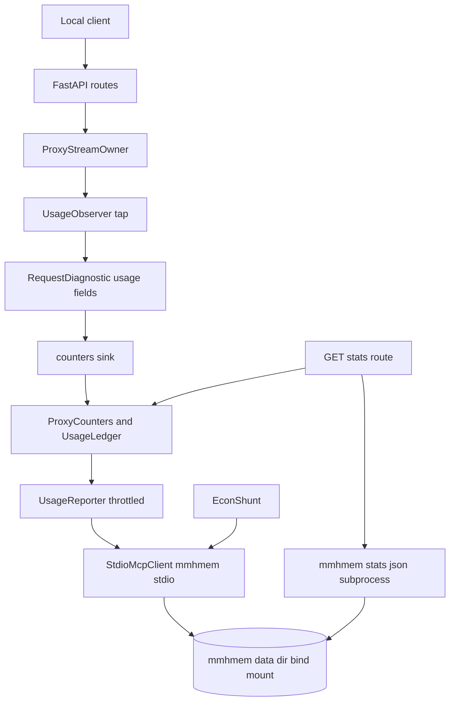
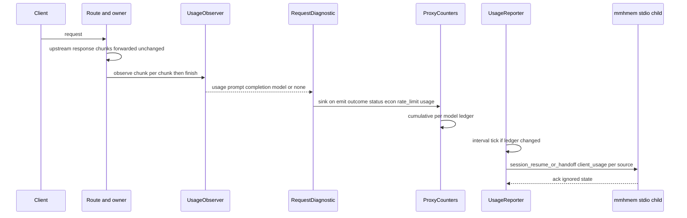

# Design Document — proxy-stats-propagation

## Overview

**Purpose**: Make the proxy a measured participant in mmhmem's statistics and give operators one place to read them. The proxy observes upstream `usage` without touching forwarded bytes, keeps cumulative in-process counters, reports them to the embedded mmhmem child as client-reported usage, serves `GET /stats` with mmhmem's statistics plus its own counters, and persists the child's state in `./mmhmem-data` next to the compose file.

**Users**: Operators running the proxy (Docker Compose or `uv run`) who want savings and spend in `mmhmem stats` and a local stats URL.

**Impact**: One new module `mvibe_proxy/stats.py`; a read-only observer seam in `mvibe_proxy/streaming.py`; a generic tool call on the existing stdio client in `mvibe_proxy/econ.py`; a sink and two numeric fields in `mvibe_proxy/diagnostics.py`; `/stats` route, lifespan wiring and `--stats` flag in `proxy.py`; Compose bind mount and defaults; `.gitignore` entry. Implemented after `upstream-rate-limit-queue` (shared files).

### Goals
- Record `usage` per upstream response passively (Req 1).
- Propagate cumulative usage to mmhmem under harness `mvibe-proxy` (Req 2).
- `GET /stats` with proxy counters and `mmhmem stats --json` (Req 3).
- Persistent `./mmhmem-data` by default in Compose (Req 4).
- No change to auth, economics contract or existing events (Req 5).

### Non-Goals
- Budgets or spend-based throttling; plugin-side stats; changes to mmhmem; caller authentication on `/stats`; documentation beyond release notes (handled at release).

## Boundary Commitments

### This Spec Owns
- `mvibe_proxy/stats.py`: `StatsConfig`, `UsageObserver`, `Usage`, `UsageLedger`, `ProxyCounters`, `UsageReporter`, `mmhmem_stats`.
- The observer seam in `_OwnedResponse`: an `observe_factory(upstream)` parameter on `ProxyStreamOwner.response(...)`, invoked once after acquisition and before `_stream_body`, whose returned callable receives every upstream chunk and a terminal `None`.
- `StdioMcpClient.call_tool` and the `shunt_content` wrapper refactor in `econ.py` (behavior of `shunt_content` unchanged).
- `RequestDiagnostic.usage` fields, the diagnostics sink hook, and `_ALLOWED_FIELDS` additions.
- `/stats` route, lifespan wiring (shared child, reporter start/stop, data-dir writability warning), `--stats` flag, startup URL line, OpenAPI entry.
- Compose bind mount and default `AGENT_MEM_*` keys, the `mmhmem-data/.gitkeep` placeholder, `.gitignore`, the Compose invariants test additions.

### Out of Boundary
- mmhmem internals (what `client_usage` means, how `stats` aggregates).
- Economics replacement logic, `EconShunt`, `econ_*` fields.
- Authentication, `mvibe_auth/**`, bridge protocol, the OpenCode plugin.
- The rate-limit gate itself; this spec only aggregates its per-request record.

### Allowed Dependencies
- stdlib (`json`, `asyncio`, `asyncio.subprocess`, `time`, `uuid`, `os`, `pathlib`), FastAPI/Starlette (existing), `httpx2` headers (existing).
- `mvibe_proxy.diagnostics` (record fields), `mvibe_proxy.econ.StdioMcpClient` (tool calls).
- Dependency direction: `diagnostics` → `stats` → `proxy.py`; `streaming` and `diagnostics` never import `stats`; `econ` never imports `stats`. `stats` imports `econ` only for the `StdioMcpClient` type.
- No new packages; `uv.lock` unchanged.

### Revalidation Triggers
- mmhmem changes the `client_usage` shape, the `--json` row fields, or the empty-stats text.
- Mistral stops sending `usage` in streamed responses.
- The `upstream-rate-limit-queue` record fields change (`GateRecord`).
- Compose project-directory semantics or the container uid change.

## Architecture

### Existing Architecture Analysis
- `_OwnedResponse._stream_body` iterates `upstream.aiter_bytes()` and optionally runs a mutating `transform`; a read-only tap belongs before the transform so raw and adapter routes see identical upstream bytes.
- `StdioMcpClient` speaks JSON-RPC to `mmhmem stdio` with one hard-coded tool; a generic call is a small generalization.
- `ProxyDiagnostics` middleware owns the per-request `RequestDiagnostic` and calls `emit()` in `finally`; that is the single place to feed in-process counters.
- The lifespan already composes optional economics and telemetry; stats slots in beside them.
- After `upstream-rate-limit-queue`: route handlers read the body first, `make_acquire` runs through a gate, and `RequestDiagnostic.rate_limit: GateRecord | None` exists.

### Architecture Pattern & Boundary Map



**Architecture Integration**
- Selected pattern: passive tap → in-process ledger → throttled push to mmhmem; pull view through `/stats`.
- Boundaries: `streaming.py` only calls an opaque `observe(chunk)`; `diagnostics.py` only calls an opaque sink; `stats.py` owns parsing, aggregation, reporting and the subprocess runner; `proxy.py` wires.
- Existing patterns preserved: `MVIBE_*` env config with fail-fast flag (`--stats` like `--econ`), allowlisted diagnostics, fail-open economics, injectable factories on `create_app`.
- Steering compliance: no content retained, no credentials in `/stats`, no auth changes, no account-specific defaults.

### Technology Stack

| Layer | Choice / Version | Role in Feature | Notes |
|-------|------------------|-----------------|-------|
| Proxy runtime | Python 3.12, FastAPI/Starlette, asyncio (existing) | observer, counters, reporter, route | stdlib `asyncio.create_subprocess_exec` for `mmhmem stats --json` |
| mmhmem child | embedded `mmhmem` 0.5.2 binary (existing) | `session_resume_or_handoff` with `client_usage`; `stats --json` | JSON contract from `src/cli/stats.rs` |
| Deployment | Docker Compose (existing) | bind mount `./mmhmem-data` | relative to compose file |
| Tests | pytest, `httpx2.MockTransport`, fake stdio client | observer parsing, reporter cadence, route | no real mmhmem binary in the offline gate |

## File Structure Plan

### Directory Structure
```
mvibe_proxy/
├── stats.py                     # NEW: StatsConfig, Usage, UsageObserver, UsageLedger, ProxyCounters, UsageReporter, mmhmem_stats
├── streaming.py                 # MOD: observe_factory(upstream) on response(...); observe(chunk) tap before transform
├── diagnostics.py               # MOD: RequestDiagnostic.usage (prompt/completion ints), sink callable fed in emit()
├── econ.py                      # MOD: StdioMcpClient.call_tool(name, arguments, timeout_ms); shunt_content delegates to it
└── observability.py             # MOD: allowlist usage_prompt_tokens, usage_completion_tokens
proxy.py                         # MOD: stats_config/stats factories on create_app; shared child; reporter; /stats route; --stats; startup URL; data-dir warning
docker-compose.yml               # MOD: ./mmhmem-data bind mount, AGENT_MEM_DATA_DIR/LOG_FILE and MVIBE_STATS_USAGE defaults on
.gitignore                       # MOD: mmhmem-data/* and !mmhmem-data/.gitkeep
mmhmem-data/.gitkeep             # NEW: keeps the bind-mount directory in the checkout, owned by the operator
tests/
├── test_stats.py                # NEW: config, observer (SSE/JSON/bounds/garbage), ledger, counters, reporter cadence, mmhmem_stats runner
├── test_proxy.py                # MOD: usage observed on /v1 chat (stream + non-stream) and embeddings; /stats route; --stats fail-fast
├── test_compat.py               # MOD: adapter routes record upstream usage
├── test_streaming.py            # MOD: observe tap never alters bytes; observer exceptions swallowed
├── test_proxy_diagnostics.py    # MOD: usage fields on the event
├── test_observability.py        # MOD: allowlist entries
├── test_econ.py                 # MOD: call_tool generic path; shunt_content unchanged
└── test_version_coupling.py     # MOD: compose declares ./mmhmem-data bind mount with AGENT_MEM_DATA_DIR
```

### Modified Files
- `mvibe_proxy/streaming.py` — `ProxyStreamOwner.response(acquire, diagnostic=None, transform=None, observe_factory=None)`; after `acquire()` returns, `_OwnedResponse.__call__` calls `observe = observe_factory(upstream)` (any exception → `None`); `_stream_body(upstream, send, transform=None, observe=None)` calls `observe(chunk)` on each upstream chunk before transform and `observe(None)` at completion inside a try/except that never raises. The adapter `replay()` path works unchanged because the factory runs on whatever `acquire()` returned.
- `mvibe_proxy/diagnostics.py` — `RequestDiagnostic.usage: tuple[int, int] | None`; `emit()` adds `usage_prompt_tokens`, `usage_completion_tokens` and finally calls the module-level sink (`set_counters_sink(callable | None)`) with the diagnostic; sink exceptions are swallowed.
- `mvibe_proxy/econ.py` — `async def call_tool(self, name: str, arguments: Mapping[str, object], *, timeout_ms: int) -> object` returns the raw `result`; `shunt_content` builds its arguments and parses via `_parse_shunt_result(await self.call_tool(...))`.
- `proxy.py` — `create_app(..., stats_config: StatsConfig | None = None, stats_runner=mmhmem_stats)`; lifespan starts the child when `econ_config` or `stats_config.usage`; `ProxyCounters` on `app.state.counters` with the diagnostics sink registered for the app's lifetime; `UsageReporter` started/stopped; `GET /stats`; routes and `adapter_post` pass an `observe_factory` building a `UsageObserver` per acquired upstream response, which records its result on the diagnostic; `main()` adds `--stats`, loads `StatsConfig.from_env()`, warns on unwritable `AGENT_MEM_DATA_DIR`, prints `Stats: http://<host>:<port>/stats`.

## System Flows

### Observe, aggregate, report



Flow decisions: the observer never raises into the stream (errors disable it for that response); the sink runs inside `emit()` which already never raises; the reporter ticks on an interval and skips unchanged ledgers; shutdown flushes once with a 2 s bound.

## Requirements Traceability

| Requirement | Summary | Components | Interfaces | Flows |
|-------------|---------|------------|------------|-------|
| 1.1 | chat usage recorded with model | UsageObserver, make_acquire | `feed/finish` | Observe |
| 1.2 | embeddings prompt_tokens | UsageObserver | same | Observe |
| 1.3 | all routes incl. adapters | tap before transform in `_stream_body` | `observe` param | Observe |
| 1.4 | bytes unchanged, bounded memory | `_stream_body` tap; 4 MiB JSON bound | — | Observe |
| 1.5 | unparseable → nothing | UsageObserver | returns None | — |
| 1.6 | only numbers and model | `Usage` value object | — | — |
| 1.7 | diagnostic fields | RequestDiagnostic.usage, allowlist | `usage_prompt_tokens`, `usage_completion_tokens` | — |
| 2.1 | cumulative client_usage per model | UsageLedger, UsageReporter, call_tool | `session_resume_or_handoff` params | Report |
| 2.2 | one batch per interval + shutdown ≤ 2 s | UsageReporter | `start/stop` | Report |
| 2.3 | cumulative per process, unique task id | UsageReporter task id | — | Report |
| 2.4 | failures counted, inference unaffected | UsageReporter | `report_failures` | — |
| 2.5 | enabled without binary → exit 2 | StatsConfig, main | `StatsConfigError` | — |
| 2.6 | shared child | lifespan | — | — |
| 2.7 | stats never enables economics | StatsConfig `MVIBE_STATS_MMHMEM_BIN`, compose defaults | `from_env` | — |
| 3.1 | /stats proxy counters | ProxyCounters.snapshot, route | JSON schema below | — |
| 3.2 | mmhmem stats --json bounded | mmhmem_stats | subprocess | — |
| 3.3 | unavailable reasons | mmhmem_stats | `unavailable` enum | — |
| 3.4 | no secrets/content | snapshot allowlist by construction | — | — |
| 3.5 | local, no upstream, no pacing | route registered before catch-all | — | — |
| 3.6 | startup URL line | main | stderr | — |
| 3.7 | OpenAPI entry | route `openapi_extra` | — | — |
| 4.1 | bind mount + defaults | docker-compose.yml | — | — |
| 4.2 | survives recreate | bind mount | — | — |
| 4.3 | unwritable warning | main data-dir check | stderr | — |
| 4.4 | gitignore | `.gitignore` | — | — |
| 4.5 | exec stats and /stats | compose, route | — | — |
| 4.6 | invariants kept | test_version_coupling | — | — |
| 5.1 | no auth/econ contract change | boundary; econ tests | — | — |
| 5.2 | unconfigured = today + /stats | StatsConfig defaults | — | — |
| 5.3 | new fields numeric + allowlisted | observability | — | — |

## Components and Interfaces

| Component | Domain/Layer | Intent | Req Coverage | Key Dependencies (P0/P1) | Contracts |
|-----------|--------------|--------|--------------|--------------------------|-----------|
| StatsConfig | config | `MVIBE_STATS_*` parsing, fail-fast | 2.5, 2.7, 5.2 | env (P0) | Service |
| UsageObserver / Usage | response tap | parse `usage` from SSE or JSON, bounded, silent | 1.1–1.6 | json (P0) | Service |
| ProxyCounters / UsageLedger | aggregation | per-outcome, per-model, econ, rate-limit aggregates | 1.7, 3.1 | diagnostics sink (P0) | Service, State |
| UsageReporter | propagation | throttled cumulative `client_usage` | 2.1–2.4, 2.6 | StdioMcpClient.call_tool (P0) | Service |
| mmhmem_stats | stats view | run `mmhmem stats --json` bounded | 3.2, 3.3 | asyncio.subprocess (P0) | Service |
| /stats route + lifespan + CLI | proxy | wire, serve, fail fast, warn, print URL | 2.5, 2.6, 3.1–3.7, 4.3 | FastAPI (P0) | API |
| Compose persistence | deployment | bind mount and defaults | 4.1, 4.2, 4.4–4.6 | Docker (P0) | — |

### Proxy stats module

#### StatsConfig

| Field | Detail |
|-------|--------|
| Intent | Operator switches for propagation and the stats view |
| Requirements | 2.5, 5.2 |

##### Service Interface
```python
class StatsConfigError(ValueError): ...

@dataclass(frozen=True)
class StatsConfig:
    usage: bool                      # MVIBE_STATS_USAGE in {1,true,yes,on}; default False
    report_interval_s: float         # MVIBE_STATS_REPORT_INTERVAL_S, default 60, > 0
    mmhmem_timeout_s: float          # MVIBE_STATS_MMHMEM_TIMEOUT_S, default 10, > 0
    mmhmem_bin: str | None           # MVIBE_STATS_MMHMEM_BIN, else MVIBE_ECON_MMHMEM_BIN; existing executable file when set
    project: str                     # from MVIBE_ECON_PROJECT, default 'mvibe'
    @classmethod
    def from_env(cls, env: Mapping[str, str] | None = None) -> "StatsConfig": ...
```
Postconditions: `usage=True` with `mmhmem_bin=None` raises `StatsConfigError` naming `MVIBE_STATS_USAGE` and `MVIBE_STATS_MMHMEM_BIN`; both binary keys set to different paths raise naming both; a set binary that is not an executable file raises naming its key (same rule as `EconConfig`); invalid numbers raise naming the variable; messages echo no values.

#### UsageObserver

| Field | Detail |
|-------|--------|
| Intent | Read-only tap extracting `usage` from one upstream response |
| Requirements | 1.1, 1.2, 1.3, 1.4, 1.5, 1.6 |

##### Service Interface
```python
@dataclass(frozen=True)
class Usage:
    prompt_tokens: int
    completion_tokens: int           # 0 for embeddings
    model: str | None

class UsageObserver:
    JSON_LIMIT = 4 * 1024 * 1024
    def __init__(self, *, content_type: str | None, model: str | None) -> None: ...
    def feed(self, chunk: bytes) -> None: ...        # never raises; SSE: line-buffer, parse only `data:` lines containing b'"usage"'; JSON: accumulate up to JSON_LIMIT then disable
    def finish(self) -> Usage | None: ...            # last usage seen (SSE) or parsed body usage (JSON); None otherwise
    def as_callable(self, diagnostic: RequestDiagnostic) -> Callable[[bytes | None], None]: ...  # chunk → feed; None → diagnostic.usage = finish()
```
Invariants: `feed` performs no I/O and never mutates its input; after an internal error the observer returns `None` for the rest of the response.

#### ProxyCounters and UsageLedger

| Field | Detail |
|-------|--------|
| Intent | In-process aggregates for `/stats` and the reporter |
| Requirements | 1.7, 3.1 |

##### Service Interface
```python
class UsageLedger:
    def add(self, usage: Usage) -> None: ...
    def totals(self) -> tuple[int, int]: ...
    def by_model(self) -> Mapping[str, tuple[int, int]]: ...
    @property
    def revision(self) -> int: ...                   # increments on add; reporter skips unchanged

class ProxyCounters:
    def __init__(self, *, clock: Callable[[], float] = time.time) -> None: ...
    def observe(self, diagnostic: RequestDiagnostic) -> None: ...   # the sink: outcome, status, econ fields, rate_limit record, usage
    def snapshot(self) -> dict[str, object]: ...     # JSON-safe
    usage: UsageLedger
```
`snapshot()` shape: `{"started_at": iso, "requests": {"total": n, "by_outcome": {...}, "by_status": {...}}, "usage": {"prompt_tokens": n, "completion_tokens": n, "by_model": {model: {...}}, "last_report_at": iso | null, "report_failures": n}, "econ": {"requests_with_econ": n, "eligible": n, "replaced": n, "bypassed": n, "pending": n, "est_saved_tokens": n}, "rate_limit": {"held_requests": n, "queued_ms_total": n, "rejections": n, "exhausted": n}}`. Only counters and fixed keys; model ids are the only free strings.

#### UsageReporter

| Field | Detail |
|-------|--------|
| Intent | Push cumulative usage to mmhmem on a throttle |
| Requirements | 2.1, 2.2, 2.3, 2.4, 2.6 |

##### Service Interface
```python
class UsageReporter:
    def __init__(self, client: StdioMcpClient, ledger: UsageLedger, *, project: str, interval_s: float,
                 task_id: str | None = None, clock=time.time, sleep=asyncio.sleep, warn: Callable[[str], None] | None = None) -> None: ...
    async def start(self) -> None: ...               # background loop: every interval_s, if ledger.revision changed → report()
    async def report(self) -> bool: ...              # one call per model source; returns True when all succeeded
    async def stop(self) -> None: ...                # cancel loop, final report bounded 2 s
    failures: int
    last_report_at: float | None
```
Call shape per source: `tools/call session_resume_or_handoff` with `{"project": project, "agent_harness": "mvibe-proxy", "workspace_task_id": task_id, "client_usage": {"prompt_tokens": p, "completion_tokens": c, "source": f"mvibe-proxy {model}"}}`; the result is discarded. `task_id` default `f"mvibe-proxy-{start_utc:%Y%m%dT%H%M%SZ}-{uuid4().hex[:8]}"`. Warn once when a failure streak starts; reset on success.

#### mmhmem_stats

```python
async def mmhmem_stats(bin_path: str | None, *, env: Mapping[str, str], timeout_s: float) -> dict[str, object]
# → {"available": True, "days": [...], "totals": {...}} parsed from `mmhmem stats --json` (its top-level keys are `days` and `totals`)
# → {"available": False, "reason": "not_configured" | "spawn_failed" | "timeout" | "exit_<code>" | "no_stats_yet" | "invalid_json"}
```
Runs `[bin_path, "stats", "--json"]` with the proxy's environment (so `AGENT_MEM_DATA_DIR`/`AGENT_MEM_LOG_FILE` apply), stdout capped at 8 MiB, kills on timeout. Non-JSON output starting with mmhmem's "No token-savings statistics" notice → `no_stats_yet`.

### Proxy wiring (proxy.py)
- `GET /stats` returns `{"proxy": counters.snapshot(), "mmhmem": await stats_runner(...)}`; registered before the catch-all routes; never touches the gate, econ or auth.
- `make_acquire` and the routes: `diagnostic.model` is set for `embeddings` as well as `chat/completions` (reuse `_request_model(payload)`), so embeddings usage carries its model (Req 1.2). Routes pass `observe_factory=lambda upstream: UsageObserver(content_type=upstream.headers.get('content-type'), model=diagnostic.model).as_callable(diagnostic)` to `stream_owner.response(...)`; the returned callable feeds chunks and, on the terminal `None`, stores `finish()` as `diagnostic.usage` (prompt, completion). `adapter_post` passes the same factory with its `replay` acquire. The ledger is updated through the diagnostics sink at `emit()`.
- `--stats` mirrors `--econ`: it requires `MVIBE_STATS_USAGE` and a resolvable binary, otherwise exit 2 naming the settings.
- Child ownership: when economics is on, `EconShunt.shutdown()` closes the child as today after `reporter.stop()`; in stats-only mode the lifespan owns the child and calls `mcp_client.shutdown()` itself after `reporter.stop()`.
- Lifespan: child when `econ_config is not None or (stats_config and stats_config.usage)`, spawned from `econ_config.mmhmem_bin` when economics is on, else from `stats_config.mmhmem_bin` (the same path by construction when both are set); `set_counters_sink(counters.observe)` on start, `set_counters_sink(None)` on shutdown; reporter `start()` after the child handshake, `stop()` before child shutdown.
- `main()`: `--stats` flag; `StatsConfig.from_env()` errors exit 2 when `--stats` or when `MVIBE_STATS_USAGE` is set, otherwise warn; data-dir check: if `AGENT_MEM_DATA_DIR` is set and not writable → `WARNING: AGENT_MEM_DATA_DIR=<path> is not writable by this user; create it before starting (mkdir -p) or fix ownership (uid 1000 in Docker)`; after config: `print(f'Stats: http://{host}:{port}/stats', file=sys.stderr)`.

### Compose persistence
- Economics stays opt-in exactly as today (`MVIBE_ECON_MMHMEM_BIN` set ⇒ economics on). Stats therefore gets its own binary key, `MVIBE_STATS_MMHMEM_BIN`, which defaults to `MVIBE_ECON_MMHMEM_BIN` when that is set, so one economics configuration also serves stats. Two different paths raise in `StatsConfig.from_env` naming both keys (Req 2.7).
- Compose defaults (active, not commented): `volumes: - "./mmhmem-data:/data/mmhmem"`, `environment: AGENT_MEM_DATA_DIR: /data/mmhmem`, `AGENT_MEM_LOG_FILE: /data/mmhmem/audit/mmhmem.log`, `MVIBE_STATS_USAGE: "1"`, `MVIBE_STATS_MMHMEM_BIN: /usr/local/bin/mmhmem`. The `MVIBE_ECON_*` keys remain commented. A stats-only child runs the same `mmhmem stdio` binary, receives only `session_resume_or_handoff` calls and needs no worker.
- Ownership on first start: Docker creates a missing bind-mount directory as root, which uid 1000 cannot write. The repository therefore commits `mmhmem-data/.gitkeep` with `.gitignore` entries `mmhmem-data/*` and `!mmhmem-data/.gitkeep`, so a fresh checkout already contains the directory owned by the operator; the startup warning (Req 4.3) covers deployments that remove it.
- Stale compose comments ("The binary is inert while economics stays off", the named-volume guidance) are rewritten to describe the stats-only child and the bind mount.
- `tests/test_version_coupling.py` asserts the compose file contains the active `./mmhmem-data:/data/mmhmem` mount and `AGENT_MEM_DATA_DIR: /data/mmhmem`, and that `mmhmem-data/.gitkeep` exists.

## Data Models

### Domain Model
- **Usage** (value): prompt_tokens, completion_tokens, model.
- **Ledger** (entity, per process): cumulative totals per model; monotonically increasing revision.
- **Report** (event): one `client_usage` per model source, cumulative, tagged with the process task id.
- Invariants: totals never decrease within a process; a source label is `mvibe-proxy <model>` or `mvibe-proxy unknown`.

### Data Contracts & Integration
- mmhmem `client_usage` request (per source) as in the reporter interface; mmhmem stores kind `client_reported` and counts the latest per (project, harness, task, source) per UTC day.
- `/stats` response: `{"proxy": <snapshot>, "mmhmem": {"available": bool, "days"?: [...DayAggregate], "totals"?: {...}, "reason"?: str}}` where `DayAggregate` fields are mmhmem's: `day`, `project`, `harness`, `avoided_input_tokens_est`, `frontier_prompt_tokens_client_reported`, `frontier_completion_tokens_client_reported`, `client_reported_sources`, `worker_prompt_tokens`, `worker_completion_tokens`, plus activity counts.
- Diagnostic event: `proxy_request` gains `usage_prompt_tokens`, `usage_completion_tokens` (ints, present only when observed).

## Error Handling

### Error Strategy
- Observer errors: swallowed per response; no usage recorded.
- Reporter errors (`McpError`, timeout, child not running): counted, one warning per streak, next tick retries; never affects requests.
- `/stats` mmhmem failures: `available: false` with reason; HTTP 200 with proxy counters.
- Config errors: exit 2 naming variables when explicitly requested; warning otherwise.
- Data dir unwritable: warning at startup; child failures stay fail-open as today.

### Monitoring
- `usage_*` fields on every observed request; `/stats` shows `report_failures` and `last_report_at`.

## Testing Strategy

### Unit Tests (`tests/test_stats.py`)
- `StatsConfig.from_env`: defaults; truthy forms of `MVIBE_STATS_USAGE`; enabled without binary raises naming both variables; invalid numbers (1 criterion 2.5, 5.2).
- `UsageObserver`: non-stream JSON with usage → `Usage`; SSE with usage in the last `data:` chunk split across two byte chunks → `Usage`; SSE without usage → None; JSON over 4 MiB → None; invalid JSON → None; embeddings usage → completion 0; a chunk that raises in a monkeypatched parser → None without exception (1.1, 1.2, 1.4, 1.5, 1.6).
- `UsageLedger`/`ProxyCounters`: totals and by_model; sink reads outcome/status/econ/rate_limit/usage from a `RequestDiagnostic`; snapshot is JSON-serializable and contains only fixed keys plus model ids (1.7, 3.1, 3.4).
- `UsageReporter` with a fake client: no call when the ledger is unchanged; one call per model with cumulative totals and the same task id after the interval; failure counted and warned once per streak; `stop()` flushes once within the 2 s bound (2.1–2.4).
- `mmhmem_stats` with a fake executable (a small Python script in the scratchpad or `tests/fixtures`) printing JSON, printing the empty notice, exiting non-zero, and sleeping past the timeout (3.2, 3.3).

### Integration Tests
- `tests/test_proxy.py`: `/v1/chat/completions` non-stream and stream with usage → diagnostic fields and ledger updated, forwarded bytes identical to upstream (1.1, 1.3, 1.4, 1.7); `/v1/embeddings` usage (1.2); `GET /stats` returns counters and the injected `stats_runner` result, is not sent upstream (3.1, 3.5); `main()` with `MVIBE_STATS_USAGE=1` and no binary exits 2 (2.5); startup prints the stats URL (3.6); lifespan starts the child with stats enabled and econ disabled, and shares it when both are enabled, using the injected `econ_client` (2.6).
- `tests/test_compat.py`: `/api/chat` streaming and `/v1/messages` record upstream usage (1.3).
- `tests/test_streaming.py`: `observe` receives every chunk and `None` at the end; an observer that raises does not change the forwarded bytes or the completion (1.4).
- `tests/test_econ.py`: `call_tool` generic path and `shunt_content` behavior unchanged (5.1).
- `tests/test_version_coupling.py`: compose bind mount and `AGENT_MEM_DATA_DIR` active; existing invariants (4.1, 4.6).

### Validation gate
- `uv run --offline --no-sync ruff check .`, `uv run --offline --no-sync pytest`; `.dagger/ci.py check` (native Dagger CLI on the Podman engine since 2026-11-10) remains the container gate (image builds; compose not executed in CI). A manual live check (`docker compose up`, a chat request, `docker compose exec proxy mmhmem stats`, `curl /stats`) is recorded in `docs/live-results.md` when performed, outside the offline gate.

## Security Considerations
- `/stats` has no caller authentication, like every proxy endpoint; the bind default stays loopback and the existing non-loopback warning covers it.
- The response includes the project name and data directory path only; no credentials, prompts or bodies.
- The usage report carries numbers and a model label only.

## Performance & Scalability
- Observer cost: a substring check per SSE line and one JSON parse for lines containing `"usage"`; non-stream bodies parse once, bounded at 4 MiB.
- Reporter: at most one batch per interval; `/stats` spawns one short-lived process per call.
