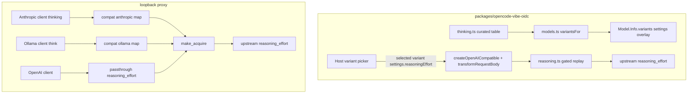

# Design Document — thinking-levels

## Overview

**Purpose**: Give clients of the mvibe proxy and of the `vibe-oidc` OpenCode provider the same selectable thinking levels Vibe offers (`../mistral-vibe`): curated per-model levels exposed as model variants on the plugin route, and `thinking`/`think` → `reasoning_effort` mapping on the proxy's Anthropic/Ollama dialects. The Mistral upstream field is the top-level `reasoning_effort` (`none` for off).

**Users**: OpenCode users of `vibe-oidc/*` (pick a level in the host variant picker); any OpenAI/Anthropic/Ollama-dialect client of the loopback proxy (set `reasoning_effort` / `thinking` / `think` directly).

**Impact**: one new plugin module `packages/opencode-vibe-oidc/src/thinking.ts` + a change in `src/models.ts` and `src/reasoning.ts`; adapter mappings in `mvibe_proxy/compat.py`; tests in both repos; docs. No new runtime dependency; responses untouched; no new diagnostics fields.

### Goals
- Curated variants per model, exactly the levels the Mistral API accepts (Req 1); `reasoning_effort` proven to survive SDK + host to the wire (Req 2); replay gated (Req 3); proxy passthrough + dialect mappings (Req 4–6); offline verification (Req 7).

### Non-Goals
- Levels for models without a known row; operator-injected variants; custom per-model level words; token-budget mapping beyond thresholds; changes to `/v1/models` payload or responses; usage metering.

## Boundary Commitments

### This Spec Owns
- `packages/opencode-vibe-oidc/src/thinking.ts`: the curated table `ROWS` with a comment citing `../mistral-vibe .../known_models.py:77-101`, plus `variantsFor(modelId)` returning `Model.Variant[]` with `settings: { reasoningEffort }` (`none` for off) and a `reasoningSupported(modelId, level)` helper. `settings` (not `body`) because OpenCode 2.2.5 merges variant settings into request options on the openai-compatible SDK path, which emits `reasoning_effort`; `body` overlays are dropped there (verified empirically against the pinned host).
- `src/models.ts`: attach `variantsFor(id)` in `mapModel` (amending the no-fabricated-variants comment); metadata boundary unchanged.
- `src/reasoning.ts`: accept the model/level and strip `reasoning_content` when reasoning is not supported.
- `src/index.ts`: pass the selected model/level into `mistralRequestBody` via the SDK hook.
- `mvibe_proxy/compat.py`: `reasoning_effort` mapping in `anthropic_messages_request` (`thinking`) and `_ollama_options`/`ollama_chat_request`/`ollama_generate_request` (`think`).
- Tests: `packages/opencode-vibe-oidc/test/thinking.test.ts` (+ SDK passthrough and host-integration arms), `tests/test_compat.py` additions, `tests/test_proxy.py` passthrough regression.
- Docs: `docs/opencode-provider.md`, `docs/proxy-guide.md`, release-notes entry.

### Out of Boundary
- Upstream `/v1/models` shape; the `opencode` host provider's own catalog; `proxy-econ-client` (request-body rewrite) — the two features compose but this spec does not touch econ code; authentication; observability allowlist (unchanged); streaming/response path.

### Allowed Dependencies
- Plugin: `@opencode/plugin` types (`Model.Variant`), existing `transformRequestBody` hook, Bun test runner. No new package.
- Proxy: stdlib only in `compat.py`.
- Dependency direction unchanged: `models.ts` → `thinking.ts`; `index.ts` → `reasoning.ts`; no cycles.

### Revalidation Triggers
- OpenCode host contract changes how variant `settings` are merged into request options for `@ai-sdk/openai-compatible` providers, or stops honoring plugin-provided `Model.Info.variants` (pinned `opencode-2.2.5.json`).
- `@ai-sdk/openai-compatible` starts stripping unknown top-level fields (breaks Req 2).
- Mistral API changes accepted `reasoning_effort` values per model (e.g. large-4 starts accepting `none`) — update the table from the mistral-vibe reference.
- mistral-vibe reference rows change (`../mistral-vibe` known_models / wire mapping).
- `proxy-econ-client` starts rewriting `reasoning_effort` or top-level fields.

## Architecture

### Existing Architecture Analysis
- Plugin: `src/models.ts` maps upstream inventory to `Model.Info` with `variants: []`; `src/index.ts` registers an `aisdk` `sdk` hook building `createOpenAICompatible({ ..., transformRequestBody: mistralRequestBody })`; `src/reasoning.ts` replays `reasoning_content` as thinking chunks.
- Proxy: all dialects converge on an upstream-shaped body in `make_acquire`; OpenAI-dialect bodies pass through (`attach_request_metadata` re-dump preserves fields); `compat.py` adapters build the upstream body for Anthropic/Ollama and currently ignore their thinking fields.

### Architecture Pattern & Boundary Map

- Selected pattern: **host-native variants** (plugin) + **adapter translation** (proxy). No proxy rewrite for the OpenAI dialect.
- Existing patterns preserved: no fabrication beyond the curated table; responses byte-exact; allowlisted diagnostics untouched; unset level sends nothing.

### Technology Stack

| Layer | Choice / Version | Role | Notes |
|---|---|---|---|
| Plugin catalog | `@opencode/plugin` 2.2.5 `Model.Variant` | variants with `settings.reasoningEffort` overlay | pinned contract `test/tool-compatibility/contracts/opencode-2.2.5.json` |
| Plugin SDK | `@ai-sdk/openai-compatible` 2.0.88 | passthrough proof via `transformRequestBody` regression | same pattern as `test/reasoning.test.ts` |
| Proxy adapters | `mvibe_proxy/compat.py` (stdlib) | `thinking`/`think` → `reasoning_effort` | Ollama clamps nothing upstream (upstream is Mistral) |
| Reference | `../mistral-vibe` | level semantics, known rows, wire mapping | read-only reference, not a dependency |

### Data Flow
1. OpenCode user picks `vibe-oidc/mistral-large-4#high` → host merges the variant's `settings.reasoningEffort: "high"` into the request options → the installed SDK emits `reasoning_effort: "high"` on the wire (proven by SDK regression + pinned-host integration test) → Mistral API.
2. Anthropic client sends `thinking: {type: "enabled", budget_tokens: 32000}` → `compat.py` sets `reasoning_effort: "high"` on the upstream body.
3. Ollama client sends `think: false` → upstream `reasoning_effort: "none"` (relayed 4xx for models that reject it).
4. `reasoning.ts` strips assistant `reasoning_content` when the model/level has no reasoning support.

## Security Considerations
- The level name is a small enum, not content; it is never added to diagnostics in v1, so no allowlist change.
- No credentials, URLs or payloads in any new log/test output; tests use synthetic bodies only.

## Testing Strategy
- Plugin: `test/thinking.test.ts` — table contents per alias group; `variantsFor` output shape; SDK `generate`/`stream` passthrough of `reasoning_effort`; host-integration variant application; `reasoning.ts` gating arms.
- Proxy: `tests/test_compat.py` — each `thinking`/`think` arm + malformed input; `tests/test_proxy.py` — OpenAI-dialect `reasoning_effort` passthrough, stream and non-stream.
- Gates: `bun --no-install test`, `bun run typecheck && bun run build`, `uv run --locked --offline -- pytest -q`, full `scripts/verify.ps1` gate.

## Open Questions
- Exact host syntax for selecting a variant from config/CLI (e.g. `#variant` suffix) — verify against the pinned host during task 3 and document it.
- Whether `opencode` provider catalog levels (`none`/`high` for mistral-large-4) conflict with the curated table when both providers are installed — cosmetic only; each provider lists its own variants.
