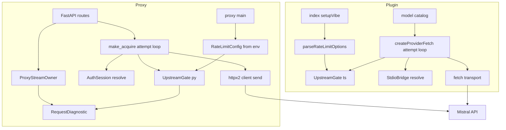
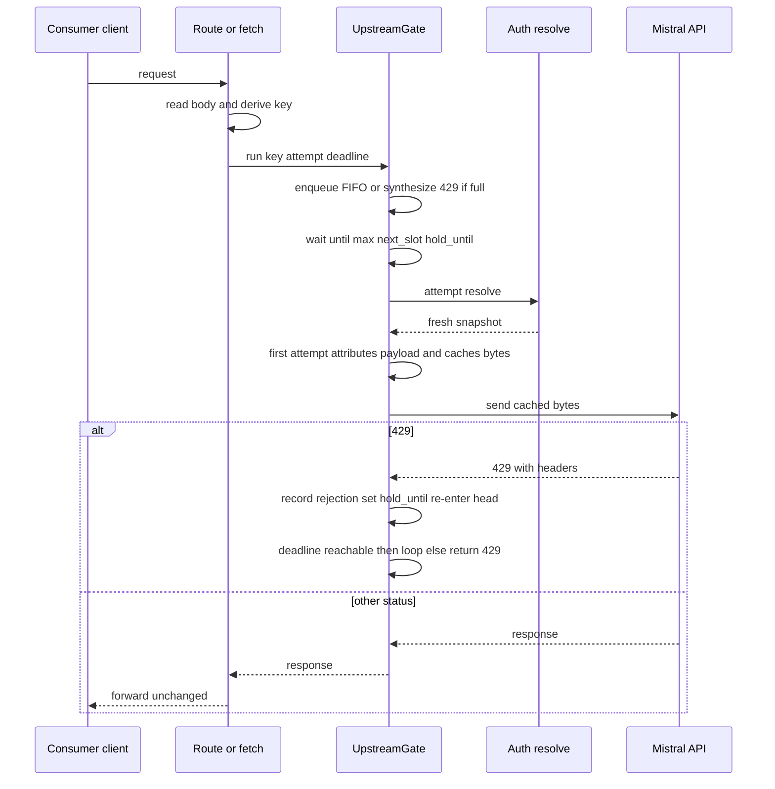
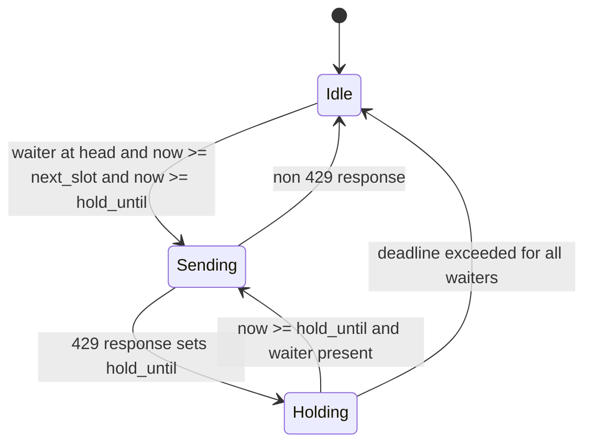

# Design Document — upstream-rate-limit-queue

## Overview

**Purpose**: Give both mvibe consumers, the local proxy and the OpenCode provider plugin, one upstream gate that recognizes a Mistral 429 as a pacing signal, holds the request before any response is started, re-sends it when the upstream allows, and optionally paces outbound requests to a configured per-second rate. Consumers see latency instead of failures.

**Users**: Agent clients behind the proxy (OpenAI, Ollama and Anthropic dialects) and OpenCode sessions using the Mistral-Vibe provider; operators tuning the rate for their workspace (0.5 requests per second for Mistral Large on the reporting workspace).

**Impact**: One new module per consumer (`mvibe_proxy/ratelimit.py`, `src/rate-limit.ts`), a hold-and-re-send loop at the existing resolve-then-send seam (`proxy.make_acquire`, `createProviderFetch`), earlier disconnect observation plus header forwarding in `mvibe_proxy/streaming.py`, new diagnostic fields, and configuration via `MVIBE_RATE_LIMIT_*` and `options.rateLimit`. Authentication, the bridge protocol and successful first-attempt forwarding are untouched.

### Goals
- Detect 429 on status alone, use `Retry-After` when present, bounded jittered backoff otherwise (Req 1).
- Hold and re-send before response start in FIFO per model, with bounded wait and depth, on every proxy route and in the plugin fetch (Req 2, 4).
- Optional proactive pacing per default and per model (Req 3).
- Diagnostics for held duration, rejection count and exhaustion (Req 5), under the existing allowlist and no-content rules.
- No contract changes to auth, bridge or passthrough (Req 6).

### Non-Goals
- Cross-process coordination between a running proxy and a running plugin.
- Predicting tokens-per-minute or tokens-per-month consumption.
- Re-sending after response headers have been sent; handling of 5xx or network errors (unchanged).
- Persisting held requests across restarts; circuit breaking.
- Documentation updates (release notes handle the new settings).

## Boundary Commitments

### This Spec Owns
- `mvibe_proxy/ratelimit.py`: configuration, 429 classification, `Retry-After` parsing, backoff policy, and the `UpstreamGate` hold/pace/re-send loop for the proxy.
- `packages/opencode-vibe-oidc/src/rate-limit.ts`: the same four responsibilities for the plugin.
- The attempt loop around resolve + send in `proxy.make_acquire` and in `createProviderFetch`, including per-attempt credential resolution and retention of the prepared body bytes for re-sends.
- Disconnect observation during acquisition (owned responses and adapter pre-translation acquisition) and `Retry-After` / `x-ratelimit-*` header forwarding on 429 in `mvibe_proxy/streaming.py`; header passthrough on adapter error responses in `proxy.adapter_post`.
- The `GateRecord` per-request record, new diagnostic fields and the `rate_limited` outcome in `mvibe_proxy/diagnostics.py`, their export allowlist entries in `mvibe_proxy/observability.py`, and the plugin's `provider_request` diagnostic fields.
- Configuration parsing and fail-fast validation in `proxy.main` and `index.settings`.

### Out of Boundary
- `mvibe_auth/*` and `src/bridge.ts`, `src/protocol*`: no credential, snapshot or protocol changes; `HELPER_API_MAJOR` untouched.
- Econ shunt, metadata attribution, compat translators: their logic is unchanged; they run exactly once per request (attribution and econ on the first attempt, with that attempt's snapshot) and the resulting bytes are reused for re-sends.
- OpenCode host retry policy, SDK `maxRetries` (stays 0), `x-should-retry` (stays `false`).
- Model catalog logic in `src/models.ts`: it benefits through the shared fetch but is not modified.
- Live acceptance against the real workspace (recorded separately; no paid inference in the offline gate).

### Allowed Dependencies
- Python: stdlib (`asyncio`, `time`, `random`, `email.utils` for HTTP-date), `httpx2` response objects, existing `mvibe_proxy.diagnostics`. No new packages.
- TypeScript: Bun/Web standard `Request`, `Response`, `AbortSignal`, timers; existing `BridgeError`. No new packages.
- Dependency direction (imports only flow left to right): `diagnostics.GateRecord` → `ratelimit` config/policy → `UpstreamGate` → `proxy.make_acquire` / `provider.ts` → routes / `index.ts`. `streaming.py` and `diagnostics.py` never import `ratelimit`; the gate fills a `GateRecord` that `diagnostics.py` defines and owns.

### Revalidation Triggers
- A change to the response-start header set forwarded by `_OwnedResponse` (consumers relying on `Retry-After`).
- A change to the `provider_request` or `proxy_request` diagnostic field names (exporter allowlist, OpenObserve dashboards).
- A change to the environment variable or `options.rateLimit` names (installer and docs).
- Any move of the attempt loop that would re-run econ or metadata attribution on later attempts.
- A host change that makes `AbortSignal` unavailable in `fetch` or alters `x-should-retry` semantics.

## Architecture

### Existing Architecture Analysis
- The proxy composes FastAPI routes whose handlers hand an `acquire()` coroutine to `ProxyStreamOwner.response`; `acquire()` reads the body, prepares the payload, resolves a credential snapshot and sends with `stream=True`. Adapter routes call `acquire()` themselves and translate `status >= 400` through `compat.adapter_error`.
- `_OwnedResponse` awaits acquisition first and only then starts the disconnect watcher, because body reading and the watcher both consume ASGI `receive()`. Starlette caches a body once read, so a route-level body read removes that constraint. `adapter_post` awaits `acquire()` directly in the route handler with no watcher at all, and the server does not cancel a handler on client disconnect.
- Metadata attribution needs the credential snapshot (`account_plan.resolve(snapshot)`), so the attributed payload cannot be prepared before the first resolve; it must be produced inside the first attempt and reused afterwards.
- The plugin's `createProviderFetch` is the single outbound path for inference and discovery; it resolves per fetch, rewrites headers, materializes chat bodies for native attribution, and forwards the response with `x-should-retry: false`.
- Diagnostics in both consumers carry fixed field names, no content, and (proxy) an exporter allowlist by construction.

### Architecture Pattern & Boundary Map



**Architecture Integration**
- Selected pattern: a per-process, per-key "earliest allowed send time" gate wrapping the existing resolve-then-send attempt. Pacing and 429 holds are the same primitive.
- Domain boundaries: the gate knows nothing about HTTP routing, auth or bodies; it schedules an `attempt` callable and inspects only the status and headers of its result. Routes and the provider fetch own payload preparation and the final response shape.
- Existing patterns preserved: injectable factories on `create_app`, `MVIBE_*` env parsing with fail-fast in `main`, labeled `setup` failures in `index.ts`, allowlisted diagnostics, byte-exact passthrough on success.
- New components rationale: `RateLimitConfig` (operator surface), `classify` (one detector), `UpstreamGate` (ordering, pacing, hold, bounds) in each language because the two consumers run in different runtimes and processes.
- Steering compliance: no credential replay beyond per-attempt resolve; no content in diagnostics; no account-specific defaults (the 0.5 rate is configuration, not code); no host automation.

### Technology Stack

| Layer | Choice / Version | Role in Feature | Notes |
|-------|------------------|-----------------|-------|
| Proxy runtime | Python 3.12, asyncio, FastAPI/Starlette (existing), httpx2 2.16.0 | Gate scheduling, body read in routes, response construction | stdlib `email.utils.parsedate_to_datetime` for HTTP-date `Retry-After` |
| Proxy diagnostics | structlog 25.5.0 (existing), OpenObserve exporter (existing) | New numeric fields, `rate_limited` outcome | Allowlist extended by name only |
| Plugin runtime | TypeScript 5.9.3 on Bun 1.4.4, `@opencode/plugin` 2.2.5 (existing) | Gate scheduling with `AbortSignal`, body bytes materialization | No new dependency |
| Tests | pytest + `tests/fakes.Clock`; `bun test` with injected `now`/`sleep` | Deterministic pacing and hold tests without real sleeps | No live inference in the gate |

## File Structure Plan

### Directory Structure
```
mvibe_proxy/
├── ratelimit.py                 # NEW: RateLimitConfig, classify, parse_retry_after, backoff, UpstreamGate
├── streaming.py                 # MOD: watcher before acquisition; acquire_watching helper for adapters; forward retry-after and x-ratelimit-* on 429
├── diagnostics.py               # MOD: GateRecord dataclass, rate_limit field, 'rate_limited' failure code, 429 hint
└── observability.py             # MOD: allowlist queued_ms, rate_limit_rejections
proxy.py                         # MOD: body read in routes; attempt loop in make_acquire; adapter acquisition through acquire_watching; gate injection; env validation in main
tests/
├── test_ratelimit.py            # NEW: config, classify, backoff, gate ordering/pacing/hold/bounds/cancel
├── test_proxy.py                # MOD: 429 then 200 through /v1; exhaustion 429 with Retry-After; pacing spacing; fresh resolve per attempt; main() env validation
├── test_streaming.py            # MOD: disconnect during acquisition; acquire_watching; 429 header forwarding
├── test_compat.py               # MOD: adapter exhaustion keeps dialect body and Retry-After; adapter disconnect during hold sends nothing
├── test_proxy_diagnostics.py    # MOD: new fields and outcome
└── test_observability.py        # MOD: allowlist entries
packages/opencode-vibe-oidc/src/
├── rate-limit.ts                # NEW: RateLimitOptions, parseRateLimitOptions, classifyRateLimit, parseRetryAfter, UpstreamGate, GateRecord
├── provider.ts                  # MOD: body bytes once; attempt loop with per-attempt resolve; key; diagnostics fields
└── index.ts                     # MOD: parse options.rateLimit; construct gate; pass to createProviderFetch
packages/opencode-vibe-oidc/test/
├── rate-limit.test.ts           # NEW: options, classify, gate behavior with fake timers
├── provider.test.ts             # MOD: 429 then 200 in one fetch; abort during hold; exhaustion passthrough; identical re-send
├── setup.test.ts                # MOD: invalid rateLimit option fails setup with option name
└── diagnostics.test.ts          # MOD: queued_ms and rate_limit_rejections present when enabled
```

### Modified Files
- `proxy.py` — routes read the body before handing the request on; `make_acquire` parses the body once for the key, then runs `attempt` (resolve, first-attempt attribution and econ with cached bytes, send) through `app.state.rate_gate.run(key, attempt, ...)`; `adapter_post` acquires through `stream_owner.acquire_watching(...)` and forwards `Retry-After`/`x-ratelimit-*` on error responses; `create_app` gains `rate_limit_config` and `gate_factory`; `main()` loads `RateLimitConfig.from_env()` and exits 2 on `RateLimitConfigError`.
- `mvibe_proxy/streaming.py` — `_OwnedResponse.__call__` starts the disconnect task group around acquisition; new `ProxyStreamOwner.acquire_watching(receive, acquire, diagnostic)` runs an acquisition under the same disconnect watcher for callers that need the upstream response before building their response; `http.response.start` adds `retry-after` and every `x-ratelimit-*` header only when the upstream status is 429.
- `mvibe_proxy/diagnostics.py` — new `GateRecord` dataclass; `RequestDiagnostic.rate_limit: GateRecord | None`; emit adds `queued_ms`, `rate_limit_rejections`, `rate_limit_headers` (stdout only); `failure('rate_limited')`; `upstream(429)` yields outcome `rate_limited` when the record is exhausted.
- `mvibe_proxy/observability.py` — `_ALLOWED_FIELDS` += `queued_ms`, `rate_limit_rejections`.
- `packages/opencode-vibe-oidc/src/provider.ts` — `ProviderFetchOptions.gate?: UpstreamGate`; body materialized to bytes once for every non-GET request; attempt loop; `diagnostic.queued_ms`, `diagnostic.rate_limit_rejections`, outcome `rate_limited`.
- `packages/opencode-vibe-oidc/src/index.ts` — `settings()` parses `options.rateLimit`; `setupVibe` constructs one `UpstreamGate` per plugin instance and passes it to `createProviderFetch`.

## System Flows

### Hold and re-send (both consumers)



Flow decisions: the deadline is `arrival + max_wait`; a `Retry-After` value is floored at the key's pacing interval (1 s when unpaced) so a zero or past `Retry-After` never produces back-to-back re-sends; the exhaustion decision uses the unclamped wait (`now + wait > deadline`, decided before any clamping, so a `Retry-After` longer than the remaining wait never yields an extra re-send exactly at the deadline); if the resulting `hold_until` lies beyond the deadline the gate stops waiting and returns the last 429 (materialized in the proxy, unread in the plugin) with `Retry-After` ensured: the upstream value when it parses and is at least 1 s, otherwise the remaining hold rounded up (minimum 1). Client disconnect or `AbortSignal` cancels the wait, removes the waiter, and never sends. Pacing advances `next_slot` only for paced keys; the `models` key is never paced. Attribution and econ run inside the first attempt because they need that attempt's credential snapshot; later attempts re-send the cached bytes with a fresh snapshot's headers.

### Gate key state



## Requirements Traceability

| Requirement | Summary | Components | Interfaces | Flows |
|-------------|---------|------------|------------|-------|
| 1.1 | 429 is a rate-limit rejection by status | `classify` (py/ts) | `classify(status, headers)` | Hold and re-send |
| 1.2 | Use `Retry-After` when present | `parse_retry_after` | `parse_retry_after(value, now)` | — |
| 1.3 | Jittered backoff fallback, 1 s or pacing interval, cap 30 s | `backoff_wait` in gate | `RateLimitConfig.backoff_cap_s` | Hold and re-send |
| 1.4 | Record `x-ratelimit-*` headers | `GateRecord.headers`, diagnostics | `GateRecord` | — |
| 1.5 | Only 429 | `classify` | returns `None` otherwise | — |
| 1.6 | No content in diagnostics | diagnostics, GateRecord | fixed numeric fields and header names | — |
| 2.1 | Hold and re-send before response start | `UpstreamGate.run`, `make_acquire` | `run(key, attempt, arrived, record)` | Hold and re-send |
| 2.2 | FIFO per model during hold | `UpstreamGate` key state | key queue | Gate key state |
| 2.3 | Connection open, no bytes while held | `_OwnedResponse` acquisition before start | — | — |
| 2.4 | Disconnect while held discards | `_OwnedResponse` watcher before acquire; `ProxyStreamOwner.acquire_watching` for adapters; gate cancel path | `CancelledError` handling | Hold and re-send |
| 2.5 | Exhaustion returns 429 with `Retry-After`, last body forwarded | `UpstreamGate.run` exhaustion response; `adapter_post` header passthrough | `run` postconditions | Hold and re-send |
| 2.6 | All routes including adapters | `make_acquire` shared by `proxy` and `adapter_post`; `adapter_post` acquires through `acquire_watching` | — | — |
| 2.7 | No re-send after start | attempt loop lives inside `acquire()`; `_OwnedResponse` unchanged after start | — | — |
| 2.8 | Fresh snapshot per attempt | `attempt` closure contains `session.resolve` | — | Hold and re-send |
| 3.1 | Default rps pacing FIFO | `UpstreamGate.next_slot` | `RateLimitConfig.default_rps` | Gate key state |
| 3.2 | Per-model rates | `RateLimitConfig.model_rps`, `rate_for(key)` | — | — |
| 3.3 | No pacing when unconfigured | `rate_for` returns `None` | — | — |
| 3.4 | Invalid config fails fast | `RateLimitConfig.from_env`, `parseRateLimitOptions`, `main`, `settings` | `RateLimitConfigError`, `BridgeError('setup')` | — |
| 3.5 | Discovery never paced | key `models` excluded from pacing | `key_for(path, model)` | — |
| 3.6 | Overridable wait and depth | `RateLimitConfig`, `RateLimitOptions` | env and options names | — |
| 4.1 | Plugin hold/re-send, same rules | `UpstreamGate` ts, `createProviderFetch` loop | `run(key, attempt, signal, record)` | Hold and re-send |
| 4.2 | Abort while held discards | gate abort listener | `BridgeError('cancelled')` | — |
| 4.3 | Exhaustion returns upstream 429 unchanged | gate returns last response | `x-should-retry: false` kept | — |
| 4.4 | Host retries stay disabled | `index.ts` `maxRetries = 0`; `provider.ts` header | — | — |
| 4.5 | Discovery under its deadline | abort propagation from `models.ts` signal | — | — |
| 4.6 | Fresh snapshot per attempt | attempt closure calls `bridge.request('resolve')` | — | — |
| 4.7 | Options in OpenCode config | `parseRateLimitOptions(options.rateLimit)` | `RateLimitOptions` | — |
| 5.1 | queued_ms and rejection count | `GateRecord` → diagnostics (py/ts) | `queued_ms`, `rate_limit_rejections` | — |
| 5.2 | Distinct exhaustion outcome and hint | `RequestDiagnostic.failure('rate_limited')`, ts `outcome: 'rate_limited'` | — | — |
| 5.3 | One warning per hold start | gate `warn(key, wait)` callback → `logging`/`console.warn` | — | — |
| 5.4 | Exported fields allowlisted | `observability._ALLOWED_FIELDS` | — | — |
| 5.5 | Plugin fields only in opt-in diagnostics | existing `options.diagnostics` gate in `provider.ts` | — | — |
| 6.1 | No auth/protocol change | boundary; validation task diff check | — | — |
| 6.2 | First-attempt success byte-exact | gate returns response object unchanged | — | — |
| 6.3 | Bounded memory | `max_queue` across keys; 429 body cap 64 KiB | — | — |
| 6.4 | Forward `Retry-After`/`x-ratelimit-*` | `_OwnedResponse` headers; `adapter_post`; plugin passthrough | — | — |

## Components and Interfaces

| Component | Domain/Layer | Intent | Req Coverage | Key Dependencies (P0/P1) | Contracts |
|-----------|--------------|--------|--------------|--------------------------|-----------|
| RateLimitConfig (py) | Proxy config | Parse and validate `MVIBE_RATE_LIMIT_*` | 3.1–3.4, 3.6 | os.environ (P0) | Service |
| classify / parse_retry_after (py) | Proxy policy | Turn a 429 into a wait signal | 1.1–1.5 | httpx2 headers (P0) | Service |
| UpstreamGate (py) | Proxy scheduling | FIFO per key, pacing, hold, bounds, exhaustion response | 2.1, 2.2, 2.5, 3.1–3.3, 3.5, 5.1, 5.3, 6.3 | asyncio (P0), classify (P0) | Service, State |
| make_acquire attempt loop | Proxy routes | Parse once, attribute on first attempt, resolve+send per attempt through the gate | 2.6–2.8, 3.5, 6.2 | UpstreamGate (P0), AuthSession (P0) | Service |
| _OwnedResponse and acquire_watching | Proxy streaming | Observe disconnect during acquisition (owned and adapter paths); forward rate-limit headers on 429 | 2.3, 2.4, 2.6, 2.7, 6.4 | anyio (P0) | State |
| Proxy diagnostics | Proxy observability | GateRecord, new fields, outcome, hint, allowlist | 1.4, 1.6, 5.1, 5.2, 5.4 | structlog (P1), exporter (P1) | Event |
| RateLimitOptions / parseRateLimitOptions (ts) | Plugin config | Parse `options.rateLimit` | 3.4, 3.6, 4.7 | BridgeError (P0) | Service |
| classifyRateLimit / parseRetryAfter (ts) | Plugin policy | Same as py | 1.1–1.5 | Response headers (P0) | Service |
| UpstreamGate (ts) | Plugin scheduling | Same as py with AbortSignal | 4.1, 4.2, 4.3, 4.5, 5.1, 5.3, 6.3 | timers (P0) | Service, State |
| createProviderFetch attempt loop | Plugin fetch | Body bytes once; resolve+send per attempt; passthrough | 4.1, 4.3, 4.4, 4.6, 5.5, 6.2 | UpstreamGate (P0), StdioBridge (P0) | Service |

### Proxy policy and scheduling

#### RateLimitConfig (py)

| Field | Detail |
|-------|--------|
| Intent | Operator configuration for pacing and bounds, validated at startup |
| Requirements | 3.1, 3.2, 3.3, 3.4, 3.6 |

**Responsibilities & Constraints**
- Frozen dataclass: `default_rps: float | None`, `model_rps: Mapping[str, float]`, `max_wait_s: float = 120`, `max_queue: int = 64`, `backoff_cap_s: float = 30`.
- `from_env(env=os.environ)` reads `MVIBE_RATE_LIMIT_RPS`, `MVIBE_RATE_LIMIT_MODEL_RPS` (`model=rps[,model=rps]`), `MVIBE_RATE_LIMIT_MAX_WAIT_S`, `MVIBE_RATE_LIMIT_MAX_QUEUE`, `MVIBE_RATE_LIMIT_BACKOFF_CAP_S`; any unparsable or non-positive value raises `RateLimitConfigError` whose message names the variable and never echoes other environment values.
- `rate_for(key) -> float | None`: model override, else default; `None` for key `models`.
- Unset variables produce the defaults with `default_rps=None` (reactive only).

**Dependencies**
- External: `os.environ` — settings source (P0).

**Contracts**: Service [x]

##### Service Interface
```python
class RateLimitConfigError(ValueError): ...

@dataclass(frozen=True)
class RateLimitConfig:
    default_rps: float | None
    model_rps: Mapping[str, float]
    max_wait_s: float
    max_queue: int
    backoff_cap_s: float
    @classmethod
    def from_env(cls, env: Mapping[str, str] | None = None) -> "RateLimitConfig": ...
    def rate_for(self, key: str) -> float | None: ...
```
Preconditions: none. Postconditions: every numeric field is positive; `rate_for('models')` is `None`.

#### classify and parse_retry_after (py)

| Field | Detail |
|-------|--------|
| Intent | Convert an upstream response into a rate-limit signal or `None` |
| Requirements | 1.1, 1.2, 1.3, 1.4, 1.5 |

**Contracts**: Service [x]

##### Service Interface
```python
@dataclass(frozen=True)
class RateLimitSignal:
    wait_s: float                      # final wait for this rejection
    retry_after_present: bool
    headers: Mapping[str, str]         # only names starting with 'x-ratelimit-', values <= 64 chars

def parse_retry_after(value: str | None, now: float) -> float | None: ...
def classify(status: int, headers: Mapping[str, str], *, fallback_wait_s: float, cap_s: float, now: float) -> RateLimitSignal | None: ...
```
Preconditions: `fallback_wait_s > 0`. Postconditions: returns `None` unless `status == 429`; `0 < wait_s <= cap_s` unless `Retry-After` is present, in which case `wait_s` is the parsed value (HTTP-date in the past yields `0`); the gate clamps it to `max_wait_s` and treats a resulting `hold_until` past the deadline as exhaustion.

#### UpstreamGate (py)

| Field | Detail |
|-------|--------|
| Intent | Schedule attempts per key with FIFO, pacing, shared hold, bounded wait and depth |
| Requirements | 2.1, 2.2, 2.5, 3.1, 3.2, 3.3, 3.5, 5.1, 5.3, 6.3 |

**Responsibilities & Constraints**
- Per-key state: `next_slot` (monotonic), `hold_until` (monotonic), `waiters: deque[asyncio.Future]`; `attempt_index` per run for backoff growth.
- Total held count across keys is bounded by `max_queue`; a run that would exceed it returns a synthesized 429 immediately (`Retry-After` = remaining hold or pacing interval, rounded up, minimum 1).
- `run` loop: enqueue → wait for head position → wait until `max(next_slot, hold_until)` or stop at `deadline` → advance `next_slot` for paced keys → `response = await attempt()` → if `classify` is `None` return response; else read body up to 64 KiB, close response, record rejection, compute the unclamped `wait`; always set the key's `hold_until = max(hold_until, now + min(wait, max_wait_s))` and call `warn(key, hold)` once per hold start, so later runs on that key stay held even when this run gives up (Req 2.2); then, if `now + wait > deadline` return the materialized 429 with `Retry-After` ensured, else re-enter at head. The materialized and synthesized 429s carry their headers as raw bytes so non-ASCII upstream values round-trip.
- Cancellation (`asyncio.CancelledError`) removes the waiter, wakes the next, and re-raises; nothing is sent.
- Exceptions from `attempt()` (for example `AuthError`) propagate unchanged after releasing the position.
- Injectable `clock` (any `() -> float`, monotonic by default), `sleep`, `random`, `warn` for tests and logging.
- `GateRecord` is defined in `mvibe_proxy/diagnostics.py` and imported by `ratelimit`; the gate only fills it.

**Dependencies**
- Inbound: `make_acquire` — schedules attempts (P0).
- Outbound: `classify` — rejection detection (P0); `logging.getLogger('mvibe.proxy')` via `warn` (P1).

**Contracts**: Service [x] State [x]

##### Service Interface
```python
# mvibe_proxy/diagnostics.py
@dataclass
class GateRecord:
    queued_ms: float = 0.0
    rejections: int = 0
    headers: dict[str, str] = field(default_factory=dict)
    exhausted: bool = False

# mvibe_proxy/ratelimit.py
class UpstreamGate:
    def __init__(self, config: RateLimitConfig, *, clock: Callable[[], float] = time.perf_counter,  # monotonic; perf_counter avoids the 15.6 ms Windows tick
                 wall_clock: Callable[[], float] = time.time,          # POSIX seconds, only for HTTP-date Retry-After
                 sleep: Callable[[float], Awaitable[None]] = asyncio.sleep,
                 random: Callable[[], float] = random.random,
                 warn: Callable[[str, float], None] | None = None) -> None: ...
    async def run(self, key: str, attempt: Callable[[], Awaitable[httpx2.Response]], *,
                  arrived: float, record: GateRecord) -> httpx2.Response: ...
    @property
    def held(self) -> int: ...
```
Preconditions: `attempt` performs resolve + send and returns an unread streaming response. Postconditions: returned response is either the first non-429 upstream response (unread, unchanged) or a 429 whose body is fully materialized and whose headers contain `Retry-After`; `record` reflects the run. Invariants: at most one attempt in flight per key; waiters are served in arrival order with the rejected request first.

#### make_acquire attempt loop (proxy.py)

| Field | Detail |
|-------|--------|
| Intent | Parse once, attribute on the first attempt, run resolve + send through the gate, keep route behavior |
| Requirements | 2.6, 2.7, 2.8, 3.5, 6.2 |

**Responsibilities & Constraints**
- `key_for(path, model)`: `'models'` for the models path; otherwise the request's `model` string, else `'default'`.
- The body is parsed once before `gate.run` to derive the key and the diagnostic model. The `attempt` closure does `session.resolve(url)`, header assembly and `traceparent` injection on every attempt; on the first attempt only it runs metadata attribution (`account_plan.resolve(snapshot)`) and econ and caches the resulting bytes in the closure; every attempt sends the cached bytes with `client.send(..., stream=True)`.
- Routes `proxy`, `models` (Anthropic dialect), `ollama_tags_route` and `adapter_post` call `await request.body()` before constructing the owned response or calling `acquire_watching`, so the disconnect watcher can start first.
- `adapter_post` obtains the upstream response through `stream_owner.acquire_watching(request.receive, acquire, diagnostic)`; on client disconnect it returns without sending and the diagnostic records `cancelled`.
- `adapter_post` copies `retry-after` and `x-ratelimit-*` from the upstream 429 onto the translated `JSONResponse`.
- `create_app(..., rate_limit_config: RateLimitConfig | None = None, gate_factory: Callable[[RateLimitConfig], UpstreamGate] = _default_gate)` where `_default_gate(config)` builds `UpstreamGate(config, warn=...)` with the `proxy_rate_limit_hold` warning logger (Req 5.3); lifespan stores `app.state.rate_gate` and `app.state.rate_limit_config`; `None` config means `RateLimitConfig.from_env({})` defaults (reactive only).
- `main()` loads `RateLimitConfig.from_env()` and exits with code 2 and the error text on `RateLimitConfigError`.

**Contracts**: Service [x]

### Proxy streaming and diagnostics

#### _OwnedResponse and acquire_watching (streaming.py)

| Field | Detail |
|-------|--------|
| Intent | Cancel a held acquisition when the client disconnects, on owned and adapter paths; forward rate-limit headers on 429 |
| Requirements | 2.3, 2.4, 2.6, 2.7, 6.4 |

**Responsibilities & Constraints**
- The disconnect task group now wraps acquisition: on `http.disconnect` before acquisition completes, the cancel scope cancels `acquire()`, the diagnostic records `cancelled`, and no response start is sent.
- `ProxyStreamOwner.acquire_watching(receive, acquire, diagnostic)` exposes the same watcher for `adapter_post`, which must inspect the upstream status before choosing a transform: it runs `acquire()` under a cancel scope fed by `receive()`, returns the upstream response, or raises `ClientDisconnected` after recording `cancelled`; the caller returns an empty response because the client is gone.
- Precondition for callers: the request body has already been read (routes guarantee this), so `receive()` only yields `http.disconnect`.
- `http.response.start` headers: `content-type`, `cache-control`; when the upstream status is 429, also `retry-after` and each `x-ratelimit-*` header present upstream (lower-cased names, latin-1 values). Successful responses keep today's header set.
- Behavior after response start is unchanged (no replacement JSON, no re-send).

**Contracts**: State [x]

##### Service Interface
```python
class ClientDisconnected(RuntimeError): ...

class ProxyStreamOwner:
    async def acquire_watching(self, receive: Callable[[], Awaitable[dict]],
                               acquire: Callable[[], Awaitable[httpx2.Response]],
                               diagnostic: RequestDiagnostic | None) -> httpx2.Response: ...
```
Preconditions: body already consumed. Postconditions: either the upstream response is returned with no bytes sent to the client, or `ClientDisconnected` is raised and nothing was sent upstream after the disconnect.

#### Proxy diagnostics (diagnostics.py, observability.py)

| Field | Detail |
|-------|--------|
| Intent | Surface held duration, rejection count, exhaustion outcome under existing rules |
| Requirements | 1.4, 1.6, 5.1, 5.2, 5.4 |

**Responsibilities & Constraints**
- Defines `GateRecord` (queued_ms, rejections, headers, exhausted) so the gate can fill it without `diagnostics.py` importing `ratelimit`.
- `RequestDiagnostic.rate_limit: GateRecord | None`; `emit` adds `queued_ms` (rounded), `rate_limit_rejections`, and on stdout only `rate_limit_headers` (names and values from the record; never bodies).
- `failure('rate_limited')` → phase `upstream`, outcome `rate_limited`, hint "Upstream rate limit persisted beyond MVIBE_RATE_LIMIT_MAX_WAIT_S or MVIBE_RATE_LIMIT_MAX_QUEUE; lower client concurrency, configure MVIBE_RATE_LIMIT_RPS, or raise the workspace limit."
- `upstream(429)` applies `failure('rate_limited')` when `rate_limit.exhausted`; otherwise the existing 429 hint stays for a first-attempt forward that was not retried (cannot happen with the gate, kept for safety).
- `_ALLOWED_FIELDS` gains `queued_ms` and `rate_limit_rejections` only.

**Contracts**: Event [x] — `proxy_request` gains optional numeric fields `queued_ms`, `rate_limit_rejections`; outcome enum gains `rate_limited`.

### Plugin policy and scheduling

#### RateLimitOptions and parseRateLimitOptions (ts)

| Field | Detail |
|-------|--------|
| Intent | Validate `options.rateLimit` from the OpenCode provider config |
| Requirements | 3.4, 3.6, 4.7 |

**Contracts**: Service [x]

##### Service Interface
```typescript
export interface RateLimitOptions {
  readonly requestsPerSecond?: number;                       // default pacing rate; absent = no pacing
  readonly modelRequestsPerSecond: Readonly<Record<string, number>>;
  readonly maxWaitMs: number;                                // default 120_000
  readonly maxQueue: number;                                 // default 64
  readonly backoffCapMs: number;                             // default 30_000
}
export function parseRateLimitOptions(raw: unknown): RateLimitOptions; // throws BridgeError("setup", "Configure rateLimit.<field> as a positive number.")
export function rateFor(options: RateLimitOptions, key: string): number | undefined; // undefined for "models"
```

#### classifyRateLimit and parseRetryAfter (ts)

| Field | Detail |
|-------|--------|
| Intent | Same detection contract as the proxy |
| Requirements | 1.1, 1.2, 1.3, 1.4, 1.5 |

##### Service Interface
```typescript
export interface RateLimitSignal { readonly waitMs: number; readonly retryAfterPresent: boolean; readonly headers: Readonly<Record<string, string>>; }
export function parseRetryAfter(value: string | null, nowMs: number): number | undefined;
export function classifyRateLimit(response: Response, fallbackWaitMs: number, capMs: number, nowMs: number): RateLimitSignal | undefined;
```

#### UpstreamGate (ts)

| Field | Detail |
|-------|--------|
| Intent | Same scheduling contract as the proxy, abort-aware |
| Requirements | 4.1, 4.2, 4.3, 4.5, 5.1, 5.3, 6.3 |

**Responsibilities & Constraints**
- Same key state and loop as the Python gate. Waiting uses an injectable `sleep(ms, signal)` that rejects on abort; abort removes the waiter and throws `BridgeError("cancelled")`.
- On 429 that will be retried, the gate cancels the response body (`response.body?.cancel()`) and never reads it. On exhaustion the last 429 is returned unread so the host receives status, headers and body intact.
- Queue-full or pacing-deadline exhaustion without an upstream attempt returns a synthesized `Response` (status 429, `content-type: application/json`, `retry-after` = max(1, ceil(max(readyAt - now, interval) / 1000)) seconds, body `{"error":{"message":"Upstream rate limit persisted; retry after <n> seconds","type":"rate_limit_error","code":"rate_limited"}}`, the same shape the proxy synthesizes).
- Transport errors from `attempt` propagate after releasing the position.

##### Service Interface
```typescript
export interface GateRecord { queuedMs: number; rejections: number; headers: Record<string, string>; exhausted: boolean; }
export interface GateDeps { now?: () => number; sleep?: (ms: number, signal?: AbortSignal) => Promise<void>; random?: () => number; warn?: (key: string, waitMs: number) => void; }
export class UpstreamGate {
  constructor(options: RateLimitOptions, deps?: GateDeps);
  run(key: string, attempt: () => Promise<Response>, signal: AbortSignal | undefined, record: GateRecord): Promise<Response>;
  get held(): number;
}
```
Preconditions: `attempt` builds a fresh outbound `Request` each call. Postconditions: as the Python gate. Invariants: `x-should-retry` handling stays in `provider.ts`.

#### createProviderFetch attempt loop (provider.ts)

| Field | Detail |
|-------|--------|
| Intent | Make the outbound request re-sendable and run it through the gate |
| Requirements | 4.1, 4.3, 4.4, 4.6, 5.5, 6.2 |

**Responsibilities & Constraints**
- `ProviderFetchOptions.gate?: UpstreamGate`; without a gate the current single-attempt behavior is preserved (tests and legacy callers).
- Body bytes are materialized once per fetch for any request with a body: the chat path keeps its attributed JSON string; other bodies use `await request.clone().arrayBuffer()`. The outbound `Request` is rebuilt per attempt from method, URL, header policy, bytes, `redirect: "manual"` and the original signal.
- `attempt` closure: `bridge.request("resolve", ...)` with the same validation as today, header rewrite, capture record per attempt, `transport(outbound)`.
- Key: `model` from the parsed chat body, `"embeddings"` for embeddings (paced by the default rate), `"models"` for discovery (never paced).
- Diagnostics: `queued_ms`, `rate_limit_rejections` from the record; outcome `rate_limited` and hint "Upstream rate limit persisted beyond rateLimit.maxWaitMs or rateLimit.maxQueue; lower session concurrency or configure rateLimit.requestsPerSecond." when exhausted. Output only when `options.diagnostics === true`.
- `x-should-retry: false` is still set on every returned response; `index.ts` keeps `maxRetries = 0`.

**Contracts**: Service [x]

## Data Models

### Domain Model
- **Gate key** (value object): `models` | model id | `default` | `embeddings`. Identifies one FIFO line, one pacing clock and one hold.
- **Rate-limit signal** (value object): wait, whether `Retry-After` was present, informational headers.
- **Gate record** (per-request entity, owned by the diagnostic): held duration, rejection count, header snapshot, exhausted flag.
- Invariants: no key has more than one attempt in flight; the sum of waiters never exceeds `max_queue`; a rejected request is always the next to be sent for its key.

### Data Contracts & Integration
- **Proxy env settings**: `MVIBE_RATE_LIMIT_RPS=0.5`, `MVIBE_RATE_LIMIT_MODEL_RPS="mistral-large-latest=0.5,codestral-latest=2"`, `MVIBE_RATE_LIMIT_MAX_WAIT_S=120`, `MVIBE_RATE_LIMIT_MAX_QUEUE=64`, `MVIBE_RATE_LIMIT_BACKOFF_CAP_S=30`.
- **Plugin option** (`opencode.json` provider options): `"rateLimit": { "requestsPerSecond": 0.5, "modelRequestsPerSecond": { "mistral-large-latest": 0.5 }, "maxWaitMs": 120000, "maxQueue": 64, "backoffCapMs": 30000 }`.
- **Client-facing 429 on exhaustion**: status 429; headers `retry-after` (integer seconds, minimum 1) plus forwarded `x-ratelimit-*`; body = last upstream body unchanged, or synthesized `{"error":{"message":"Upstream rate limit persisted; retry after <n> seconds","type":"rate_limit_error","code":"rate_limited"}}` on `/v1`, dialect shape via `compat.adapter_error(dialect, 429, hint)` on adapters.
- **Diagnostic events**: `proxy_request` and `provider_request` gain `queued_ms: number`, `rate_limit_rejections: number`; `outcome` gains `rate_limited`.

## Error Handling

### Error Strategy
- 429 before response start: handled by the gate (hold, re-send) up to the deadline; never visible to the client unless exhausted.
- Exhaustion: client receives 429 with `Retry-After`; diagnostic outcome `rate_limited`.
- Queue full: immediate 429 with `Retry-After`, no upstream attempt, outcome `rate_limited`.
- Client disconnect / host abort while held: waiter removed, nothing sent, outcome `cancelled`.
- Auth failure during an attempt: propagates exactly as today (401 JSON on the proxy, `BridgeError` in the plugin); the waiter is released first.
- Transport failure during an attempt: as today (502 on the proxy, `BridgeError("request")` in the plugin); no re-send of a transport failure (not a rate limit).
- Invalid configuration: proxy exits 2 naming the variable; plugin setup fails with `BridgeError("setup")` naming `rateLimit.<field>`.
- After response start: unchanged; the gate is out of the picture.

### Monitoring
- One `logging.warning('proxy_rate_limit_hold model=%s wait_s=%.1f')` per hold start on the proxy; `console.warn` equivalent in the plugin only when diagnostics are enabled (otherwise silent, Req 5.5).
- Fields `queued_ms`, `rate_limit_rejections` on every request event; exporter receives both.

## Testing Strategy

### Unit Tests
- `tests/test_ratelimit.py`: `from_env` accepts the documented variables and rejects non-numeric, zero, negative and malformed per-model lists with the variable name in the message (3.4); `parse_retry_after` handles delay-seconds, HTTP-date (future and past) and garbage (1.2); `classify` returns `None` for 200/401/503 and a bounded jittered wait for a 429 without `Retry-After` (1.1, 1.3, 1.5); gate with `fakes.Clock`: FIFO order for one key, pacing at 0.5 rps spaces send times by 2 s (3.1), model override (3.2), `models` key unpaced (3.5), shared hold after a 429 delays later arrivals (2.2), rejected request re-enters at head, deadline returns the materialized 429 with `Retry-After` (2.5), queue-full synthesized 429 (6.3), cancellation removes the waiter and wakes the next (2.4).
- `test/rate-limit.test.ts`: the same matrix with injected `now`/`sleep`, plus abort during wait throws `BridgeError("cancelled")` and sends nothing (4.2), exhaustion returns the last response object unread (4.3), retried 429 bodies are cancelled.

### Integration Tests
- `tests/test_proxy.py`: scripted upstream 429 (no `Retry-After`) then 200 on `/v1/chat/completions` → client gets 200, two upstream sends with identical bodies, two `resolve` events, attribution and econ applied once using the first attempt's snapshot (2.1, 2.8); 429 with `Retry-After: 5` and `max_wait_s=1` → client gets 429 with `retry-after` and the upstream body bytes and `x-ratelimit-*` forwarded (2.5, 6.4); pacing with fake clock: three parallel chat requests start 2 s apart at 0.5 rps (3.1); success without pacing has zero added waits, byte-exact body and today's header set (6.2); `main()` with an invalid `MVIBE_RATE_LIMIT_RPS` exits 2 naming the variable (3.4).
- `tests/test_compat.py`: `/api/chat` and `/v1/messages` exhaustion keeps dialect error shape and carries `retry-after` (2.6); disconnect during a hold on `/api/chat` sends nothing upstream and records `cancelled` (2.4, 2.6).
- `tests/test_streaming.py`: disconnect while acquisition is held → acquire cancelled, no response start, diagnostic `cancelled` (2.3, 2.4); `acquire_watching` raises `ClientDisconnected` on disconnect and returns the upstream response otherwise; a 429 response start forwards `retry-after` and `x-ratelimit-remaining-req-minute` while a 200 keeps today's headers (6.4, 6.2).
- `tests/test_proxy_diagnostics.py` / `tests/test_observability.py`: `queued_ms`, `rate_limit_rejections` present, `rate_limited` outcome and hint on exhaustion, exporter allowlist (5.1, 5.2, 5.4), header values never include body text (1.6).
- `test/provider.test.ts`: fixture with a gate and scripted 429-then-200 → single `fetch` resolves 200, `sent.length === 2`, both sent bodies equal, `resolved.length === 2` (4.1, 4.6); abort during hold → `BridgeError("cancelled")`, `sent.length === 1` (4.2); exhaustion → upstream 429 object with `x-should-retry: false` and original body (4.3, 4.4); GET `/models` never paced (3.5).
- `test/setup.test.ts`: `rateLimit: { requestsPerSecond: "fast" }` fails setup naming `rateLimit.requestsPerSecond` (3.4); valid options reach the fetch; a never-answering gate still lets discovery time out under its existing deadline (4.5).
- `test/diagnostics.test.ts`: diagnostics line includes `queued_ms` and `rate_limit_rejections` only when enabled (5.5).

### Validation gate
- Python: `ruff`, full `pytest` (two xdist workers). TypeScript: `bun run lint`, `bun run typecheck`, `bun run build`, `bun test`. Diff check that `mvibe_auth/`, `src/bridge.ts`, `src/protocol*` and version-coupling surfaces are untouched (6.1). No live inference.

## Security Considerations
- Diagnostics add only numeric fields and `x-ratelimit-*` header names/values; upstream 429 bodies are forwarded to the client but never logged or exported (1.6).
- A held request keeps its prepared payload in memory for at most `max_wait_s`; the depth bound caps total retained bodies (6.3).
- Each attempt resolves a fresh snapshot through the existing session; credentials are never cached in the gate (2.8, 4.6).
- The synthesized 429 body contains no environment values.

## Performance & Scalability
- Success path without pacing adds one dictionary lookup and one future per request; no sleeps, no body reads.
- With `MVIBE_RATE_LIMIT_RPS=0.5`, a burst of N requests for one model completes in roughly `2 * (N - 1)` seconds instead of producing `N - 1` failures.
- Held requests are bounded (default 64) and hold their already-prepared bytes only.
