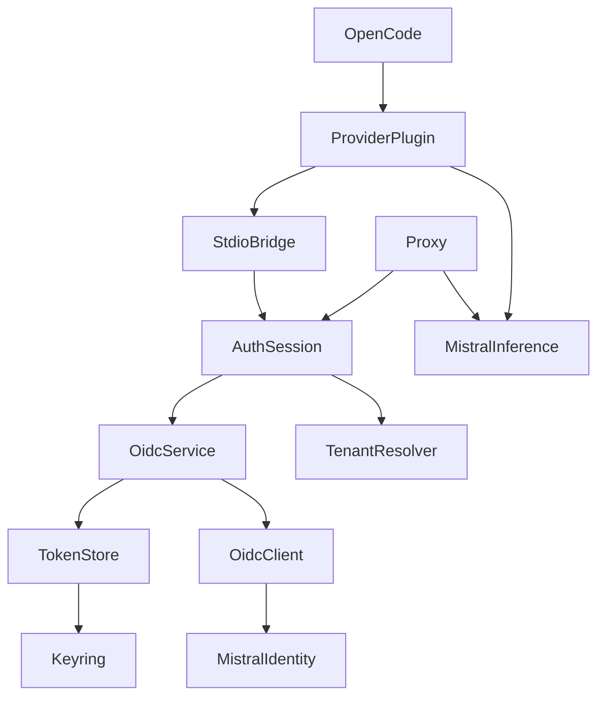
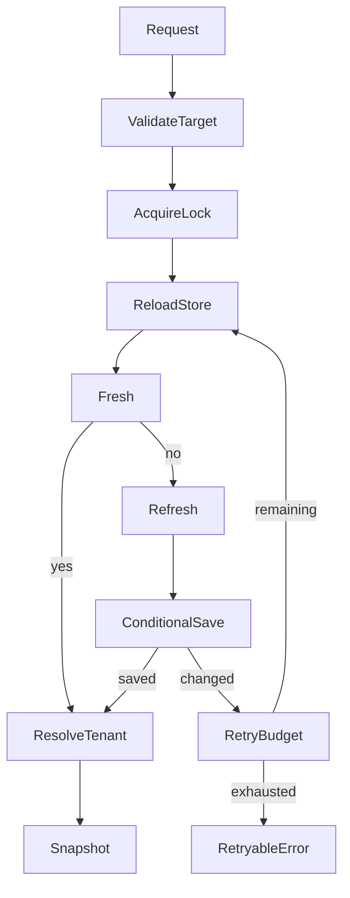

# Technical Design: Vibe OIDC Shared Authentication

## Overview
The feature packages Vibe OIDC authentication as one reusable Python library consumed by the local proxy and an OpenCode provider plugin. A thin TypeScript adapter uses a private stdio bridge to that same library; it contains no second implementation of OAuth, refresh or credential storage.

This extends the original proxy specification with the user's shared-library/provider-plugin direction. Python remains a prerequisite for the plugin. Live Vibe entitlement and provider interoperability remain unverified until the explicit live gate.

### Goals
- Preserve Vibe browser OIDC, inference ID tokens and the shared credential slot.
- Cycle credentials after observed rotation without overwriting newer credentials.
- Supply stable typed interfaces, deterministic offline tests and explicit provider lifecycle.
### Non-Goals
API-key authentication, Responses API, other providers, public authentication services, modification of installed Vibe, automatic replay of inference, and a JavaScript port of authentication.

## Boundary Commitments
### This Spec Owns
- Public Python authentication API, token/tenant lifecycle and credential consistency.
- Private versioned stdio adapter and TypeScript OpenCode provider integration.
- Existing loopback proxy and isolated verification for both consumers.
- Installation, source provenance, compatibility and sanitized verification documentation.
### Out of Boundary
Mistral identity registration, subscription entitlements, upstream service schemas and OpenCode internals. Installed Vibe does not participate in library locking; concurrent external re-login remains best effort.
### Allowed Dependencies
Python >=3.12; existing Authlib, joserfc, Pydantic, keyring and HTTPX2 stack; FastAPI/Uvicorn only for proxy; filelock for coordination among library consumers; pytest/AnyIO for Python tests. TypeScript adapter uses @opencode/plugin 2.x types and the configured OpenAI-compatible provider package. No authentication dependency on FastAPI or OpenCode.
### Revalidation Triggers
Public API/protocol versions, credential schema/slot, issuer/client/audience, provider SDK version, callback validation, token selection, dependency locks and response lifecycle changes require targeted regression and downstream adapter checks.

## Architecture
### Existing Architecture Analysis
Authentication already lives under mvibe_auth but the proxy imports private modules. Environment, caches and locks are global; the package exports platform access-token helpers that are not the inference credential API. Preserve those helpers internally and explicitly expose an ID-token inference facade.

### Architecture Pattern & Boundary Map
Select the hybrid approach: stable facade over existing auth services, minimal focused corrections, a stdio adapter and one provider plugin. Reuse token validation rather than reimplement it.

Dependency direction: public contracts/configuration -> storage/client/callback -> service/runtime -> public facade -> adapters. Transport helpers depend on primitive configuration/contracts; remove the runtime marker-hook import cycle by injecting credential resolution when needed. Package exports must be lazy or limited to contracts/facade so library import does not initialize an app or open credentials.

### Technology Stack
| Layer | Choice | Role and constraint |
| --- | --- | --- |
| Auth | Python >=3.12; Authlib 1.9.1; joserfc 1.7.7; Pydantic 2.13.4 | Preserve declared baseline; validate installed interoperability before implementation acceptance |
| Storage/HTTP | keyring 25.7.0; HTTPX2 2.16.0 | Existing Vibe slot and transport |
| Coordination | filelock native local-file lock | Serialize participating processes; exact resolved version recorded in uv.lock |
| Proxy | FastAPI, Uvicorn, AnyIO | Existing dependencies locked during environment task |
| Plugin | TypeScript strict; @opencode/plugin 2.x | Inspected published API; current stable OpenCode 2; exact tested host/SDK pair recorded |
| Tests | pytest with AnyIO asyncio backend; Bun tests and TypeScript typecheck | New development dependencies resolved and pinned in lockfiles |

The package version starts independently of the upstream Vibe source version; record Vibe 3.0.4 as provenance, not the version of the new public API. Runtime packages and test dependencies are locked during implementation. No claim is made that an environment has already resolved or passed imports.

## File Structure Plan
### New Files
| Path | Component/responsibility |
| --- | --- |
| pyproject.toml | Installable library, optional proxy extra, dev dependencies and pytest configuration |
| uv.lock | Resolved Python runtime/test dependency graph |
| mvibe_auth/api.py | AuthSession facade, public result/error and login handle contracts |
| mvibe_auth/_coordination.py | Shared local lock and rotation-resolution budget |
| mvibe_auth/bridge.py | Validated protocol dispatcher and stdio lifecycle |
| mvibe_auth/__main__.py | Explicit bridge entry point |
| mvibe_proxy/streaming.py | Upstream response ownership across ASGI execution |
| mvibe_proxy/__init__.py | Proxy package marker with no side effects |
| packages/opencode-vibe-oidc/package.json | SDK/provider dependencies, exports, test/typecheck commands |
| packages/opencode-vibe-oidc/tsconfig.json | Strict TypeScript configuration |
| packages/opencode-vibe-oidc/bun.lock | Locked adapter dependencies |
| packages/opencode-vibe-oidc/src/index.ts | OpenCode V2 Plugin.define and domain registrations |
| packages/opencode-vibe-oidc/src/bridge.ts | Managed child process, correlation, cancellation and version checks |
| packages/opencode-vibe-oidc/src/provider.ts | Per-request fetch adapter and model mapping |
| packages/opencode-vibe-oidc/src/protocol.ts | Narrow TypeScript protocol types and runtime validation |
| packages/opencode-vibe-oidc/test/provider.test.ts | Auth/provider/streaming tests with synthetic bridge |
| packages/opencode-vibe-oidc/test/bridge.test.ts | Framing, lifecycle, cancellation and child failure tests |
| tests/conftest.py | Default-deny external effects and state isolation |
| tests/fakes.py | Typed store, transport, clock and callback fixtures |
| tests/test_auth_api.py | Public API and shared-consumer behavior |
| tests/test_oidc_login.py | Callback/exchange/token validation |
| tests/test_credentials.py | Persistence, rotation and cancellation |
| tests/test_tenant.py | Selection, schema and cache identity |
| tests/test_transport.py | Destination, proxy/trust and redirects |
| tests/test_proxy.py | Route/payload/error/stream ownership |
| tests/test_bridge.py | Protocol and shutdown |
| tests/test_startup.py | Isolated application and bridge startup |
| tests/traceability.json | Requirement ID to test or documentary evidence mapping |
| tests/test_traceability.py | Reject missing/invalid requirement mappings |
| docs/auth-library.md | Public API, bridge and installation |
| docs/opencode-provider.md | Provider setup and supported host version |
| docs/live-verification.md | Explicit account test procedure and result template |
| docs/vibe-provenance.md | Source hashes/license/deviation record |
| scripts/verify.ps1 | Offline Python/plugin/typecheck orchestration |

### Implementation File Alignment
The initial file plan was refined into the following internal boundaries during implementation. These splits retain the dependency direction above and add no second authentication implementation.

| Path | Implemented responsibility |
| --- | --- |
| mvibe_auth/_auth_config.py | Primitive immutable configuration below services and facade |
| mvibe_auth/_auth_contracts.py | Public immutable outcomes, snapshots and safe failures |
| mvibe_auth/_bridge_protocol.py | Validated Python wire models and bounded framing |
| mvibe_auth/login_cli.py | V2 command browser presentation using public AuthSession; marker-only stdout |
| packages/opencode-vibe-oidc/src/models.ts | Strict metadata mapping and connection-bound inventory |
| packages/opencode-vibe-oidc/src/windows-job.ts | Windows 10+ native Job Object ownership via stdlib ctypes, including descendants after root exit |
| scripts/verification.py | Named executed evidence and all-criterion acceptance validation |
| scripts/live_evidence.py | Offline-only sanitized live-report validation |
| docs/consumer-integration.md | Native-host integration evidence and supported V2 routing/retry contracts |
| docs/offline-acceptance.md | Reproducible final offline result and limitations |
| docs/live-results.md | Explicitly unverified live evidence record |
| docs/live-evidence-template.json | Structured per-consumer/per-operation results |

V2 provider definitions use the `aisdk:` package selector. The adapter adds the host-supported `x-should-retry: false` response header while preserving status, payload and body streaming; SDK construction options alone do not suppress native host replay. The private bridge API version follows the independent library distribution (0.1.0), not Vibe provenance (3.0.4). Credential change events invalidate the account-bound catalog. These contracts were verified with the actual isolated host in task 8.1.

### Modified Files
- proxy.py: consume AuthSession, application factory/test injection, error normalization and streaming owner; retain CLI.
- mvibe_auth/__init__.py: explicit public exports without application side effects.
- _oidc_callback.py: preserve blank parameters before duplicate checks.
- _oidc_credentials.py: conditional save for an expected absent/present snapshot; distinguish unreadable store from absent slot.
- _oidc_service.py: bounded conflict handling and conditional login commit.
- _oidc_runtime.py: expose reusable tenant/ID-token resolution and reload stored state before resolution.
- _oidc_config.py: normalize parser exceptions and enforce usable proxy/inference audience.
- http.py: preserve transport policy, remove upward runtime import by resolver injection.
- README.md: library/proxy/plugin entry points and verification commands.
- .gitignore: environments, generated reports, caches and node_modules only.
Private paths above are under mvibe_auth/. Existing JWT/platform helper modules remain internal and covered by tests.

## System Flows
### Credential Resolution and Rotation

Resolution permits the original pass plus one conflict retry. Reload before every resolution, even when the process cache appears fresh. Refresh only when access or required ID token is within 30 seconds of expiry. A refresh that retains an already-fresh ID token is valid. Never reuse an expired ID token or retry a rejected refresh token unchanged. On invalid_grant, reload once within the same conflict budget and retry only if token material changed. After tenant discovery, recheck the stored token revision; if it changed, restart the whole token-plus-tenant resolution within that budget.

Login captures a store snapshot before browser authorization. It holds no process lock during the browser wait. Commit compares that snapshot with current storage under the shared lock. If changed, discard the candidate and resolve current credentials once; return a reused-current outcome if usable, otherwise a sanitized re-login/retry error. Never loop browser sign-in automatically.

### Plugin Sign-in
OpenCode runs the registered Python login command. The command creates AuthSession, starts browser OIDC, waits for validated persistence, closes owned work and returns a non-secret marker. OpenCode stores that marker as connection bookkeeping. The reusable library has no browser UI. Proxy CLI and login command own browser presentation. Per-request bridge resolution reloads authoritative credentials; cancellation and forced termination retain unknown-commit handling.

## Components and Interfaces
### Public AuthSession
Contracts: Service and State. Inbound proxy/bridge (P0); outbound OIDC service/store/tenant resolver (P0); external issuer/keyring (P0).
Public Python types use frozen dataclasses, Literal discriminators and explicit annotations:
- AuthConfig: immutable validated issuer/client/audience/callback/scope/tenant selection.
- AuthSnapshot: headers excluded from repr, expires_at, opaque revision, target and non-secret outcome; no refresh token.
- AuthFailure: code in missing, invalid, rejected, transient, conflict, cancelled; safe message and retryable flag.
- LoginHandle: attempt_id, authorization_url excluded from repr, expires_at.
- async start_login(force: bool = False) -> LoginHandle
- async wait_login(attempt_id: str) -> LoginOutcome
- async cancel_login(attempt_id: str) -> None
- async resolve(target_url: str) -> AuthSnapshot
- async close() -> None
- async status() exposes only signed-in/config-match state, not token material.

Configuration is captured at session creation; environment reading is confined to AuthConfig.from_env. Configuration changes require a new session. start_login returns after the callback is listening and the URL is available; wait_login returns completed, reused_current or typed failure, and reused_current must never claim the browser-selected identity was persisted. resolve never starts a browser and validates target before reading credentials. Inference/tenant requests use ID tokens; UserInfo retains its separate access-token implementation. Both library consumers share the same tests and code path.

### Credential Store and Coordination
Contracts: Service and State. Keep existing versioned JSON and keyring service/entry. Add conditional save accepting expected tokens or an explicit absent sentinel; a storage read error is never an absent snapshot. Preserve tenant updates when comparing token material.

A per-user lock path based on the keyring slot coordinates proxy and plugin helper processes using this library. Use native local-filesystem locking; no soft-lock fallback on unsupported filesystems. Lock acquisition has a 90-second deadline and reports a transient error. Hold the coordination lock across reload/refresh/conditional save, not browser interaction. Existing slot RLock protects in-process store calls. Lock ordering is coordinator then slot; never acquire coordinator while holding slot.

Blocking acquisition/storage runs off the event loop. Cancellation must await outstanding worker completion before releasing owned locks. External Vibe does not honor this lock; reload-and-compare detects observed external changes but cannot make its writes atomic. Tenant reads bind to the same identity/revision as the returned token.

### Stdio Bridge
Contracts: Service and State. Inbound TypeScript adapter (P0), outbound public API only (P0).
Entry: installed Python executable with arguments "-m", "mvibe_auth", "bridge"; spawn without a shell, Windows hidden. Private stdin/stdout pipes carry UTF-8 newline-delimited JSON:
- request: {version:1,id:string,method:string,params:object}
- response: {version:1,id:string,ok:true,result:object} or {version:1,id:string,ok:false,error:{code,message,retryable}}
- methods: hello, status, login.start, login.wait, login.cancel, resolve, shutdown.
- hello returns protocol/API version and configured audience; resolve accepts only a target URL under that audience policy.
- Frames capped at 1 MiB; malformed/oversize/duplicate active IDs fail safely; unknown versions/methods return typed errors.
- Dispatch login.wait concurrently so cancellation/shutdown remain processable. Bound active requests to 32; auth resolution itself is serialized.
- Parent EOF cancels work and closes AuthSession. Python startup failures surface as actionable adapter errors, never as API-key prompts.
- Resolve returns the short-lived inference headers only. Refresh tokens never cross this boundary. Stdout is protocol-only; stderr is sanitized diagnostics. Never write headers to disk or logs.

### OpenCode Provider
Contracts: Service, API and State. Inbound OpenCode V2 SDK (P0), outbound bridge (P0), provider HTTP transport (P0).
User correction: target the auto-updating OpenCode 2 stable release line. Use `@opencode/plugin` and `Plugin.define({id: "vibe-oidc", setup(ctx)})`. The V1 contracts below are superseded by this V2 contract; historical discovery remains evidence only.
- Register the distinct provider through ctx.provider.transform, supplying immutable provider/model definitions and a source connection where applicable. Configure the OpenAI-compatible adapter and install its custom SDK/fetch through the provider-scoped ctx.aisdk hook; verify propagation in the real host.
- Register a command authentication method labelled Vibe OIDC through ctx.integration.transform. Its argument array runs the installed Python module's explicit login command. That command uses AuthSession, presents the browser authorization locally, and writes exactly one fixed non-secret connection marker to stdout only after validated persistent login or usable reused-current completion. It emits no token, authorization URL or code to stdout/stderr. Failure exits nonzero with sanitized diagnostics. This is browser OIDC via a host command, with no API-key authentication option.
- OpenCode V2 stores command stdout in a key-shaped connection record. The value is solely a non-secret marker and is never forwarded upstream. V2 OAuth callbacks require stored OAuth credentials, so do not use those callbacks or populate fake token fields. V2 external methods store metadata but do not execute login callbacks.
- The managed bridge still resolves request credentials for every fetch. Ignore caller API-key headers; attach only permitted auth/tenant headers, force manual redirects, forward AbortSignal and never replay inference. The login command is a separate host-owned child; cancellation/forced termination leaves commit outcome unknown and subsequent resolution reloads storage.
- Obtain /v1/models with the same authenticated fetch. Map verified upstream or explicit operator metadata to V2 Model.Info definitions; omit incomplete models with actionable configuration guidance. Do not infer capabilities, limits, pricing or entitlements from SDK defaults.
- Pass through streaming Response objects without reading the entire body. Retry is limited to credential resolution before send; never replay a sent chat request.
- Cleanup returned by setup calls shutdown, closes pipes and terminates an unresponsive owned bridge child after five seconds. One managed bridge per plugin instance; no unrelated process is stopped.
- Missing Python/library, protocol mismatch and host incompatibility produce explicit setup errors. No silent source download or dependency installation from a request.

Lock exact SDK and host test versions for reproducibility, but target current stable OpenCode 2 rather than requiring operators to freeze updates. Record the tested host/SDK pair. Provide a separately network-enabled compatibility action that discovers the current V2 release, prepares an isolated environment and runs the same offline hook/login-marker/fetch/stream/cancellation smoke. Unknown versions are unverified until checked; incompatible contracts produce actionable errors. Do not download dependencies from request handling. The user reports 2.2.6; the local bundled CLI inspected during discovery reports 2.2.5, so record these separately and retest the actual updated binary.

### Proxy and Stream Owner
Contracts: API and State. Proxy owns CLI/browser UI and HTTP route policy, not auth internals. create_app(auth_factory, client_factory) supports isolated startup; default app construction does not perform login until lifespan.
| Method/path | Contract |
| --- | --- |
| GET /health | 200 local liveness only |
| GET /v1/models | Authenticated model passthrough |
| POST /v1/chat/completions | JSON request and JSON/SSE response passthrough |
| POST /v1/embeddings | Authenticated embedding passthrough |
| Other GET/POST under /v1/ | 404 unsupported endpoint |
| Unsupported methods | 405 without upstream send |

Construct requests with ordered query pairs preserving repeated and blank values. Preserve request body bytes. Decode upstream content for application-byte passthrough; omit upstream content-encoding/content-length when decoded. Retain status/content-type, fallback application/json and no-cache.

Stream owner acquires upstream response inside its ASGI call and surrounds response-start/body delivery with try/finally. It closes in a bounded shielded cleanup scope, including cancellation before first body iteration. If close times out, abort the owning transport/client and mark it unavailable for reuse; emit a sanitized cleanup diagnostic. Setup failures before response start map to 401/502; after headers, abort stream, never append synthetic JSON. No redirect following or inference replay.

### Bridge Payload Contracts
All envelopes are validated and reject extra credential-bearing fields.
| Method | Parameters | Successful result |
| --- | --- | --- |
| hello | empty object | protocol=1, api_version string, audience string |
| status | empty object | signed_in boolean, config_match boolean |
| login.start | force boolean | attempt_id string, authorization_url string, expires_at number |
| login.wait | attempt_id string | outcome completed or reused_current; no tokens |
| login.cancel | attempt_id string | cancelled boolean |
| resolve | target_url string | headers string map, expires_at number, revision string, target string |
| shutdown | empty object | closed boolean |

Adapter deadlines: handshake 10 seconds, resolve 180 seconds, login.wait up to remaining login expiry plus five seconds. Timeouts reject the pending promise and cancel the associated operation or retire the helper if cancellation cannot be acknowledged. Protocol responses never include Python traceback data. A versioned JSON schema and fixture vectors live beside protocol.ts and tests/test_bridge.py respectively; add packages/opencode-vibe-oidc/src/protocol.schema.json for the canonical wire schema.

## Data Models
Maintain OidcTokens schema and Vibe keyring slot; no credential migration or second token database. Public snapshots contain only request-scoped headers and expiry/revision metadata. Callback parsing retains blank values and requires exactly one nonempty state and success code. Tenant schemas require nonempty non-whitespace identifiers; do not silently substitute another workspace.

Config keeps existing known issuer registrations and HTTPS/numeric-loopback URL policy, fixed-port callback and openid scope. Inference consumers additionally require a nonempty audience; normalize malformed URLs to typed safe configuration failure. Default issuer/client/audience remain Vibe's registration, not general API-key configuration.

Protocol schemas are mirrored narrow Python/TypeScript types with shared JSON fixture vectors; unknown input is validated before narrowing. No TypeScript any is introduced in adapter code even when SDK declarations use it.

## Error Handling
Auth/library errors are discriminated results or a typed exception carrying AuthFailure; raw dependency exceptions are chained internally but never serialized.
- Proxy auth/config failure: 401 and --login guidance; setup transport failure: generic 502.
- Plugin auth failure: provider connection/re-login message; transient conflict: retry guidance after bounded cycling.
- Upstream statuses/content remain upstream responses; no automatic 401 replay.
- Diagnostics use event name, stage and non-secret reason only. Tokens, codes, auth URLs and request bodies excluded.
- Startup with absent/mismatched identity invokes explicit login in proxy CLI. Stored but expired identity is resolved at request time; no surprise browser from plugin fetch.

## Testing Strategy
Default command: scripts/verify.ps1 runs uv run --locked --offline pytest, then Bun locked dependency tests/typecheck. Environment setup is a separate documented network-enabled step; missing caches fail rather than silently downloading during offline verification.
- pytest AnyIO backend is asyncio. Patch socket connection/browser/keyring before importing application modules; use fake stores/transports and test-owned environment.
- Unit: callback blank duplicates/denial/timeouts; signed synthetic JWTs and algorithm/claims rejection; exact 30-second boundaries; storage absent versus unreadable; tenant pagination/empty IDs; destination/proxy/trust policy.
- Credential integration: login conditional commit, fresh external rotation, refresh race, omitted refresh/ID token, same-subject tenant change, bounded repeated conflicts and cancellation while a persistence worker runs.
- Consumer integration: proxy and bridge resolve identical credentials under the same fixtures; participating-process concurrency test uses fake storage and a temporary lock directory, never real keyring.
- Proxy streaming: controlled ASGI receive/send tests prove incremental first chunk before upstream completion, close on early cancellation, bodyless statuses, repeated query pairs and sanitized setup errors.
- Bridge/plugin: validated protocol vectors, malformed frames, child crash/EOF, pending login cancellation, per-request re-resolution, direct model requests, AbortSignal and no upstream redirect/replay.
- Offline startup: injected proxy lifespan and real helper process with test-only fake dependencies. Test wiring is not selectable by production remote input.
- Host compatibility: load the pinned plugin in an isolated OpenCode profile using a synthetic bridge/provider; confirm auth callback marker and custom fetch actually take effect.
- Live checks are an explicit manual command/procedure after offline results, using real browser/keyring only by operator action. Exercise both consumers; distinguish entitlement limits, untested refresh and failure.
- Every criterion maps to tests or documentary evidence in tests/traceability.json. Validation rejects absent IDs, skipped mandatory checks or claims based only on test collection.

## Security Considerations
Library is authoritative for target policy and credential handling. Plugin also validates the outbound audience before attaching headers. Refresh tokens remain in Python/keyring; ID-token headers traverse only owned pipes and request memory. Local proxy remains unauthenticated loopback per requirements. No auth material in command-line arguments, logs, fixtures or OpenCode persisted auth marker.

## Migration Strategy
Introduce packaging and tests, expose facade, migrate proxy, then implement bridge/provider. Preserve script CLI and original Vibe keyring format; do not clear existing credentials. Record source-copy edits. Release plugin and library protocol versions together. Revert adapter changes independently; no credential schema rollback is required.

## Requirements Traceability

| Requirement | Summary | Components | Interfaces | Flows |
| --- | --- | --- | --- | --- |
| 1.1 | When upstream authentication is required, the Proxy shall derive credentials exclusively from Vibe's separate browser OIDC flow or credentials previously obtained through that flow. | AuthSession | Named component contract | Contract-specific flow and test |
| 1.2 | If OIDC authentication fails, the Proxy shall report the authentication failure without falling back to API-key authentication. | AuthSession | Named component contract | Contract-specific flow and test |
| 1.3 | When an agent supplies a placeholder API key or Authorization header, the Proxy shall exclude that caller credential from upstream authentication. | AuthSession | Named component contract | Contract-specific flow and test |
| 1.4 | When authenticating an inference request, the Proxy shall use the ID-token credential required by the existing Vibe integration. | AuthSession | Named component contract | Contract-specific flow and test |
| 1.5 | When the separate UserInfo helper authenticates its identity probe, the Proxy shall use the access-token credential for that probe. | AuthSession | Named component contract | Contract-specific flow and test |
| 1.6 | If the destination is outside the configured OIDC credential destination policy, the Proxy shall refuse to attach OIDC credentials. | AuthSession | Named component contract | Contract-specific flow and test |
| 2.1 | When startup finds no readable stored identity matching the active authentication configuration, the Proxy shall initiate browser sign-in before serving agent requests. | AuthSession and proxy/provider presentation | Named component contract | Contract-specific flow and test |
| 2.2 | When the operator requests forced sign-in, the Proxy shall initiate a new browser sign-in before serving agent requests. | AuthSession and proxy/provider presentation | Named component contract | Contract-specific flow and test |
| 2.3 | When an authorization URL becomes available, the Proxy shall display that URL and attempt to open it in the operator's browser. | AuthSession and proxy/provider presentation | Named component contract | Contract-specific flow and test |
| 2.4 | When browser sign-in starts, the Proxy shall bind the authorization result to that sign-in attempt using state, nonce and proof of possession of the authorization-code verifier. | AuthSession and proxy/provider presentation | Named component contract | Contract-specific flow and test |
| 2.5 | If a callback has an incorrect method, path, missing or duplicate required parameter, or mismatched state, the Proxy shall reject it as an authorization result. | AuthSession and proxy/provider presentation | Named component contract | Contract-specific flow and test |
| 2.6 | If the issuer returns a matching authorization denial, the Proxy shall report sign-in failure. | AuthSession and proxy/provider presentation | Named component contract | Contract-specific flow and test |
| 2.7 | If sign-in does not complete within 300 seconds, the Proxy shall terminate the attempt and report failure. | AuthSession and proxy/provider presentation | Named component contract | Contract-specific flow and test |
| 2.8 | When a sign-in attempt completes, fails or is cancelled, the Proxy shall release its callback listener and pending callback activity. | AuthSession and proxy/provider presentation | Named component contract | Contract-specific flow and test |
| 2.9 | If sign-in fails, the Proxy shall not announce successful startup for agent requests. | AuthSession and proxy/provider presentation | Named component contract | Contract-specific flow and test |
| 3.1 | When receiving an initial token response, the Proxy shall validate the ID-token signature, issuer, client audience, nonce, subject and lifetime before accepting the identity. | AuthSession and Credential Store | Named component contract | Contract-specific flow and test |
| 3.2 | If discovery identifies a different issuer or a token uses an unsupported signing algorithm, the Proxy shall reject the authentication result. | AuthSession and Credential Store | Named component contract | Contract-specific flow and test |
| 3.3 | If the token response lacks a usable bearer access token, a positive finite access-token lifetime or the required initial ID token, the Proxy shall reject it. | AuthSession and Credential Store | Named component contract | Contract-specific flow and test |
| 3.4 | When sign-in succeeds, the Proxy shall persist credentials in the Vibe-compatible operating-system credential store for subsequent launches. | AuthSession and Credential Store | Named component contract | Contract-specific flow and test |
| 3.5 | When readable stored credentials match the active issuer, client and audience, the Proxy shall reuse that identity without a new browser sign-in unless forced sign-in is requested. | AuthSession and Credential Store | Named component contract | Contract-specific flow and test |
| 3.6 | If credentials cannot be persisted after initial sign-in, the Proxy shall report sign-in failure rather than claim successful persistent login. | AuthSession and Credential Store | Named component contract | Contract-specific flow and test |
| 3.7 | When a credential update encounters a stored identity or token set changed since the update began, the Proxy shall avoid overwriting the newer credential set. | AuthSession and Credential Store | Named component contract | Contract-specific flow and test |
| 3.8 | When displaying credential objects or authentication failures, the Proxy shall omit token values and raw token-response contents. | AuthSession and Credential Store | Named component contract | Contract-specific flow and test |
| 3.9 | When credential resolution detects that stored credentials changed during login or refresh, the Shared Auth Library shall preserve the newer credentials and retry resolution with a bounded retry budget before returning a retryable failure. | AuthSession and Credential Store | Named component contract | Contract-specific flow and test |
| 4.1 | When resolving credentials whose access token expires within 30 seconds, the Proxy shall attempt refresh before forwarding the authenticated request. | AuthSession and Coordination | Named component contract | Contract-specific flow and test |
| 4.2 | If the inference ID token has no usable expiry or expires within 30 seconds, the Proxy shall attempt refresh before using it for inference. | AuthSession and Coordination | Named component contract | Contract-specific flow and test |
| 4.3 | If refresh does not provide an ID token valid beyond the 30-second freshness window, the Proxy shall refuse to forward the inference request with that token. | AuthSession and Coordination | Named component contract | Contract-specific flow and test |
| 4.4 | If refresh credentials are missing or the refresh grant is rejected, the Proxy shall report authentication failure with re-login guidance. | AuthSession and Coordination | Named component contract | Contract-specific flow and test |
| 4.5 | If a refresh response changes the authenticated subject, the Proxy shall reject the identity change. | AuthSession and Coordination | Named component contract | Contract-specific flow and test |
| 4.6 | When a valid refresh response omits a replacement refresh token, the Proxy shall retain the previously accepted refresh token. | AuthSession and Coordination | Named component contract | Contract-specific flow and test |
| 4.7 | When concurrent requests within one proxy process require refresh of the same identity, the Proxy shall serialize refresh resolution to avoid competing refresh operations in that process. | AuthSession and Coordination | Named component contract | Contract-specific flow and test |
| 4.8 | When an upstream inference request returns 401, the Proxy shall relay that response without automatically replaying the request. | AuthSession and Coordination | Named component contract | Contract-specific flow and test |
| 5.1 | When an organization override is configured, the Proxy shall use that organization without performing workspace discovery. | AuthSession tenant resolver | Named component contract | Contract-specific flow and test |
| 5.2 | When organization and workspace overrides are both configured, the Proxy shall attach the configured organization and workspace context. | AuthSession tenant resolver | Named component contract | Contract-specific flow and test |
| 5.3 | When a workspace is selected without an organization override, the Proxy shall discover the organization associated with that exact accessible workspace. | AuthSession tenant resolver | Named component contract | Contract-specific flow and test |
| 5.4 | When no tenant override is configured, the Proxy shall select the first accessible workspace returned by workspace discovery. | AuthSession tenant resolver | Named component contract | Contract-specific flow and test |
| 5.5 | When workspace discovery spans multiple pages, the Proxy shall continue until the applicable workspace is found or the results are exhausted. | AuthSession tenant resolver | Named component contract | Contract-specific flow and test |
| 5.6 | If discovery yields no applicable workspace or cannot produce a valid tenant result, the Proxy shall report authentication failure without forwarding the inference request. | AuthSession tenant resolver | Named component contract | Contract-specific flow and test |
| 5.7 | When reusing cached tenant information, the Proxy shall restrict reuse to the matching authenticated identity and workspace selection. | AuthSession tenant resolver | Named component contract | Contract-specific flow and test |
| 5.8 | If persistence of newly resolved tenant information fails but usable request credentials and tenant context are available, the Proxy shall allow that request to proceed. | AuthSession tenant resolver | Named component contract | Contract-specific flow and test |
| 6.1 | When launched with default settings, the Proxy shall listen on 127.0.0.1 port 8765. | Proxy | Named component contract | Contract-specific flow and test |
| 6.2 | When an operator supplies a valid port override, the Proxy shall listen on that port while retaining loopback-only binding. | Proxy | Named component contract | Contract-specific flow and test |
| 6.3 | When a client requests GET /health after startup, the Proxy shall return status 200 with {"status":"ok"} without making an upstream readiness request. | Proxy | Named component contract | Contract-specific flow and test |
| 6.4 | When a client requests GET /v1/models, POST /v1/chat/completions or POST /v1/embeddings, the Proxy shall route the operation to the corresponding endpoint of the configured audience. | Proxy | Named component contract | Contract-specific flow and test |
| 6.5 | If a client sends another GET or POST operation under /v1/, the Proxy shall return 404 with an unsupported-endpoint error without forwarding it. | Proxy | Named component contract | Contract-specific flow and test |
| 6.6 | If a client uses another method for the proxy API, the Proxy shall reject it without forwarding it. | Proxy | Named component contract | Contract-specific flow and test |
| 6.7 | When serving the loopback interface, the Proxy shall accept requests without requiring a local caller credential. | Proxy | Named component contract | Contract-specific flow and test |
| 7.1 | When forwarding an allowed operation, the Proxy shall preserve the request method, query parameter values and request-body bytes. | Proxy and Stream Owner | Named component contract | Contract-specific flow and test |
| 7.2 | When forwarding an allowed operation, the Proxy shall supply OIDC-derived authentication, resolved tenant context and application/json request content type. | Proxy and Stream Owner | Named component contract | Contract-specific flow and test |
| 7.3 | When the upstream service returns a response, the Proxy shall preserve its status code and content type, using application/json when the upstream content type is absent. | Proxy and Stream Owner | Named component contract | Contract-specific flow and test |
| 7.4 | When the upstream response contains chat messages, embeddings, model listings or tool-call data, the Proxy shall relay the response content without translating its application payload. | Proxy and Stream Owner | Named component contract | Contract-specific flow and test |
| 7.5 | While an upstream response is streaming, the Proxy shall relay available response data without waiting for the complete response. | Proxy and Stream Owner | Named component contract | Contract-specific flow and test |
| 7.6 | When relaying a response, the Proxy shall include Cache-Control: no-cache. | Proxy and Stream Owner | Named component contract | Contract-specific flow and test |
| 7.7 | When an upstream response completes or streaming is interrupted by an error or client cancellation, the Proxy shall release the associated upstream response. | Proxy and Stream Owner | Named component contract | Contract-specific flow and test |
| 7.8 | If streaming fails after response headers have been sent, the Proxy shall terminate that stream without appending a replacement JSON error as successful response content. | Proxy and Stream Owner | Named component contract | Contract-specific flow and test |
| 7.9 | When an upstream response redirects, the Proxy shall not automatically follow that redirect using the request credentials. | Proxy and Stream Owner | Named component contract | Contract-specific flow and test |
| 8.1 | When supported VIBE_CLI_OIDC_* overrides are supplied, the Proxy shall apply the selected issuer, client, audience, callback, scope and tenant settings. | AuthSession and Proxy | Named component contract | Contract-specific flow and test |
| 8.2 | If OIDC is explicitly disabled, the Proxy shall refuse OIDC authentication rather than silently re-enable it or use API keys. | AuthSession and Proxy | Named component contract | Contract-specific flow and test |
| 8.3 | If authentication configuration violates the documented URL, callback or scope constraints, the Proxy shall reject it before sending authenticated inference requests. | AuthSession and Proxy | Named component contract | Contract-specific flow and test |
| 8.4 | If authentication fails while preparing a proxy request, the Proxy shall return 401 with guidance to run proxy.py --login. | AuthSession and Proxy | Named component contract | Contract-specific flow and test |
| 8.5 | If an upstream connection fails before response headers are sent, the Proxy shall return 502 with a generic upstream-connection error. | AuthSession and Proxy | Named component contract | Contract-specific flow and test |
| 8.6 | When reporting proxy authentication or connection errors, the Proxy shall omit token values, authorization codes and raw credential-store errors. | AuthSession and Proxy | Named component contract | Contract-specific flow and test |
| 8.7 | If the upstream returns an application error response, the Proxy shall relay its status and response content without representing it as a successful inference result. | AuthSession and Proxy | Named component contract | Contract-specific flow and test |
| 9.1 | When documenting the implementation baseline, the Project Documentation shall identify the examined source revision or hashes and the inspection date. | Project Documentation | Named component contract | Contract-specific flow and test |
| 9.2 | When capturing internals, the Project Documentation shall describe the sign-in, validation, storage, refresh, tenant-selection, forwarding and cleanup flows with source-file references. | Project Documentation | Named component contract | Contract-specific flow and test |
| 9.3 | When describing behavior, the Project Documentation shall distinguish code-observed behavior, intended requirements, suspected defects and unverified external assumptions. | Project Documentation | Named component contract | Contract-specific flow and test |
| 9.4 | When describing agent setup, the Project Documentation shall provide the loopback base URL, supported operations, model-ID discovery and the placeholder-only role of a client API-key field. | Project Documentation | Named component contract | Contract-specific flow and test |
| 9.5 | When describing operation, the Project Documentation shall state that local caller authentication is absent, health is local liveness only, and account entitlement controls model availability. | Project Documentation | Named component contract | Contract-specific flow and test |
| 9.6 | When describing shared credentials, the Project Documentation shall warn that concurrent Vibe/proxy re-login can contend for the same credential slot. | Project Documentation | Named component contract | Contract-specific flow and test |
| 9.7 | When Vibe-derived code is changed, the Project Documentation shall retain license attribution and record deviations from the documented source baseline. | Project Documentation | Named component contract | Contract-specific flow and test |
| 10.1 | When the default Verification Suite runs, the Verification Suite shall avoid the real operating-system credential store, browser launch, live sign-in and remote service requests. | Verification Suite | Named component contract | Contract-specific flow and test |
| 10.2 | When verifying authentication and forwarding, the Verification Suite shall use synthetic credentials and controlled external responses. | Verification Suite | Named component contract | Contract-specific flow and test |
| 10.3 | When verifying time-sensitive behavior, the Verification Suite shall exercise expiry, timeout and refresh boundaries without waiting for real token expiry. | Verification Suite | Named component contract | Contract-specific flow and test |
| 10.4 | When a test modifies cached identity, tenant or authentication configuration, the Verification Suite shall isolate that state from subsequent cases. | Verification Suite | Named component contract | Contract-specific flow and test |
| 10.5 | When verifying the proxy, the Verification Suite shall cover allowed and rejected operations, payload preservation, error responses, streaming and response cleanup. | Verification Suite | Named component contract | Contract-specific flow and test |
| 10.6 | When verifying authentication, the Verification Suite shall cover callback rejection, token-validation failure, credential reuse/storage failure, refresh rotation/failure/concurrency and tenant selection/failure. | Verification Suite | Named component contract | Contract-specific flow and test |
| 10.7 | When verifying credential transport, the Verification Suite shall cover destination restrictions, redirect behavior and supported proxy/trust configuration using controlled destinations and responses. | Verification Suite | Named component contract | Contract-specific flow and test |
| 10.8 | When reporting verification, the Verification Suite shall associate checks with requirement IDs and distinguish passed, failed and skipped checks. | Verification Suite | Named component contract | Contract-specific flow and test |
| 10.9 | When maintainers run the documented offline verification command, the Verification Suite shall return a failing exit status if any mandatory check fails. | Verification Suite | Named component contract | Contract-specific flow and test |
| 10.10 | When a characterization check demonstrates a suspected defect, the Project Documentation shall record the discrepancy without declaring that behavior compliant with the intended requirement. | Verification Suite | Named component contract | Contract-specific flow and test |
| 11.1 | When the default offline command runs, the Verification Suite shall exclude live account checks unless they are explicitly enabled by a separate live-verification action. | Live verification documentation | Named component contract | Contract-specific flow and test |
| 11.2 | When defining live verification, the Project Documentation shall provide a sequence covering browser OIDC, credential reuse, tenant selection, model listing, minimal chat, streaming, tool-call exchange and embeddings where the account supports them. | Live verification documentation | Named component contract | Contract-specific flow and test |
| 11.3 | When recording live results, the Project Documentation shall identify the client/provider and runtime versions, sanitized configuration and result of each exercised operation. | Live verification documentation | Named component contract | Contract-specific flow and test |
| 11.4 | If refresh or another live scenario has not been exercised, the Project Documentation shall mark it unverified rather than infer success from offline tests. | Live verification documentation | Named component contract | Contract-specific flow and test |
| 11.5 | If the account lacks a model or capability, the Project Documentation shall distinguish that entitlement limitation from an established proxy defect. | Live verification documentation | Named component contract | Contract-specific flow and test |
| 11.6 | When recording verification artifacts, the Project Documentation shall exclude real tokens, authorization codes, transient sign-in URLs and private prompt/account contents. | Live verification documentation | Named component contract | Contract-specific flow and test |
| 11.7 | When assessing readiness, the Project Documentation shall report offline evidence, local startup evidence and live compatibility evidence separately. | Live verification documentation | Named component contract | Contract-specific flow and test |
| 12.1 | When the proxy or OpenCode provider needs authentication, the Shared Auth Library shall own login, validation, persistence, refresh, tenant selection and credential cycling through one implementation. | AuthSession, Stdio Bridge and OpenCode Provider | Named component contract | Contract-specific flow and test |
| 12.2 | When another consumer integrates authentication, the Shared Auth Library shall expose a documented public interface independent of proxy HTTP routing and OpenCode hooks. | AuthSession, Stdio Bridge and OpenCode Provider | Named component contract | Contract-specific flow and test |
| 12.3 | When OpenCode loads the plugin, the Provider Plugin shall register a distinct Vibe OIDC provider with a browser OIDC connection method. | AuthSession, Stdio Bridge and OpenCode Provider | Named component contract | Contract-specific flow and test |
| 12.4 | When a provider request begins, the Provider Plugin shall resolve current credentials through the Shared Auth Library instead of retaining a fixed credential from plugin startup. | AuthSession, Stdio Bridge and OpenCode Provider | Named component contract | Contract-specific flow and test |
| 12.5 | When available models are requested, the Provider Plugin shall obtain model IDs through authenticated Vibe access and expose only models with sufficient verified or operator-configured metadata. | AuthSession, Stdio Bridge and OpenCode Provider | Named component contract | Contract-specific flow and test |
| 12.6 | When forwarding a provider inference request, the Provider Plugin shall preserve streaming and tool-call content and propagate caller cancellation. | AuthSession, Stdio Bridge and OpenCode Provider | Named component contract | Contract-specific flow and test |
| 12.7 | When persisting OpenCode connection state, the Provider Plugin shall store only non-secret connection metadata and leave refresh credentials in the shared library's credential store. | AuthSession, Stdio Bridge and OpenCode Provider | Named component contract | Contract-specific flow and test |
| 12.8 | If the shared library runtime or adapter protocol is unavailable or incompatible, the Provider Plugin shall report an actionable setup error without falling back to API-key authentication. | AuthSession, Stdio Bridge and OpenCode Provider | Named component contract | Contract-specific flow and test |
| 12.9 | When the provider is disposed or its host connection closes, the Provider Plugin shall release its owned helper and pending authentication activity. | AuthSession, Stdio Bridge and OpenCode Provider | Named component contract | Contract-specific flow and test |
| 12.10 | When verifying either consumer, the Verification Suite shall exercise the shared authentication contract and the provider adapter without live credentials. | AuthSession, Stdio Bridge and OpenCode Provider | Named component contract | Contract-specific flow and test |

## Review Result
Inline design review passed for boundaries, typed contracts, lifecycle, test strategy and complete traceability. Design approval remains pending. No runtime correctness claim is made.

