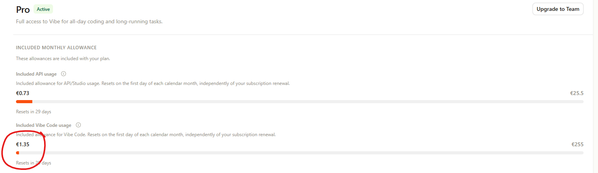
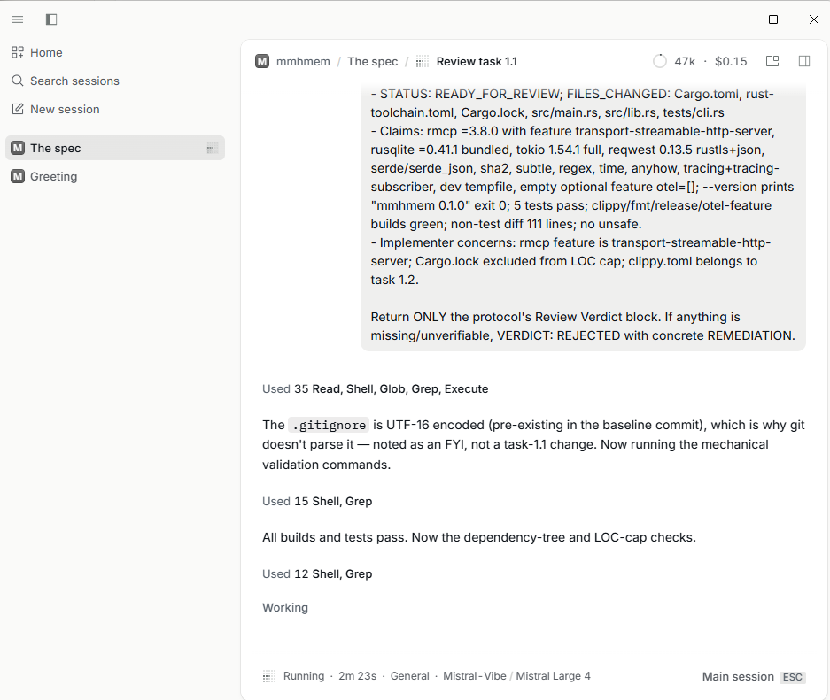
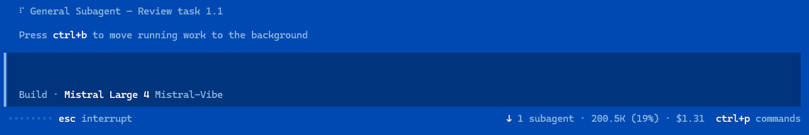

> “Man is condemned to be free”
>
> “L’homme est condamné à être libre” — Jean-Paul Sartre

# mvibe: use your Vibe login in OpenCode

**For students, researchers and educators only. This is untested, experimental
software, not production software.** Project-authored code is provided under the
[Beerware license](LICENSE); upstream Vibe code retains its
[Apache 2.0 license](THIRD_PARTY_NOTICES).

Add Mistral models to OpenCode Desktop or the OpenCode CLI using your normal
Vibe browser sign-in. The provider appears as `Mistral-Vibe` and connects
directly to Mistral. You do not need to run a proxy.

This gives Windows users an OpenCode interface for their Vibe-backed models.
Mistral says Vibe works on Windows while official support targets Unix
environments. mvibe still needs the initial Vibe login. See
[Mistral's platform statement](https://github.com/mistralai/mistral-vibe).

The existing-login route consumed the expected Vibe quota on the tested account
in OpenCode. That is not a guarantee for every credential, model or plan.
The [authentication writeup](docs/vibe-authentication.md) explains the evidence
and why experimental direct OIDC behaved differently.

| Vibe allowance | OpenCode Desktop | OpenCode CLI |
|:---:|:---:|:---:|
| [](docs/images/vibe-allowance.png) | [](docs/images/opencode-desktop.png) | [](docs/images/opencode-cli.png) |

Select a screenshot to open the full-size image. These are observations from one
local setup; they do not establish production readiness or general quota eligibility.

## Before installing

- Install OpenCode Desktop, the OpenCode 2 CLI, or both.
- Prepare native uv and Bun 1.4.4. The installer uses uv-managed Python, not Windows Store Python.
- Complete normal Vibe browser sign-in on the same OS and user account that runs
  OpenCode. A WSL login does not automatically populate the Windows keyring.

If you need Vibe, follow its [official setup guide](https://docs.mistral.ai/vibe/code/cli/install-setup).
With uv installed, `uv tool install mistral-vibe` prepares the CLI. Run `vibe`
and complete normal browser sign-in. Do not enable experimental OIDC for this setup.

Extract a release when available, or use a checkout of this repository. Keep
that directory after installation: OpenCode loads its plugin and helper from
there. See [release installation](docs/release.md) for checksum verification.

## Guided installation

Open a terminal in the extracted directory or checkout.

Windows PowerShell:

```powershell
./install.ps1 -Interactive
```

Linux or macOS:

```bash
bash ./install.sh --interactive
```

Choose Desktop, CLI or both, select the existing Vibe login, then decide whether
to set a default model, restart the service and connect. The installer backs up
changed configuration and preserves unrelated settings. It does not install
OpenCode or complete Vibe browser sign-in for you.

Desktop and CLI share global server configuration. The target selects a setup
workflow; it does not isolate provider credentials or model defaults by interface.

## Unattended Desktop setup

These examples set Large 4 as the global default, restart the background service
and connect using the existing Vibe login. They send no inference request.
Restarting the service can interrupt active OpenCode work.

```powershell
./install.ps1 -Auto -Target Desktop -AuthSource existing-vibe -Model vibe-oidc/mistral-large-4 -Connect -Restart
```

```bash
bash ./install.sh --yes --target desktop --auth-source existing-vibe --model vibe-oidc/mistral-large-4 --connect --restart
```

Use `-Target Cli` / `--target cli` or `Both` / `both` for the other workflows.
Omit the model flag to preserve the current default. Connect and restart are
opt-in. Existing auth choices are preserved unless the auth-source flag changes
them explicitly. If the CLI is not on PATH, supply `-OpenCode` / `--opencode`.

The [Desktop guide](docs/desktop-setup.md) includes the Windows bundled CLI path,
backend checks and the local setup command. Use `./install.ps1 -Help` or
`bash ./install.sh --help` for all flags.

## Start using Mistral-Vibe

**Fully quit and reopen OpenCode Desktop after setup.** Restarting its background
service alone can leave an open window with an outdated model list. If the CLI
shows Vibe models but Desktop does not, reopen Desktop and clear the model
picker's search/filter. No separate Desktop plugin installation is needed.

Open a new Desktop session and choose `Mistral-Vibe` with your model. A draft or
session that already selected another model can keep that choice after a global
default change. See [Desktop model precedence](docs/desktop-setup.md#new-sessions-and-existing-drafts).

In the CLI, use `/models` or specify the provider explicitly:

```powershell
opencode run --model vibe-oidc/mistral-large-4 "Say hello in one sentence"
```

This makes a live model request. The historical internal provider ID remains
`vibe-oidc`; its display name and auth mode are separate. Use an exact model ID
available to your account, then check the usage counter after the first request.

## Stay under your rate limit

From 3.1.1 the provider holds and re-sends a request when Mistral answers 429
instead of failing; this needs no configuration. To avoid reaching the limit at
all, tell the provider how many requests per second your account allows per
model. Take the values from the limits page of your Mistral account; they are
account-specific.

Open the global OpenCode config (`~/.config/opencode/opencode.jsonc`, on Windows
`%USERPROFILE%\.config\opencode\opencode.jsonc`) and add `rateLimit` to the
`options` of the `opencode-vibe-oidc` plugin entry, next to `authSource`:

```jsonc
"options": {
  "authSource": "existing-vibe",
  "audience": "https://api.mistral.ai",
  "rateLimit": {
    // one entry per model name exactly as you select it; a model you list
    // queues its requests and spaces them by 1 / rate seconds
    "modelRequestsPerSecond": { "mistral-large-4": 0.5 },
    // optional: a default for every model without an entry
    // "requestsPerSecond": 1
  },
  "helperCommand": { "...": "unchanged" }
}
```

Then run `opencode service restart` and fully quit and reopen Desktop. An
invalid value stops the provider from loading with a message naming the
`rateLimit` field. Models without a rate send concurrently and only wait after
a 429. An alias and its dated model id are separate entries. `maxQueue`
(default 64) and `backoffCapMs` (default 30000) are optional.

The local proxy is configured separately with `MVIBE_RATE_LIMIT_MODEL_RPS`
(for example `mistral-large-4=0.5`) and `MVIBE_RATE_LIMIT_RPS`; with Docker
Compose put them in an untracked `.env` next to `docker-compose.yml`. The
provider and the proxy do not share a budget, so if you use both against the
same model, split the rate between them.

## If setup stops

| Symptom | Next action |
|---|---|
| Missing Vibe credential | Finish normal Vibe sign-in under the same native OS/user, then reconnect. |
| CLI lists Vibe models but Desktop does not | Fully quit and reopen Desktop, then clear the model picker's search/filter. Restarting the service alone may not refresh the window. |
| Desktop shows another model | Start a new session or change that session's selection; an existing draft can override the global default. |
| Provider missing | Check the global config and Desktop's server using the [Desktop guide](docs/desktop-setup.md). |
| Helper is disposed | Run `opencode service restart`, then reopen/reconnect the client. Ctrl+C followed by `opencode -c` can reuse the same service. Keep the installed plugin separate from development builds; see [helper recovery](docs/desktop-setup.md#recover-a-disposed-authentication-helper). |
| Model unavailable | List models available to your account; the example name does not grant access. |
| API usage increases | Verify `authSource: "existing-vibe"` and preserve that sign-in path when collecting evidence. |

See the [provider guide](docs/opencode-provider.md) for manual configuration,
model metadata and diagnostics. Ordinary logging is off by default. Payload
capture requires separate opt-in and can contain sensitive conversation content.

## Other uses and project details

- [Desktop setup and backend verification](docs/desktop-setup.md)
- [Optional proxy and curl checks](docs/proxy-guide.md)
- [Authentication internals and quota evidence](docs/vibe-authentication.md)
- [Prebuilt releases](docs/release.md)
- [Build, tests and compatibility work](docs/development.md)

OpenCode executes its own native and MCP tools. The proxy forwards tool-call
payloads but adds no search executor or Responses API. See the
[tested tool scope](docs/tool-compatibility.md).
